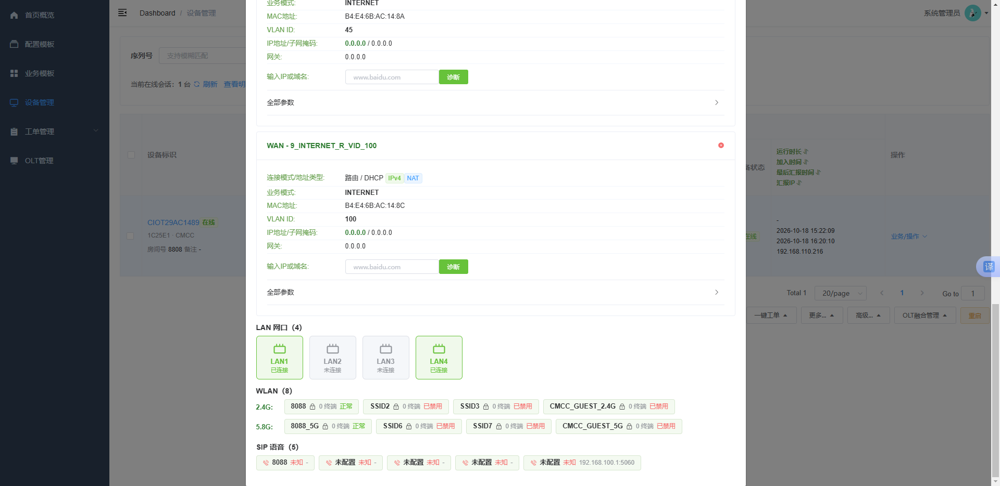

# javaacs

English | [简体中文](./README.md)

TR069 ACS (Java Edition) — a CWMP/TR-069 based remote management platform for optical network units (ONUs / "光猫"), built with Spring Boot 3 + Vue 2.

- Deployment guide: **[doc/DEPLOYMENT.en.md](./doc/DEPLOYMENT.en.md)** ([中文](./doc/DEPLOYMENT.md))
- Adapted ONU models: **[doc/ADAPTED_MODELS.en.md](./doc/ADAPTED_MODELS.en.md)** ([中文](./doc/ADAPTED_MODELS.md))
- Front-end project: [web/](./web)
- Screenshots: [doc/Display/](./doc/Display) (see "Screenshots" below)

> The configuration delivery pipeline has been **largely reworked**: templates changed from "files + step orchestration" to **intent templates stored in the database**,
> and delivery now renders real CWMP parameters at runtime from "intent + model mapping" (`exec/IntentDeliveryService`).
> Both work orders and whole-package business template delivery run on this pipeline.
> Remaining work is listed in section 2 (batch progress, intent field extension, real OLT data, etc.).

---

## Screenshots

All screenshots live in [`doc/Display/`](./doc/Display).

### Login

Brand area on the left, account card on the right, dark tech style:


### Dashboard

Device / online / offline / delivery statistics, ONU vendor distribution, work order and template statistics, quick entries:


### Device Management and Model Adaptation

The device list shows vendor, model, software/hardware version and PON count; the service status columns read WAN connection / WiFi / SIP directly;
registration info includes online status, probe IP and last report time; the bottom-right corner holds the batch operation toolbar.
Devices that are not yet adapted are guided through model adaptation first:


Model adaptation: manually declare the operator, port count, port speed, SIP count and WiFi specs:


After the declaration, a trial collection maps every capability item to the real CWMP parameter path of that model, with results echoed in real time:


Once the test passes, each item is listed as a "capability ↔ delivery intent data" mapping and can be saved as the adaptation profile of that model with one click.
The declared operator is registered into the device inventory at the same time:


After adaptation the device becomes "adapted" and its service status is displayed from real data:


### Device List and Service Details (latest)

Device list (columns from left to right): SN/remark, terminal info (vendor / model / hardware & firmware version / PON type + optical power, sortable headers),
service status (WAN connection + **LAN port icons**, **WiFi split into 2.4G / 5.8G rows**, SIP info, device status),
**runtime info** (uptime / join time / last report time / report IP, sortable headers), actions:



Device detail service panel: info cards (uptime / registration time / last report / report IP), WAN connections, LAN ports (green when plugged, grey when unplugged, hover for MAC),
WLAN split into 2.4G / 5.8G rows, SIP voice (only real line instances):


### OLT Management (demo data)

OLT resources, boards, PON ports and ONU online statistics. Note: the current page data is mocked on the front end;
see "To be implemented" #6 for real collection:


---

## 1. Implemented

### 1.1 Backend

| Capability | Description | Main location |
| --- | --- | --- |
| CWMP ingress | Inform / empty POST probe / RPC response, three paths; digest authentication (`auto` disables auth); multiple ports + multiple paths for vendor compatibility | `acs/controller/CwmpController`, `acs/auth/CpeAuthenticator`, `common/web/CwmpMultiPortConfig` |
| Protocol layer | SOAP parse/build, RPC method enum, namespaces | `cwmp/*` |
| Session management | Session state machine, pending RPCs, timeout fallback; periodic Inform treated as heartbeat with session takeover (a CPE switching TCP connections does not rebuild the session, does not go offline and does not clear the pending delivery queue); offline is judged only by long silence; suspected dual sessions only raise a warning | `acs/session/*` |
| Device management | Auto registration, online status, paged details, online session details | `acs/service/DeviceRegistryService`, `api/controller/DeviceController` |
| Capability tree collection | Only four subtrees are collected (fixed in code): WAN / WiFi / LAN ports / SIP; `GetParameterNames` fetches paths and `GetParameterValues` reads values in batches; auto collection after Inform, forced re-collection on BOOTSTRAP, `NextLevel` fallback | `acs/service/DeviceCapabilityService` |
| Parameter tree export | Export capability trees per model to `configuration/models/`, and locate model files per device | `worklist/service/ModelTreeStore` |
| Service snapshot | Partitions: `device` / `wan` / `wifi` / `lan` / `sip` / `pon`; supports single-device and whole-page batch reads; the LAN section adds link status (`connected`) and MAC; the SIP section keeps only real line instances (aggregate objects such as `VoiceProfile.{n}.SIP.` are dropped); registration time and last report time are returned together | `acs/service/DeviceBusinessService` |
| **LAN port status auto refresh** | Periodically (5 minutes by default) re-reads the port status leaves of online devices (`Enable/Status/X_CT-COM_*LineStatus/MAC/rate`); no need to click "re-collect" after plugging or unplugging a cable; only online devices and only the port leaves are read; waiting for a response does not time out as failure (the command stays queued) | `acs/service/LanStatusRefreshService`, `DeviceBusinessService#lanStatusPaths` |
| **Super-admin account query** | `GET /api/device/{sn}/admin-account`: reads `User.{i}.Username/Password` from online devices in real time and returns them in plain text; returns `offline` for offline devices; falls back to TR-098 / TR-181 standard paths when the capability tree is missing; retries one by one when a whole batch is rejected, sharing a 30s total budget; only accounts under `.User.{i}.` are accepted, so WAN dial-up accounts are never picked up by mistake | `acs/service/DeviceAccountService`, `api/controller/DeviceController` |
| Model semantic mapping | `cpe_model` + `model_param_mapping` / `model_object_mapping`: business field ↔ real CWMP path per model, with candidate path recommendation by SN | `worklist/controller/ModelMappingController`, `ModelMappingService` |
| Model adaptation | After capability collection, manually declare operator / port count / speed / SIP count / WiFi specs, run a trial collection to verify item by item, then save the adaptation profile (capability tree XML + adaptation yml); the declared operator is written back to the device inventory, and list/detail views follow the inventory | `worklist/service/ModelAdaptationService`, `ModelTreeStore` |
| RPC delivery (async) | Delivery returns a task number; poll the result by task number; timeouts are finalized uniformly | `agent/RpcDispatchService`, `queue/RpcTaskQueue`, `api/controller/RpcTaskController` |
| Queue peak shaving | Reports and deliveries go through Redis queues; degrades to in-process handling when Redis is unavailable | `queue/*` |
| **Config intent templates** | Stored in `config_template`, describing only provisioning intent (no payload data): 7 kinds (WAN DHCP / WAN PPPoE / WAN static IP / WAN bridge / 2.4G WiFi / 5.8G WiFi / SIP), each with its own intent fields; supports `/meta` field definitions, list, detail, save and delete | `template/*` (`ConfigTemplateService`, `ConfigTemplateController`) |
| Business templates | Orchestrate several intent templates into one business package: list, detail, save, delete, pre-delivery self-check `/validate`, delivery record query | `biz/*` (`BizTemplateService`, `BizTemplateExecutionService`) |
| **Work order delivery (admin side)** | `POST /api/worklist/instances` creates an order using `worklistDesc` as the idempotency key; right after persisting, it becomes a delivery task (`IntentDeliveryService`, `source=worklist`); when the task finishes, `TaskFinishedEvent` writes back the terminal state and failure reason; work orders and step records are queryable | `worklist/service/WorklistDeliveryService`, `worklist/controller/WorklistExecuteController` |
| Dashboard | Online/offline, vendor distribution, template statistics (template count now counts intent templates) | `api/service/DashboardService` |
| Data model adaptation | Dual data model support for TR-098 (`InternetGatewayDevice.`) and TR-181 (`Device.`): root node inferred from Inform parameters, business prefixes expanded per model, model profiles and capability tree XML record and reconcile the data model | `acs/model/DataModel`, `InformService`, `DeviceBusinessService` |
| **Intent delivery executor** | Intent fields + model semantic mapping → CWMP paths and values → `AddObject` on demand then batched `SetParameterValues`, all recorded in `device_task`; idempotent by `taskNo` | `exec/*` (`IntentDeliveryService`, `IntentPlanRenderer`) |
| **Northbound API** | Dedicated port 8899 + `/openapi/v1/**`: device inventory/online/capability tree/service snapshot/work order result query, delivery acceptance and result query, webhook event push (online/offline, delivery finished); reuses the admin-side JWT authentication | `openapi/*` |
| Admin authentication | JWT login, `sys_user` lookup, initial admin inserted on first start, JWT interceptor | `api/controller/AuthController`, `config/AdminAuthInterceptor` |
| Startup self-check | Create/initialize missing business tables, verify optional read-only tables | `common/startup/*` |

### 1.2 Frontend (`web/`)

| Menu | Route | Status |
| --- | --- | --- |
| Dashboard | `/dashboard` | Implemented |
| Config templates | `/template/list` | Implemented (intent templates, intent fields rendered per type; **advanced mode / file templates fully removed**) |
| Business templates | `/biz/list` | Implemented (orchestration + member view + self-check + serial whole-package delivery, supports continue-on-error) |
| Device management | `/device/list` | Implemented (list/detail/service info/WAN parameter dialog/online details + **bottom-right batch toolbar** + **LAN port icons** + **WiFi split into 2.4G/5.8G rows** + **runtime info columns** (uptime/join time/last report time/report IP, sortable) + **query super-admin password dialog**) |
| Device detail | `/device-detail/:sn` | Implemented (capability tree, parameter tree, RPC debugger + service panel: info cards changed to uptime/registration time/last report/report IP, LAN port block, WLAN rows per band, SIP lists only real lines) |
| Work order records | `/worklist/instances` | Implemented (work order and step query; bulk order entry is in the device list toolbar "One-click work order ▲") |
| OLT management | `/olt/management` | **UI implemented, entirely front-end mock data** |

Bottom-right toolbar of the device list (`web/src/views/device/list.vue`, devices must be selected first):

| Group | Wired up | Placeholder (backend pending) |
| --- | --- | --- |
| Template keyword + batch template delivery | Template dropdown is wired to intent templates and business templates; creates an order / execution record per selected device for the chosen template | Whole-batch progress board, one-click retry of failures |
| One-click work order ▲ | Work order record redirect + bulk provisioning / maintenance orders (per device, independent serial number per device, failure list summarized at the end) | — |
| More… ▲ | Factory reset / deep factory reset / reset counters → `FactoryReset`; **query super-admin password** (reads `User.{i}.Username/Password` live for each selected device, shown in plain text in a dialog; a timeout or offline device does not affect the others) | Telnet switch, WAN-side access, one-click WiFi, disable SIP, delete WAN connection, lift Internet restriction, clear cache, mark replacement |
| Advanced… ▲ | Export devices (CSV), deliver custom TR069 parameters (dialog → `SetParameterValues`), debug command (dialog → arbitrary RPC), refresh status | Telnet command, remove SSID prefix, fix SIP/bridge, export/clone config file, force report |
| Converged OLT management ▲ | OLT/ONU management (redirect to the OLT page) | OLT topology |
| Reboot | Batch `Reboot` (with confirmation dialog) | — |

### 1.3 Adapted ONU Models

The list is maintained separately in **[doc/ADAPTED_MODELS.en.md](./doc/ADAPTED_MODELS.en.md)** (operator + vendor model only, one line per adapted device).
The adaptation profiles themselves live in the portable SQLite template library `configuration/tr069_tpl.pack`
(config property `acs.tr069tpl.db-path`) and ship with the repository — copy it to the deployment host and models are recognized as adapted, no re-adaptation needed.

---

## 2. To Be Implemented / In Progress

| # | Item | Status | Notes |
| --- | --- | --- | --- |
| 1 | ~~**Intent template delivery executor** (core)~~ | **Done** | `exec/IntentDeliveryService`: intent fields + `model_param_mapping` / `model_object_mapping` → render a delivery plan (`{i}` instance index substitution, read-only and required validation) → `AddObject` + batched `SetParameterValues`, state persisted in `device_task`. Next step: add more intent fields beyond WiFi / SIP (see #8) |
| 2 | Batch template delivery | **Partially done** | Whole-package batch delivery of business templates is wired up (one execution record per device, success/failure list summarized); batch delivery of config intent templates goes through the "batch template delivery" entry to create work orders. Remaining: whole-batch progress board, one-click retry of failures |
| 3 | ~~Business template whole-package delivery~~ | **Done** | `POST /api/biz-template/execute`: executes members serially in order, records written to `biz_template_execution`; a member failure stops or continues per the template's `continueOnError`, and a completed run with failures is recorded as `partial` |
| 4 | ~~One-click work order (provisioning / maintenance)~~ | **Done** | Orders are created per device from the device list selection, one independent serial number per device (`worklistDesc` idempotency); a single failure is recorded but the remaining devices continue, and failures are summarized at the end |
| 5 | Backend for batch device operations | Partially wired (**super-admin password done**) | Telnet switch and command execution, WAN-side access, WiFi switch, disable SIP, delete WAN connection, lift Internet restriction, clean SSID prefix, export/clone config file, force report, etc. — parameter paths must be completed per vendor/model (always through model mapping, never hardcoded). Super-admin account query works, but it requires the device to be online and the model to expose `User.{i}.Username/Password` to TR-069 |
| 6 | Real data for converged OLT management | Mock data | `web/src/views/olt/management.vue` is all front-end mock; needs SNMP/Telnet collection: OLT resources, boards, slots, PON ports (Tx/Rx optical power, MAC, VLAN, ONU count); data replacement is concentrated in the `resources` / `olt` objects at the top of the page |
| 7 | Legacy data migration | Not started | Legacy `biz_template_item.template_key` still holds old file keys, and `BizTemplateService.parseId` treats them as "config template not found"; a migration script is needed to switch to `config_template.id` |
| 8 | Intent field extension | In progress | WAN currently only covers IP protocol / whether VLAN is used / whether a port is bound; still missing: WAN IP acquisition mode, PPPoE account, SIP server/account, WiFi SSID/password, etc. (VLAN ID and concrete ports are still not persisted; they are decided at delivery time) |
| 9 | Full cleanup of the legacy mechanism | Almost done | Old file templates / wizard compilation / legacy work order orchestration engine have been deleted; work orders now go through `IntentDeliveryService`; the `worklist` package keeps profiles, model mapping, capability tree export and work order creation/query — naming can be revisited when wrapping up |
| 10 | Others | Not started | Refined delivery audit logs, refined roles/permissions, device alarms (optical power degradation, bulk offline alerts), offline threshold computed dynamically from the real report interval (`PeriodicInformInterval`) instead of the fixed 120 s (models whose period is not 60 s must be tuned manually today), etc. |
| 11 | UI polish | Not started | ① fold (`+N`) or horizontal scroll for more than 4 LAN ports in the device list, which currently overflows horizontally; ② skip disabled SSIDs during **collection** (today only the display layer filters them; collection still reads everything); ③ visual distinction for disabled SSIDs on the detail page (today only the status text "disabled"); ④ sorting on the runtime info columns applies to the current page only (backend paged sorting is not wired yet) |

---

## 3. Tech Stack

| Layer | Choice |
| --- | --- |
| Backend | Spring Boot 3.2.5, Java 21, MyBatis-Plus 3.5.7, MySQL Connector/J, Spring Data Redis (Lettuce), JJWT 0.12.6, Lombok, Jackson, SnakeYAML (ONU profiles) |
| Frontend | Vue 2.6 + vue-router + Vuex + Element UI 2.13 + axios (vue-admin-template) |
| Storage | MySQL 8 / MariaDB 10.6+, Redis 6+ (optional; in-process handling when disabled) |

## 4. Ports

| Port | Purpose | Property |
| --- | --- | --- |
| 8888 | Admin UI and `/api` | `server.port` |
| 8899 | **Northbound API** `/openapi/v1/**` (upstream system integration), isolated from the admin port | `acs.openapi.port` |
| 9090 / 8082 | CPE report listener | `acs.cwmp.listen-ports` |
| 9528 | Front-end dev server (proxies `/dev-api` → `http://127.0.0.1:8888/api`) | `web/vue.config.js` |

## 5. Project Layout

```
javaacs/
├── README.md                 This document (Chinese)
├── README.en.md              This document (English)
├── API.md                    API documentation (admin /api and northbound /openapi/v1)
├── doc/
│   ├── DEPLOYMENT.md         Deployment guide
│   ├── ADAPTED_MODELS.md     List of adapted ONU models (operator + vendor model)
│   └── Display/              UI screenshots (see "Screenshots")
├── pom.xml                   Backend (Maven)
├── sql/schema.sql            Single database creation script (all tables)
├── deploy/
│   └── config/application.yml.example   External configuration template
├── src/main/java/com/tr069/acs/         Backend sources
├── src/main/resources/
│   └── application.yml                  Default configuration
└── web/                      Frontend project (build output dist/ is not committed)
```

External configuration directory (default `./configuration`; relative paths are resolved against the **jar directory**, independent of the process working directory,
see `acs.worklist.root-path`):

```
configuration/
└── models/      Per-model capability tree {isp}/{model-id}.xml (generated by capability tree export)
```

> The legacy `operators/` work order template directory is deprecated; templates now live in the database.
> ONU adaptation profiles have also moved to the SQLite template library (`acs.tr069tpl.db-path`); YAML profiles are no longer used.

## 6. Backend Package Structure

Packages under `com.tr069.acs`, split by responsibility:

| Package | Responsibility |
| --- | --- |
| `acs` | CWMP ingress core: `controller` report entry, `service` registration/Inform/capability collection/service snapshot, `session` sessions and pending RPCs, `auth` digest authentication |
| `cwmp` | Protocol layer: SOAP parse and build, RPC method enum, namespaces, struct models |
| `queue` | Redis queues: report queue and consumer, RPC command queue and task registry |
| `agent` | RPC delivery and result write-back scheduling (async task number) |
| `template` | **Config intent templates**: entity, Mapper, Service, Controller (intent field definitions are centralized in `ConfigTemplateService#FIELD_DEFS`) |
| `biz` | Business templates: orchestration entities, member views, execution records, pre-delivery self-check |
| `worklist` | ONU profiles (`loader`/`registry`/`model`), model semantic mapping (`ModelMappingService`), capability tree export (`ModelTreeStore`), model adaptation (`ModelAdaptationService`), work order creation and query (`WorklistDeliveryService`, `controller/WorklistExecuteController`) |
| `api` | Admin-side APIs: device, capability, business, RPC task, statistics, login and their Services |
| `exec` | **Intent delivery executor**: delivery plan rendering (`IntentPlanRenderer`), execution and task table (`IntentDeliveryService`, `DeviceTask`), task finished event |
| `openapi` | **Northbound API**: port and path isolation (`config`), three controllers for query/delivery/event subscription, webhook push and event delivery, device online/offline detection (`watch`) |
| `domain` / `mapper` | Main database entities and Mappers |
| `common` | Unified response `Result`, pagination, global exception handling, startup self-check, web configuration (multi-port, path dispatch) |
| `config` | JWT interceptor, CORS, MyBatis-Plus, SPA route fallback |

## 7. Frontend Layout

```
web/src/
├── api/            device / rpc / configTemplate / bizTemplate / dashboard / worklist / user
├── views/
│   ├── dashboard/  Dashboard overview
│   ├── device/     Device list list.vue, device detail detail.vue
│   ├── worklist/   templates.vue (intent templates), instances.vue (work order records), profiles.vue (ONU adaptation)
│   ├── biz/        Business template template.vue
│   ├── olt/        OLT/ONU management management.vue (mock data)
│   └── login/ 404.vue
├── components/     DeviceBusinessPanel (service panel), DeviceIdentityCell (terminal info column), DeviceRuntimeCell (runtime info column), etc.
└── router/         Menu and routes
```

## 8. Local Development

```bash
# 1) Create the database and tables
mysql -u root -p -e "CREATE DATABASE tr_acs DEFAULT CHARACTER SET utf8mb4;"
mysql -u root -p tr_acs < sql/schema.sql
# The script is idempotent (CREATE TABLE IF NOT EXISTS); missing tables are auto-created on startup

# 2) Start the backend (8888), adjust src/main/resources/application.yml as needed
mvn spring-boot:run

# 3) Start the frontend (9528, already proxied to /api on 8888)
cd web
npm install --legacy-peer-deps
npm run dev
```

Open `http://127.0.0.1:9528` in your browser. On first start an initial administrator **admin / admin** is created (only when `sys_user` is empty) — change the password right after login.

Build verification:

```bash
mvn -q compile                 # backend
cd web && npx vue-cli-service lint --no-fix    # frontend lint
```

For ONU onboarding, packaging/deployment and troubleshooting, see [doc/DEPLOYMENT.en.md](./doc/DEPLOYMENT.en.md).

## 9. Key Configuration Reference

| Property | Default | Description |
| --- | --- | --- |
| `acs.cwmp.listen-ports` | `9090,8082` | CPE report ports, comma separated |
| `acs.cwmp.cpe-path` | `/ACS-server/ACS` | Primary report path |
| `acs.cwmp.extra-cpe-paths` | `/acs,/cwmp,/tr069,/`, etc. | Compatible report paths; append here when you hit 405 |
| `acs.auth.cpe-to-acs-username/password` | `auto` | Credentials used by the CPE to reach the ACS; `auto`/empty means no authentication — set real credentials before going live |
| `acs.capability.enabled` / `collect-on-inform` | `true` | Capability collection master switch and auto collection after Inform |
| `acs.config-template.auto-create-table` | `true` | Create `config_template` on startup if missing |
| `acs.worklist.root-path` | `./configuration` | External config root (`models/`); relative paths resolve against the jar directory, so any working directory points to the same place |
| `acs.queue.enabled` | `true` | Set to false to fall back to in-process handling |
| `acs.device.account.read-timeout-seconds` | `30` | Max wait (seconds) for a device response when querying the local account (super-admin password) |
| `acs.device.lan.auto-refresh.enabled` | `true` | Master switch for periodic LAN port status auto refresh |
| `acs.device.lan.auto-refresh.interval-millis` | `300000` | Auto refresh interval (ms), 5 minutes by default |
| `acs.device.lan.auto-refresh.wait-seconds` | `120` | Upper bound (seconds) for waiting for device responses in one round; timeouts are not treated as failures |
| `acs.device.lan.auto-refresh.max-devices-per-round` | `200` | Max devices refreshed per round |
| `acs.agent.rpc-timeout` | `510` | Timeout (seconds) for waiting for a device response to a single RPC |
| `acs.exec.request-timeout-seconds` | `90` | Timeout (seconds) for waiting for a device response during delivery |
| `acs.openapi.port` | `8899` | Dedicated northbound port; set to 0 to serve it under the admin port |
| `acs.openapi.path-prefix` | `/openapi/v1` | Northbound path prefix; authentication and port isolation are judged by it |
| `acs.openapi.webhook.max-attempts` | `5` | Max retry attempts for event push |
| `admin.jwt.expire-hours` | `12` | Admin token lifetime (hours) |

> The admin JWT signing key is not stored in any configuration file: `JwtSecretProvider` loads it from
> `target/secret.xml` under the process working directory and generates it automatically on first start;
> the initial administrator account is inserted by `sql/schema.sql` when the database is created.

## 10. Northbound API (`/openapi/v1`)

Dedicated port **8899**, path prefix `/openapi/v1`. Authentication reuses the admin JWT: get a token from
`POST /api/user/login` (or `/vue-admin-template/user/login`), then send `X-Token` or `Authorization: Bearer` with northbound requests.

**Port isolation**: port 8899 only serves `/openapi/v1/**`; any other path returns 404. Conversely, the admin port and report ports
do not serve northbound paths. CORS is enabled for admin paths only — northbound calls are server-to-server and need no CORS.

### 10.1 Query (read-only)

| Method | Path | Description |
| --- | --- | --- |
| GET | `/devices` | Paged device inventory: `keyword`, `isp`, `page`, `size` |
| GET | `/devices/{sn}` | Inventory + capability summary; returns `rootNode` and `dataModel` (TR-098 / TR-181) |
| GET | `/devices/{sn}/online` | Online status, session state, last report time |
| GET | `/devices/{sn}/capability/tree?parent=` | One level of the capability tree; without `parent` the root level is returned |
| GET | `/devices/{sn}/capability/params?prefix=` | Parameter value list, filterable by path prefix |
| GET | `/devices/{sn}/business` | Service snapshot: device / wan / wifi / sip / pon partitions, read from the database without waiting for the device |
| GET | `/devices/{sn}/deliveries` | Delivery task history of the device |
| GET | `/devices/{sn}/work-orders` | Work order execution results |

### 10.2 Delivery

| Method | Path | Description |
| --- | --- | --- |
| GET | `/deliveries/meta` | Business type ↔ business object mapping and the intent template list |
| POST | `/deliveries` | Accept a delivery: `{taskNo, sn, category, templateId?, values, createInstance?}` |
| GET | `/deliveries/{id}` | Query result by internal id |
| GET | `/deliveries?taskNo=` | Query result by external order number |
| GET | `/deliveries` | Task list, filterable by `sn` and `status` |

Delivery is **asynchronous**: the ACS can only piggyback commands onto the empty POST that follows a device report,
so when it actually goes out depends on the device heartbeat interval. `PENDING` / `RUNNING` are normal intermediate states;
poll the query endpoints above for the final result, or wait for the webhook.

Task states: `PENDING` accepted / `RUNNING` delivered, awaiting response / `SUCCESS` confirmed written by the device /
`FAILED` device error or timeout / `REJECTED` not delivered (model not adapted, device offline, missing required intent fields).

**Idempotency**: `source + taskNo` is unique, so repeated submissions are accepted only once and network retries will not cause duplicate provisioning.

### 10.3 Event Push

| Method | Path | Description |
| --- | --- | --- |
| GET | `/events/types` | Supported event types |
| GET/POST | `/events/subscriptions` | List subscriptions / create or modify a subscription (including `secret`, `eventTypes`) |
| DELETE | `/events/subscriptions/{id}` | Delete a subscription |
| GET | `/events/subscriptions/{id}/deliveries` | Push records: `status`, `attempts`, `responseCode` |
| POST | `/events/test` | Send a test event to verify the callback and signature |

Event types: `device.online`, `device.offline`, `delivery.finished` (pushed for success, failure and rejection alike).

Push requests carry three headers: `X-ACS-Event-Id` (receivers deduplicate by it), `X-ACS-Event-Type`,
`X-ACS-Signature` (Base64 of `HMAC-SHA256(body, secret)`). Failures are retried with **30s × 2^n** backoff,
5 attempts by default; delivery records are persisted before pushing, so nothing is lost even if the ACS restarts.

> The above is only an index. **For the complete API documentation (all admin `/api` endpoints, request/response samples and the error reason table) see [`API.md`](API.md) (currently Chinese only).**
