# PilotACS

[English](./README.en.md) | [简体中文](./README.md)

TR069 ACS (Java edition) — a CWMP/TR-069 based remote management platform for ONTs,
built with Spring Boot 3 + Vue 2.

- **Repositories: [Gitee](https://gitee.com/kangweft/tr069) (mainland China) ｜ [GitHub](https://github.com/tangsky001/tr069) (elsewhere)** — kept in sync, pick whichever your network reaches; if screenshots do not load in mainland China, read this file on Gitee
- Deployment: **[doc/DEPLOYMENT.md](./doc/DEPLOYMENT.md)**
- Adapted ONT models: **[doc/ADAPTED_MODELS.en.md](./doc/ADAPTED_MODELS.en.md)**
- Frontend project: [web/](./web)
- Screenshots: [doc/Display/](./doc/Display) (see "Screenshots" below)
- Want to help? See **[section 11 Repository and contributing](#11-repository-and-contributing)**

> The configuration delivery chain has been **largely reworked**: templates moved from
> "file + step orchestration" to **intent templates stored in the database**, and delivery now
> resolves "intent + model mapping" into real CWMP parameters at runtime
> (`exec/IntentDeliveryService`). Work orders and business template packages both run on this chain.
> Converged OLT management is wired to **real Telnet** (verified on a Huawei MA5683T): collection is
> read-only (`display` / `show`), while **config delivery is live** for VLAN create/delete, DBA profile
> create/delete, line-profile T-CONT / GEM port / GEM mapping, TR069 profile creation, one-click setup,
> **ONT registration** (`ont confirm` + service-port), the per-port `ont-auto-find` switch and
> **deleting all ONTs on a service board**. Registration has its own tab (matching templates, command
> preview, batch delivery, registration records, optional auto-scan). Single-ONT reboot / delete and
> board reboot are **not** wired yet.
>
> The **ONT config / status** table follows the layout used in the field: auth code (SN) →
> **management IP** → **MAC** → **service flow** → **line profile** / **service profile**
> (two separate columns), then status and the on-demand query icons. MAC and both profile IDs are
> finished by a background backfill (MAC per ONT via `display ont ipconfig`, profile IDs from the
> `ont add` lines of `display current-configuration`); once collected they are **only overwritten,
> never dropped** by later syncs. Two batch buttons (**reboot ONU** / **delete registration**) sit in
> the bottom-right corner and still only report that writes are not open yet.
>
> **On-demand queries (one login per click)**: clicking the SN or a profile column runs three
> commands in a single session — `display current-configuration ont 0/<slot>/<port> <ONT ID>`
> (authorization row; the management IP is taken from `display ont info` in the same session);
> clicking the ONT ID runs `display ont capability 0/<slot> <port> <ONT ID>` (hardware
> capability / status); "View" in the service flow column runs
> `display service-port port 0/<slot>/<port> ont <ONT ID>`; the row icons give optical info /
> version / registration history.
>
> The per-item list lives in **[1.5 OLT tabs: implemented / placeholder](#15-olt-tabs-implemented--placeholder)**; remaining work is in section 2.

---

## Screenshots

All screenshots live in [`doc/Display/`](./doc/Display).

### Login

Brand panel on the left, account card on the right, dark tech style:

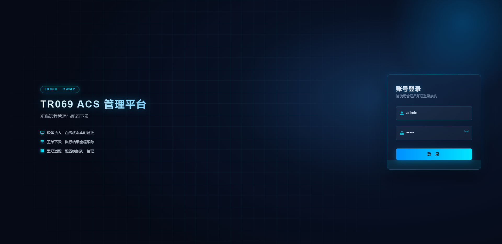

### Dashboard

Device / online / offline / delivery counters, ONT vendor distribution, work order and template
statistics, quick entries:

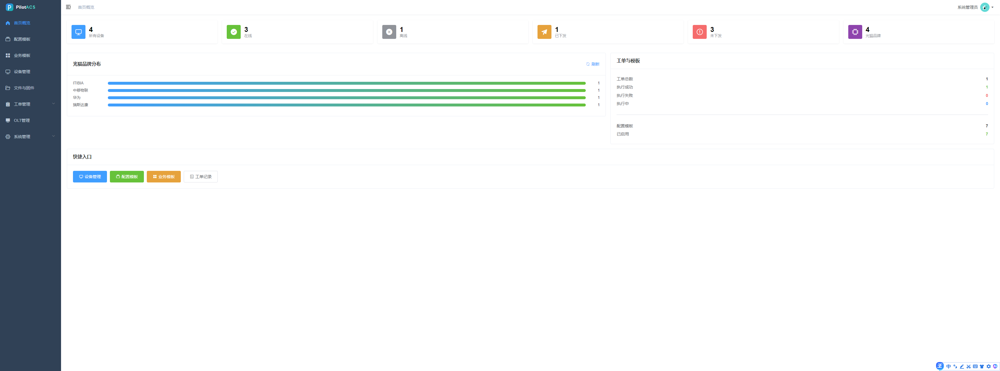

### Device management and model adaptation

The device list shows vendor, model, software/hardware version and PON count; the business status
column reads WAN connections / WiFi / SIP directly; registration info includes online status,
detected IP and last inform time; the batch operations toolbar sits in the bottom-right corner.
Unadapted devices are guided through model adaptation first:

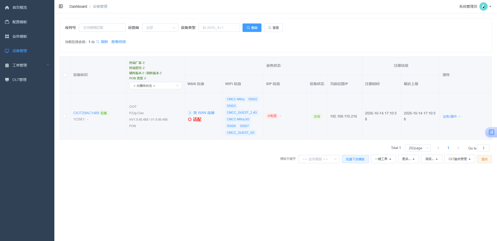

Model adaptation: manually declare ISP, LAN port count, port speed, SIP count and WiFi spec:

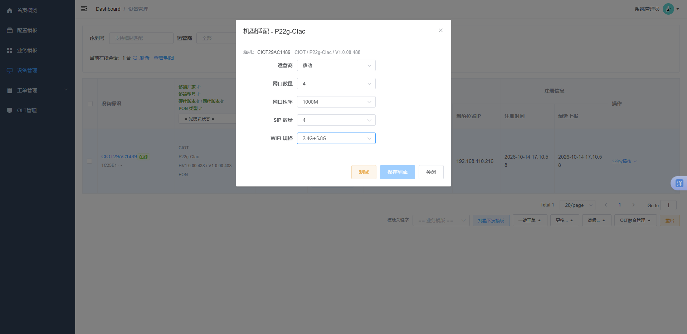

After declaring, run a test collection that maps every capability item to the model's real CWMP
parameter paths, with results shown live:

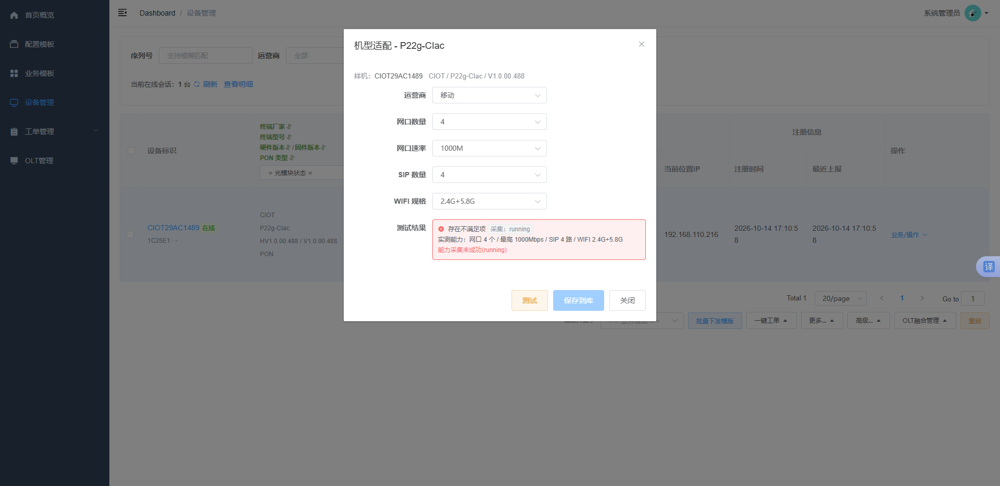

Once it passes, a per-item "capability ↔ delivery intent data" comparison is shown, and it can be
saved as the model's adaptation record with one click. The declared ISP is written back to the
device ledger:

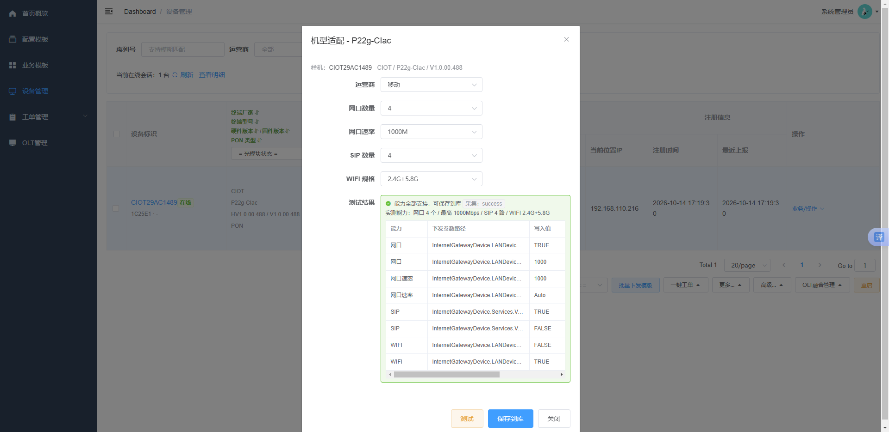

After adaptation the device becomes "adapted" and business status renders from real data:

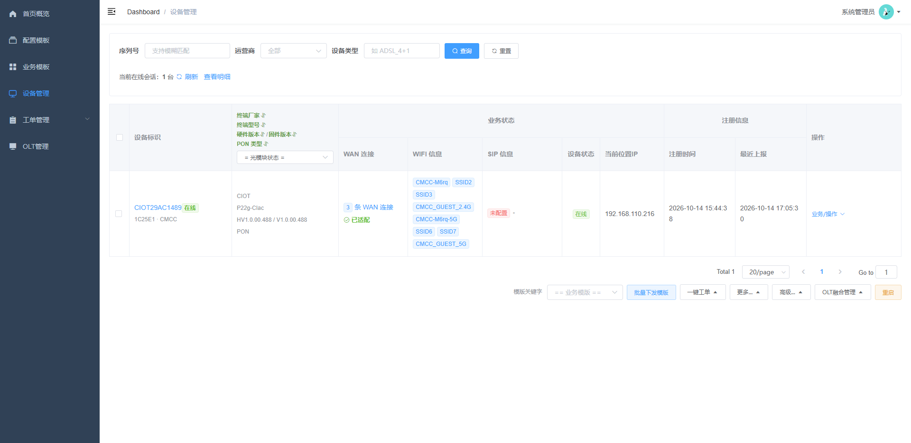

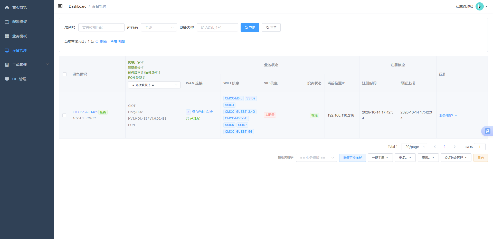

### Device list and business details (latest)

Device list (columns left to right): SN/remark, terminal info (vendor / model / hardware+firmware
version / PON type + optical power, sortable headers), business status (WAN connections +
**LAN port icons**, **WiFi split into 2.4G / 5.8G rows**, SIP info, device status),
**runtime info** (uptime / join time / last inform / inform IP, sortable headers), actions:

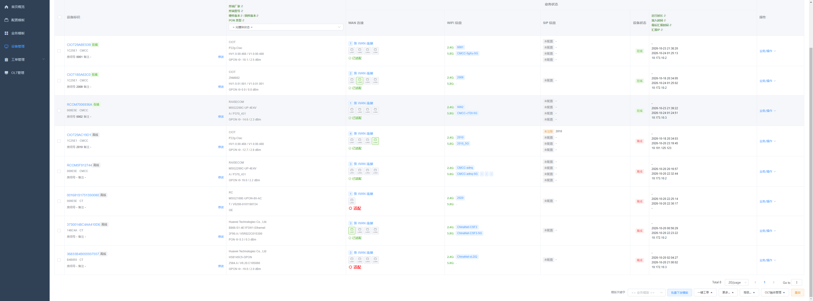

Device detail business panel: info cards (uptime / registration time / last inform / inform IP),
WAN connections, LAN ports (green when plugged, grey when not, hover for MAC),
WLAN split by 2.4G / 5.8G, SIP voice (real line instances only):

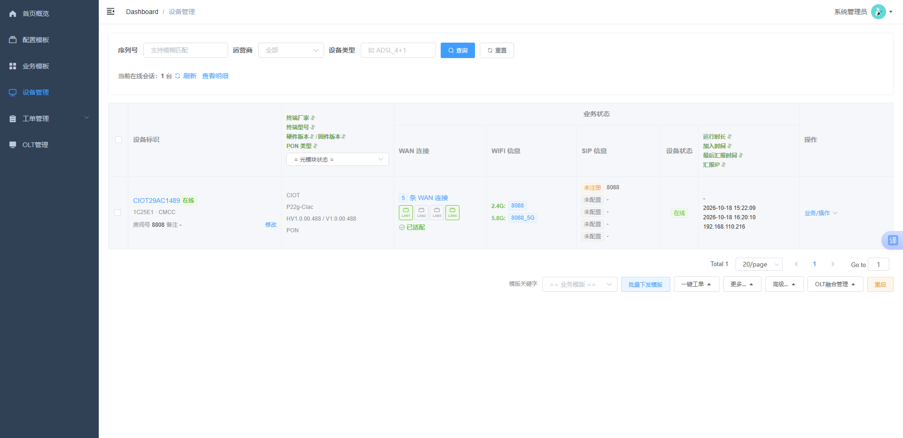

### Super admin account and password (read live from the device)

Select devices and click "query super admin account": each device is queried on its own — the ACS
first sends a CWMP Connection Request to bring the device up (offline ones are given time to
reconnect), then issues `GetParameterValues` against the ISP-specific node
(`DeviceInfo.X_CMCC_TeleComAccount.*` / `X_CT-COM_TeleComAccount.*` / `X_CU_TeleComAccount.*`) and
falls back to the generic nodes (`UserInterface.X_HW_WebUserInfo.{i}` / `User.{i}`) when that node
does not exist. Account and password come back in clear text and can be used to log into the ONT's
web UI right away; one row per device, a failing device never blocks the others, and extra accounts
expand to show their instance number and real parameter path:

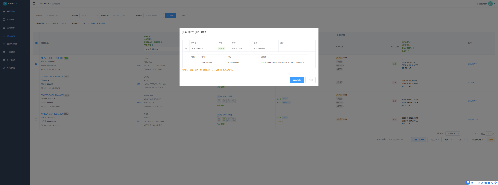

### OLT management (real device collection, **config delivery included**)

Collected from the OLT CLI over Telnet, verified on a Huawei MA5683T.

The pages are **per-vendor**: the ledger entry routes you to the matching detail page by vendor —
Huawei goes to `huawei.vue`, HSGQ to `hsgq.vue` (all-in-one chassis, no board concept), anything
unrecognized to `generic.vue`. The vendor is detected from the version output at "test connection"
time, persisted with the device, so a newly added device lands directly on its vendor page.
The screenshots below are all from the **Huawei** panel.

> **Collection is read-only, config delivery is live.** Only `display` / `show` commands are sent
> while collecting (`enable` → `config` merely enters the config view, because temperature / ONT /
> VLAN commands are only accepted there; it quits right after). Every tab shows the **device's
> current configuration**, not an ACS intent.
> **Writable**: VLAN create/delete, DBA profile create/delete, line-profile T-CONT / GEM port /
> GEM mapping, TR069 profile creation, one-click setup, **ONT registration (`ont confirm` +
> service ports)**, the **per-port auto-find switch** and **deleting all ONTs on a board** — all as
> form / preview / deliver with constraints and command sequences computed by the backend.
> Still CLI-only: single-ONT reboot/delete, board reboot, template add/delete. Write operations:
> section 2 #15.

- **OLT status / configuration**: model, version and patch, backplane, control board MAC, uptime, sync summary; board cards list model / status / description / temperature / port and ONT totals;
- **Board diagram**: `P0`-`P7` port rows are pinned at the height of the matching physical port on the diagram; expanding a row lists every ONT under that port (ID / SN / model / online-offline);
- **ONT configuration / status**: one table per board, port × ONT totals / online / offline; one row per ONT, columns left to right are auth code (SN), run flag, **management IP**, **MAC**, **service flow**, **line profile**, **service profile**, ONT description, status and the query icons; rows can be selected and two batch buttons (**reboot ONU** / **delete registration**) sit in the bottom-right corner (not wired yet, clicking reports that writes are not open);
- **VLAN**: L3 VLAN interfaces (VLAN ID / IP / mask), uplink VLAN pass-through (VLANs and native VLAN allowed per uplink), VLAN and L2 interworking (merged into `41、45-46` by type), static routes (destination / next hop / egress interface);
- **Collection records**: connection time, summary and raw output of every sync and diagnostic run.

#### ONT on-demand query dialogs (one login per click)

Nothing is polled in the background here — each dialog logs in and issues exactly the commands it
needs, so reading one ONT never walks the whole device:

**[ONT config / service flow]** (click the auth code SN, the line profile or the service profile column)

```
display current-configuration ont 0/<slot>/<port> <ONT ID>
display service-port port 0/<slot>/<port> ont <ONT ID>
display ont info 0 <slot> <port> <ONT ID>
```

Dialog: authorization info (SN / description / line profile / service profile) + the service flow
table (index / OLT-side VLAN / VLAN attribute / GEM port / ONT user-side VLAN / upstream+downstream
traffic profile / edit / select; the four buttons at the bottom all report that they are not open
yet).

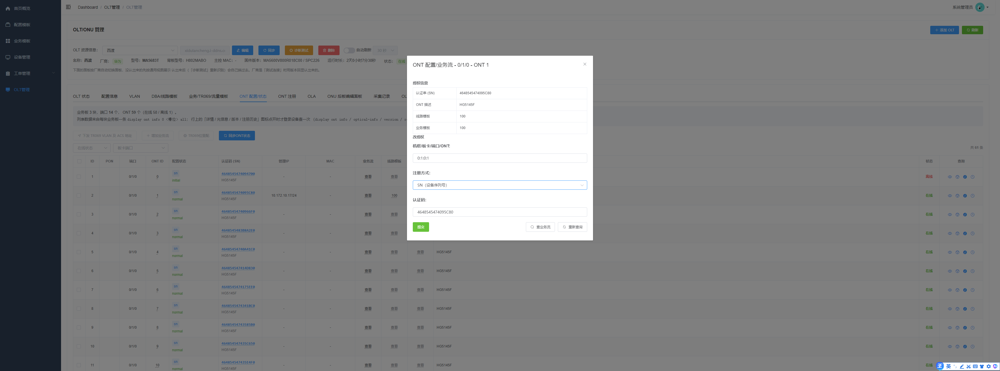

**[ONT hardware capability / status]** (click the ONT ID)

```
display ont capability 0/<slot> <port> <ONT ID>
```

Dialog: PON / POTS / ETH / VDSL / GEM port counts, whether IP configuration is supported, T-CONT
count, flow control type, ONT type, per-T-CONT PQ counts — labels and values are translated
to Chinese for both Chinese and English output.

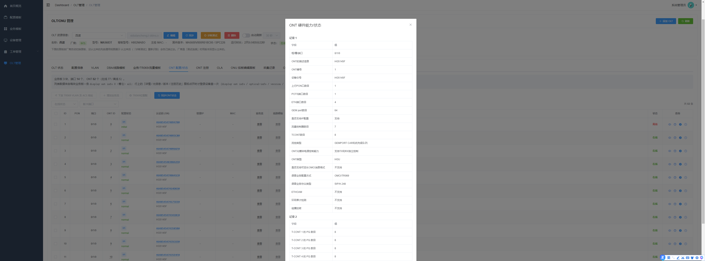

**[ONT service flow]** (click "View" in the service flow column)

```
display service-port port 0/<slot>/<port> ont <ONT ID>
```

Dialog: only the service flow table (same columns as above), no authorization block.

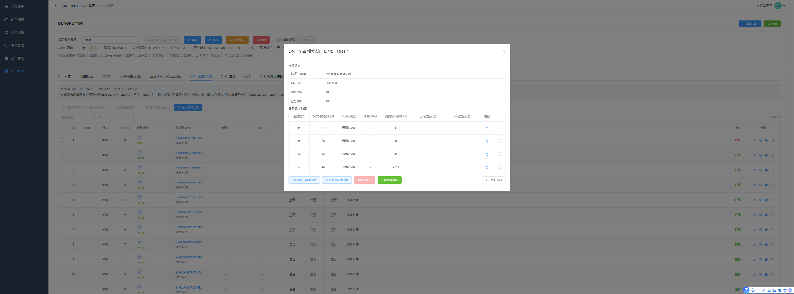

**[Detail / optical info / version / registration history]** (the eye / thermometer / info / clock icons on a row)

```
display ont info 0 <slot> <port> <ONT ID>
display ont optical-info <port> <ONT ID>
display ont version <port> <ONT ID>
display ont register-info <port> <ONT ID>
```

Dialogs: detail (IP, offline reason, online duration) / optical info / version / registration
history, rendered as card blocks.

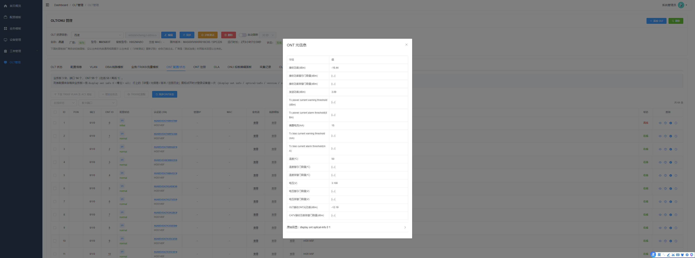

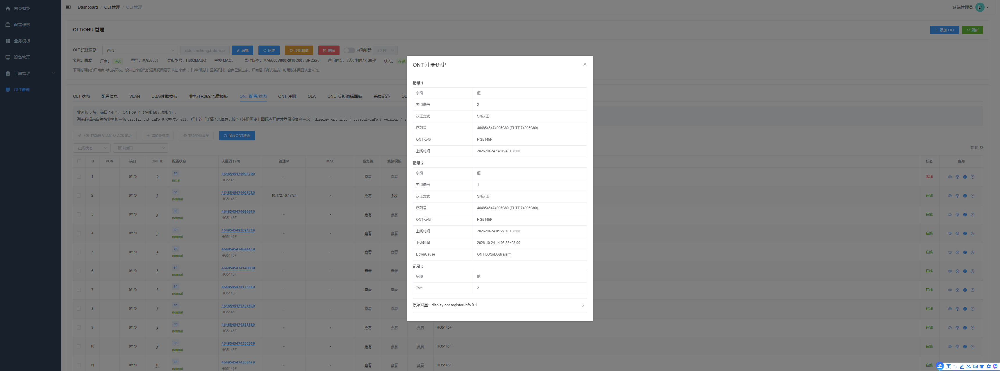

#### DBA / line profile (real collection, create/delete wired)

- **DBA profile**: `display dba-profile all detail` + `display dba-profile all` — profile ID / name / type / fixed·assured·maximum bandwidth (kbps, raw numbers). The summary table only carries the ID and a numeric type, so names are filled back from the detail output by ID;
- **ONT line profile**: `display ont-lineprofile gpon all` only returns the summary; the per-`profile-id` detail carries T-CONT (`DBA Profile-ID`), GEM ports and GEM mappings (`Mapping VLAN`). When one GEM port carries several mappings they are merged the way the vendor NMS shows them (mapping ID `0,1` / VLAN `45,4011`);
- The built-in `profile-id 0` (`line-profile_default_0`) is not shown.

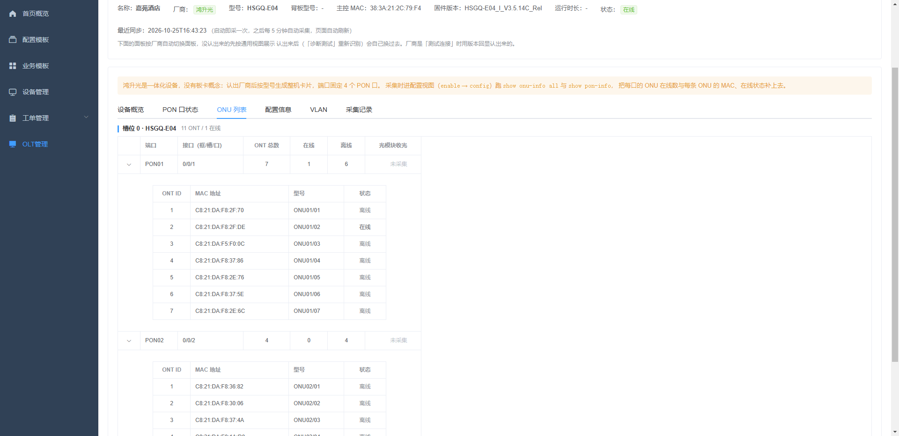

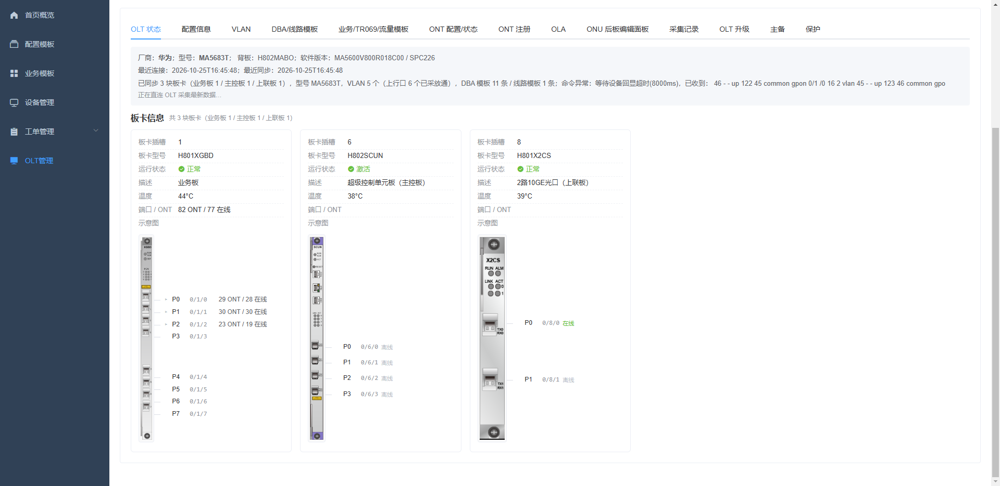

#### Service / TR069 / traffic profile (real collection; TR069 create wired)

- **ONT service profile**: `display ont-srvprofile gpon all` summary + per-profile detail, LAN/POTS port counts (`ont-port pots adaptive 32 eth adaptive 8`);
- **TR069 management profile**: `display ont tr069-server-profile all`, ACS URL and login account (the password is ciphertext and is not collected);
- **Traffic profile**: `display traffic table ip all`, committed rate (CIR) / peak rate (PIR);
- **Service flow details**: `display current-configuration section service-port` (fixed field semantics, so the `F/S/P` port never lands in the wrong column) — index / ONT ID / user-side VLAN / VLAN attribute / GEM port / port for 700+ service flows.

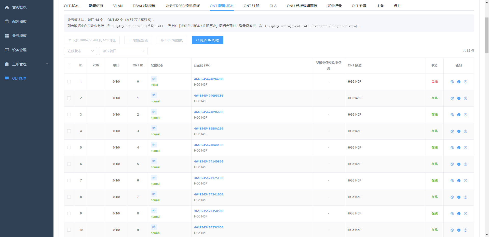

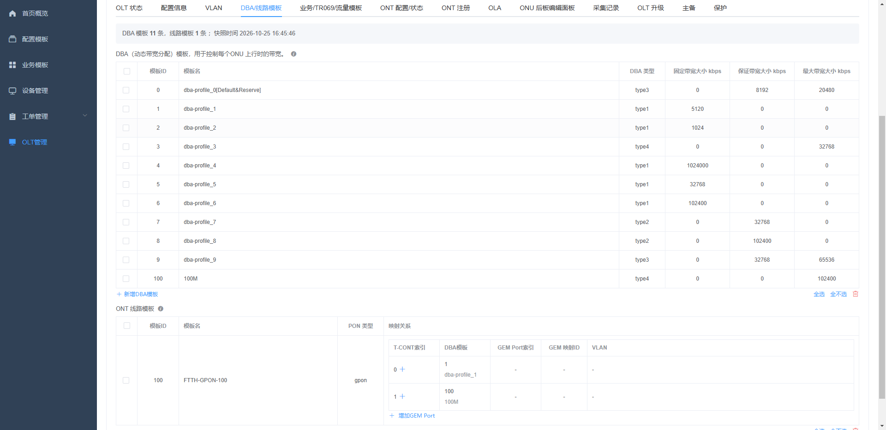

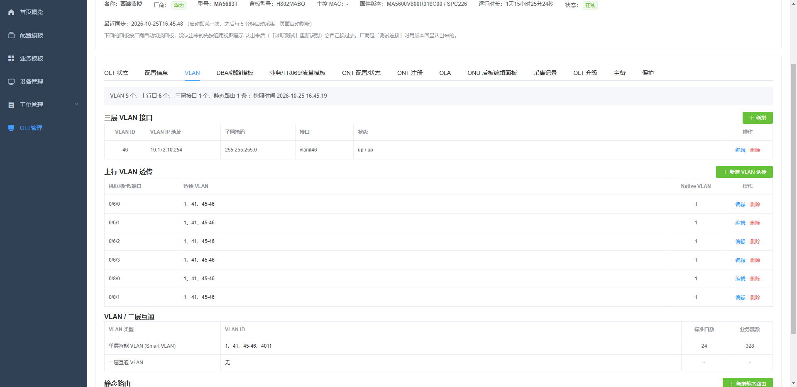

#### OLT status and VLAN (real collection)

The PON board type decides the keyword in the command: `gpon` is tried first, falling back to `epon`
(`display ont-lineprofile epon all`). The add/delete buttons on the **Huawei** template tabs are
**placeholders** (they report that delivery is not wired yet); on the HSGQ page the TR-069 profile
panel creates profiles for real, and the rest of its writes go through the device command center.

OLT status page: 3 boards (1 service / 1 control / 1 uplink), backplane and version, each board
listing `P0`-`P7` and its ONT count at the physical port height on the right of the diagram.

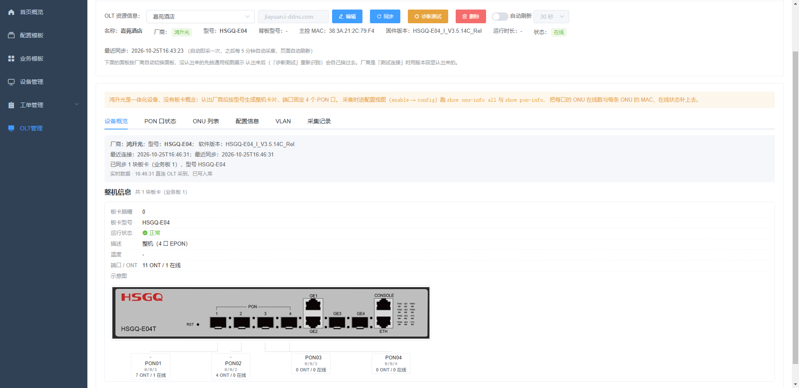

VLAN page: L3 VLAN interface (`vlanif46  10.172.10.254/24`), uplink VLAN pass-through
(`0/6/0`-`0/8/1` allowing `1、41、45-46`, native VLAN 1), VLAN and L2 interworking (single-layer
smart VLAN), static route (`0.0.0.0/0 → 10.172.10.1`).

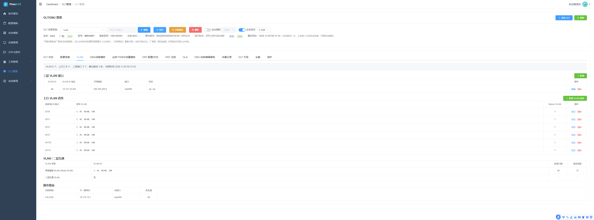

#### Screenshot inventory

Screenshots are **not moved or renamed** — they all live in the root of
[`doc/Display/`](./doc/Display) (troubleshooting screenshots in `Debug/`). The tables below split
them into the **ACS side** (ACS service / ONT device management) and the **OLT side**
(converged OLT management: read-only collection, live config delivery).

**ACS side (ACS service / ONT device management)**

| File | Content | Where it is used | Status |
| --- | --- | --- | --- |
| `170451_518.png` | Login | Screenshots · Login | In use |
| `170528_847.png` | Dashboard | Screenshots · Dashboard | In use |
| `171236_574.png` | Device management (unadapted) | Screenshots · Device management | In use |
| `171244_327.png` | Model adaptation · declaration | Screenshots · Model adaptation | In use |
| `171437_294.png` | Model adaptation · test collection | Screenshots · Model adaptation | In use |
| `172759_926.png` | Model adaptation · passed | Screenshots · Model adaptation | In use |
| `170658_702.png` | Device management (adapted) | Screenshots · Device management | In use |
| `174419_542.png` | Device list after adaptation | Screenshots · Device management | In use |
| `013530_034.png` | Device list (current) | Screenshots · Device list | In use |
| `162116_423.png` | Device detail business panel | Screenshots · Device detail | In use |
| `180849_848.png` | Super admin account / password dialog (read live) | Screenshots · Super admin account | In use |
| `013724_056.png` | ONT admin UI platform server config | 1.4 Device provisioning | In use |
| `162046_560.png` | Device list (**older** version, used before `013530_034`) | — | Unused (kept) |
| `025159_916.png` | Device list (**older** version, used early on) | — | Unused (kept) |

**OLT side (converged OLT management: read-only collection, live config delivery)**

| File | Content | Where it is used | Status |
| --- | --- | --- | --- |
| `164812_931.png` | Huawei panel (OLT status / boards) | Screenshots · OLT management | In use |
| `164849_972.png`, `164917_540.png` | DBA / line profile | Screenshots · template tabs | In use |
| `165011_460.png`, `165021_956.png`, `165027_868.png` | Service / TR069 / traffic profile + service flow details | Screenshots · template tabs | In use |
| `203941_898.png` | VLAN page | Screenshots · VLAN | In use |
| `013810_265.png` | ONT config / service flow dialog (click SN) | Screenshots · ONT on-demand dialogs | In use |
| `013739_612.png` | ONT hardware capability / status dialog (click ONT ID) | Screenshots · ONT on-demand dialogs | In use |
| `004502_731.png` | ONT service flow dialog (service flow column "View") | Screenshots · ONT on-demand dialogs | In use |
| `013803_107.png` | ONT detail / optical info dialog | Screenshots · ONT on-demand dialogs | In use |
| `013753_883.png` | ONT version / registration history dialog | Screenshots · ONT on-demand dialogs | In use |

> Adding screenshots: drop them into `doc/Display/` and reference them by file name. Overwriting an
> existing file needs no README change, so both Gitee and GitHub pick it up.

---

## 1. Implemented

### 1.1 Backend

| Capability | Detail | Main location |
| --- | --- | --- |
| CWMP ingress | Inform / empty-POST probe / RPC response, digest auth (`auto` disables it), multiple ports + paths for vendor-specific reporting | `acs/controller/CwmpController`, `acs/auth/CpeAuthenticator`, `common/web/CwmpMultiPortConfig` |
| Protocol layer | SOAP parse/build, RPC method enums, namespaces | `cwmp/*` |
| Session management | Session state machine, pending RPCs, timeout fallback; periodic inform treated as heartbeat with session takeover (a CPE switching TCP connections does not rebuild the session, mark it offline, or clear the pending queue); offline only judged by long silence; suspected dual sessions only warn | `acs/session/*` |
| **Per-ONT on-demand query (read-only)** | Clicking SN / a profile column runs three commands in one session: `display current-configuration ont 0/<slot>/<port> <ONT ID>` (authorization row: SN / line profile / service profile / description) + `display service-port port 0/<slot>/<port> ont <ONT ID>` (service flow table) + `display ont info 0 <slot> <port> <ONT ID>` (management IP); clicking the ONT ID runs `display ont capability 0/<slot> <port> <ONT ID>` (hardware capability); row icons give optical info / version / registration history. Older firmware that does not accept the `ont` filter falls back to a whole-port query filtered by VPI (ONT ID) | `olt/telnet/OltCliSession` (`queryOntConfigAndServicePorts`, `queryServicePorts`, `queryOntDetail`), `olt/telnet/OltInfoParser` (`parseOntBindInfo`, `parseServicePorts`, `parseOntKeyValueBlocks`), `olt/service/OltService#queryOnt` |
| Device management | Auto registration, online status, paged details, online session details | `acs/service/DeviceRegistryService`, `api/controller/DeviceController` |
| Capability tree collection | Collects only WAN / WiFi / LAN port / SIP subtrees (fixed in code): `GetParameterNames` for paths + `GetParameterValues` in batches, auto-collect after Inform, forced re-collect on BOOTSTRAP, NextLevel fallback | `acs/service/DeviceCapabilityService` |
| **Device provisioning** | Right after Inform, issues one `SetParameterValues` writing `ManagementServer.URL` (ACS address), `PeriodicInformInterval` (inform interval) and `ConnectionRequestUsername/Password` (connection request credentials) back to the device; skips items already matching, no re-send within 24h, forced re-send on BOOTSTRAP; credentials are recorded in the ledger once rewritten so wake-up can use them | `acs/service/InformProvisionService` |
| **Wake-up before delivery** | CWMP is short-lived: the ACS cannot push data, so ordinary deliveries queue up until the device's next periodic inform; human-triggered deliveries (work order / business template / manual collection) first send a connection request so the device informs immediately and the commands ride that session — if it cannot be woken, it falls back to waiting. Credentials are resolved as ledger → collected parameters → global config → `itms` fallback | `acs/service/DeviceCapabilityService#wakeUp`, `exec/IntentDeliveryService` |
| Parameter tree export | Export the capability tree per model to `configuration/models/`, and locate the model file by device | `worklist/service/ModelTreeStore` |
| Business snapshot | `device` / `wan` / `wifi` / `lan` / `sip` / `pon` sections, single-device and whole-page batch reads; LAN section adds link state (`connected`) and MAC, SIP section keeps only real line instances (drops the `VoiceProfile.{n}.SIP.` aggregate), ledger registration time and last inform time are returned too | `acs/service/DeviceBusinessService` |
| **Automatic LAN port refresh** | Periodically (5 min by default) re-reads port state leaves (`Enable/Status/X_CT-COM_*LineStatus/MAC/speed`) for online devices, so unplugging a cable does not require a manual "re-collect"; online devices only, port leaves only, a wait timeout is not a failure (the command stays queued) | `acs/service/LanStatusRefreshService`, `DeviceBusinessService#lanStatusPaths` |
| **Super-admin account lookup** | `GET /api/device/{sn}/admin-account`: reads `User.{i}.Username/Password` and returns it in plain text; an online session is woken up before reading and an offline device gets a connection request (up to 30 s) before `offline` is reported; falls back to TR-098 / TR-181 standard paths when no tree was collected; re-sends item by item when a whole batch is rejected, sharing a 30s budget; only accounts under `.User.{i}.` count, so WAN dial-up accounts are not collected by mistake | `acs/service/DeviceAccountService`, `api/controller/DeviceController` |
| Model semantic mapping | `cpe_model` + `model_param_mapping` / `model_object_mapping`: business field ↔ the model's real CWMP path, with candidate path recommendation by SN | `worklist/controller/ModelMappingController`, `ModelMappingService` |
| Model adaptation | After collection, declare ISP / LAN port count / speed / SIP count / WiFi spec, verify each item with a test collection, then save the adaptation record (capability tree XML + adaptation yml); the declared ISP is written back to the device ledger, and list and detail views follow the ledger. **Band detection** combines four rules — band parameter / channel list / 802.11 standard / SSID wording; when only 5G is labelled and 2.4G is not, it is treated as dual-band, and when no band can be detected at all it falls back to the radio count (full rule list in [doc/ADAPTED_MODELS.en.md](./doc/ADAPTED_MODELS.en.md)) | `worklist/service/ModelAdaptationService`, `ModelTreeStore` |
| RPC delivery (async) | Delivery returns a task id; poll the result by id; timeouts are finalized uniformly | `agent/RpcDispatchService`, `queue/RpcTaskQueue`, `api/controller/RpcTaskController` |
| Queue smoothing | Inform and delivery go through Redis queues; degrades to in-process handling when Redis is unavailable | `queue/*` |
| **Configuration intent templates** | Stored in `config_template`, describing provisioning intent only (no data is delivered): 7 categories (WAN DHCP / WAN PPPoE / WAN static IP / WAN bridge / 2.4G WiFi / 5.8G WiFi / SIP), each with its own intent fields; `/meta` field definitions, list, detail, save, delete; **incremental** switch (`incremental`): when on, delivery only `AddObject`s this one service, skips the WAN cleanup and never touches services already on the device | `template/*` (`ConfigTemplateService`, `ConfigTemplateController`) |
| Business templates | Several intent templates orchestrated into one package: list, detail, save, delete, pre-delivery self-check `/validate`, delivery record query | `biz/*` (`BizTemplateService`, `BizTemplateExecutionService`) |
| **Work order delivery (admin)** | `POST /api/worklist/instances` uses `worklistDesc` as the idempotency key; after persisting, it immediately becomes a delivery task (`IntentDeliveryService`, `source=worklist`); on completion `TaskFinishedEvent` writes back the final state and failure reason; work orders and step records are queryable | `worklist/service/WorklistDeliveryService`, `worklist/controller/WorklistExecuteController` |
| Dashboard | Online/offline, vendor distribution, template statistics (counting intent templates) | `api/service/DashboardService` |
| Data model adaptation | Dual model support for TR-098 (`InternetGatewayDevice.`) and TR-181 (`Device.`): root node decided by majority of Inform parameters, business prefixes expanded for both models, model records and capability tree XML record the data model and are reconciled | `acs/model/DataModel`, `InformService`, `DeviceBusinessService` |
| **Intent delivery executor** | Intent fields + model semantic mapping → CWMP paths and values → `AddObject` as needed then batched `SetParameterValues`, all recorded in `device_task`; idempotent per `taskNo` | `exec/*` (`IntentDeliveryService`, `IntentPlanRenderer`) |
| **Northbound API** | Dedicated port 8899 + `/openapi/v1/**`: device ledger/online/capability tree/business snapshot/work order results, delivery acceptance and result query, Webhook event push (online/offline, delivery finished), reusing admin JWT auth | `openapi/*` |
| **OLT CLI collection (read-only)** | Telnet login → paging off → `display board 0` / `display version` → `enable` → `config` (config view is entered only to read temperature / ONT / VLAN, nothing is configured) → temperature → one `display ont info 0 <slot> all` per service board → `display vlan all` → `display port vlan 0/<slot>/<port>` per uplink/control port → `display ip interface brief` / `display ip routing-table` → `quit`; boards, per-port ONTs (with every ONT detail), VLANs, L3 interfaces and static routes are persisted (`olt_device.vlan_json`, `olt_board.ports_json`); one round right after startup, a full round every 30 hours as a safety net and a board-status refresh every 2 minutes, while tab sync collects only the section it needs. The page only reads the latest data and never touches the device. Collection sends only `display` / `show`; writes go through the delivery endpoints — ONT registration and deleting board ONTs are wired, single-ONT reboot/delete and board reboot are not. The vendor is detected from the version output after login and written back to `olt_device.vendor`, which routes the device to its vendor page (`web/src/views/olt/vendors.js`). Verified on a Huawei MA5683T | `olt/*` (`telnet/OltCliSession`, `telnet/OltInfoParser`, `service/OltService`, `service/OltTelnetService`) |
| **ONT detail backfill** | The board-wide table (`display ont info 0 <slot> all`) carries neither MAC nor profile IDs, so a background job fills them in: MAC per ONT via `display ont ipconfig <port> <ONT ID>` (once found it is skipped for good; a `0000-0000-0000` answer is flagged and never retried), profile IDs from one `display current-configuration` run by parsing `ont add … ont-lineprofile-id / ont-srvprofile-id`. Only missing values are fetched, then persisted and reused | `olt/telnet/OltCliSession#enrichOntProfiles`, `#fillOntProfilesFromConfig`, `olt/service/OltService#collectOntDetailsAndPersist` |
| **ONT details: overwrite, never delete** | Every write path (full sync / tab sync / quick sync / board refresh / background backfill) merges in `writeBoards`: rows are matched by SN (falling back to slot + port + ONT ID when the SN changed); an empty new value keeps the stored MAC / management IP / line profile / service profile, a collected value overwrites it; `-` and `0000-0000-0000` count as "not collected" and never overwrite | `olt/service/OltService#mergeUnsyncedPortData`, `#mergeOntDetails`, `#applyOntDetail` |
| **OLT template collection (read-only)** | Same Telnet session continues with the templates: `display dba-profile all detail` + `display dba-profile all` (names filled back by ID, the summary only carries the ID and a numeric type), `display ont-lineprofile <gpon\|epon> all` summary + per-`profile-id` detail (T-CONT `DBA Profile-ID`, `<Gem Index:n>` and the `Mapping VLAN` table), `display ont-srvprofile <gpon\|epon> all` summary + per-profile detail (`ont-port pots/eth adaptive`), `display ont tr069-server-profile all` (ACS URL and account), `display traffic table ip all` (CIR / PIR), `display current-configuration section service-port` (service flows; fixed field semantics, preferred over the table output). PON type is probed `gpon` first, then `epon`; the built-in `profile-id 0` is hidden; the result overwrites `olt_device.template_json` as a whole (a failed round keeps the previous data) | `olt/telnet/OltInfoParser` (`parseDbaProfiles` / `parseDbaDetails` / `parseLineProfiles` / `parseSrvProfiles` / `parseTr069Profiles` / `parseTrafficTables` / `parseServicePortsFromConfig`), `olt/telnet/OltCliSession#collectTemplates` |
| **OLT CLI robustness** | ① Huawei's continuation prompt `( Press 'Q' to break ) ----` is recognized as paging; when the prompt shares a line with content, only the prompt is stripped and no space is sent, so paging never hangs; ② paging is disabled per vendor: Huawei gets `scroll` (`screen-length` belongs to VRP switches, OLTs reject it), re-sent after entering the config view; ③ parameter completion prompts (including the `<cr>`-less `{ all<K>\|bound-info<K> }:`) are answered with an automatic Enter instead of blocking for the full 8s timeout | `olt/telnet/TelnetClient#handlePagination`, `olt/telnet/OltVendor#getPagingCommands`, `olt/telnet/OltCliSession#readToPrompt` |
| Admin auth | JWT login, `sys_user` lookup, initial admin created on first startup; besides validating the token, the JWT interceptor **derives the required permission from the request URL and method** (`GET` needs `xxx:view`, write methods need `xxx:manage`) and rejects with 403 when it is missing | `api/controller/AuthController`, `config/AdminAuthInterceptor`, `api/auth/PermissionCodes` |
| **Roles & permissions** | `sys_role` + `sys_role_permission`: 20 permission points (10 modules × read/write) come from a code-level list and are **not stored in a table**; permissions are ticked per role and take effect **immediately** (every request re-reads the role from the database, nothing is cached in the token); the system administrator short-circuits to full permission in code, has **no row in the permission table** and cannot be modified | `api/auth/PermissionCodes`, `api/service/RoleService`, `api/controller/SystemController` |
| **User management** | Nine endpoints under `/api/system`: create/read/update/delete users, change role, change password (**changing someone else's password requires re-entering the operator's own password**), enable/disable; you cannot delete yourself | `api/service/UserAdminService` |
| **Login log** | Every attempt lands in `sys_login_log`: result and failure reason, **real IP** (first hop of `X-Forwarded-For`, private addresses ignored), **login source** (web / client / mobile, from `X-Client-Type` or the UA) and the UA; the latest 50 records are kept per user | `api/service/LoginLogService`, `api/auth/ClientIpResolver`, `api/auth/LoginSourceResolver` |
| Startup self-check | Create/initialize business tables, check optional read-only tables | `common/startup/*` |

### 1.2 Frontend (`web/`)

| Menu | Path | Status |
| --- | --- | --- |
| Dashboard | `/dashboard` | Done |
| Config templates | `/template/list` | Done (intent templates, rendering intent fields by type; **advanced mode / file templates removed entirely**) |
| Business templates | `/biz/list` | Done (orchestration + member view + self-check + serial whole-package delivery, continue-on-error supported) |
| Device management | `/device/list` | Done (list/detail/business info/WAN parameter dialog/online details + **bottom-right batch toolbar** + **LAN port icons** + **WiFi split into 2.4G/5.8G rows** + **runtime columns** (uptime/join time/last inform/inform IP, sortable) + **super-admin password dialog**) |
| Device detail | `/device-detail/:sn` | Done (capability tree, parameter tree, RPC debug + business panel: info cards for uptime/registration time/last inform/inform IP, LAN port block, WLAN split by band, SIP listing real lines only) |
| Work orders | `/worklist/instances` | Done (work order and step query; batch creation entry is "One-click work order ▲" in the device list toolbar) |
| OLT ledger | `/olt/management` | Done (**entry page**: ledger CRUD, connectivity diagnostic, trigger sync; **dispatches by vendor** to the three detail pages below; a newly added device goes straight to its vendor page once identified) |
| OLT detail · Huawei | `/olt/huawei/:id` | Done (**real Telnet: read-only collection + live config delivery**: OLT status (boards/temperature/port ONTs/diagram), configuration, VLAN, **DBA/line profile**, **service/TR069/traffic profile**, ONT config and status, collection records; port rows pinned on the board diagram; the ONT config/status table has auth code / run flag / **management IP** / **MAC** / **service flow** / **line profile** / **service profile** columns, rows are selectable and **reboot ONU / delete registration** buttons sit in the bottom-right; on-demand dialogs: click SN → authorization info + service flow, click ONT ID → hardware capability/status, service flow "View" → service flow table; **config delivery is live** for VLAN create/delete, DBA profile create/delete, line-profile T-CONT / GEM port / GEM mapping, one-click setup, **ONT registration** (matching templates + auto-scan), the **per-port `ont-auto-find` switch** and **deleting all ONTs on a board** — constraints, defaults and command previews all come from the backend, and only the affected data is re-read after delivery; the add/delete buttons on the Huawei template tabs, single-ONT reboot/delete and the four service flow buttons are still placeholders, and OLA / ONU rear panel / OLT upgrade / standby / protection are empty tabs) |
| OLT detail · HSGQ | `/olt/hsgq/:id` | Done (**all-in-one panel**: device overview with the spec line `8 × GPON + 4 × GE + 4 × XGE`, PON ports plus uplink GE / XGE / NMS / CONSOLE drawn per model; PON port status, **ONU list** (real data from `show onu-info all`), configuration, VLAN (create/delete), **TR069 profiles** (create), one-click setup, **device config command center** (system / firmware / ONU upgrade, link aggregation, ONT add/delete/reset), collection records; the per-row "Config" dropdown in the ONU list is still a placeholder) |
| OLT detail · Generic | `/olt/generic/:id` | Done (unrecognized vendors, ZTE and FiberHome land here: boards, ONTs, VLAN, configuration, collection records; **read-only**, once identified the device can be re-tested and routes to the matching vendor page) |
| **User management** | `/system/users` | Done (create/edit/delete users, role changes take effect immediately, password change, enable/disable; the list carries **last login / login IP / login source**; the delete button of the initial `admin` is disabled) |
| **Role permissions** | `/system/roles` | Done (tick **view / manage** per module; the **system administrator row is disabled**; a role still in use cannot be deleted) |
| **Login log** | `/system/login-logs` | Done (successes and failures; filterable by **login IP / login time / login source**) |

Bottom-right toolbar of the device list (`web/src/views/device/list.vue`, select devices first):

| Group | Wired up | Placeholder (backend pending) |
| --- | --- | --- |
| Template keyword + batch template delivery | Dropdown wired to intent and business templates; creates a work order / execution record per selected device | Whole-batch progress board, one-click retry for failures |
| One-click work order ▲ | Jump to work orders + batch provisioning / maintenance orders (per-device order, independent serial number each, failures summarized at the end) | — |
| More… ▲ | Factory reset / deep factory reset / clear-type → `FactoryReset`; **super-admin password lookup** (reads `User.{i}.Username/Password` live per device, shown in a dialog, one device timing out or being offline does not affect the others) | Telnet switch, WAN-side access, one-click WiFi, disable SIP, delete WAN connection, lift internet restriction, clear cache, mark as replaced |
| Advanced… ▲ | Export devices (CSV), deliver custom TR069 parameters (dialog → `SetParameterValues`), debug command (dialog → any RPC), refresh status | Telnet commands, strip SSID prefix, repair SIP/bridge, export/clone config file, force inform |
| Converged OLT management ▲ | OLT/ONU management (jump to the OLT page) | OLT topology |
| Reboot | Batch `Reboot` (with confirmation) | — |

### 1.3 Adapted ONT models

The list is maintained separately in **[doc/ADAPTED_MODELS.en.md](./doc/ADAPTED_MODELS.en.md)**
(ISP + vendor model only, one row per adapted model). The adaptation records themselves live in the
portable SQLite template library `configuration/tr069_tpl.pack` (property `acs.tr069tpl.db-path`),
which ships with the repository — copy it to a deployment host and those models are recognized as
adapted, no need to adapt again.

### 1.4 Device provisioning and wake-up

A factory-fresh ONT carries the vendor platform's address; leave it alone and the next inform goes
somewhere else. Every time a device informs, the ACS immediately issues one `SetParameterValues`
to take it over:

| Delivered item | Value | If left untouched |
| --- | --- | --- |
| `ManagementServer.URL` | `acs-url`; when empty, built from `public-host` + inform port + inform path | The device keeps informing the vendor platform and the ACS never sees it again |
| `ManagementServer.PeriodicInformInterval` | `inform-interval-seconds`, default 300 | Factory values are often tens of seconds — pointless load at scale; too long and deliveries stall waiting |
| `ManagementServer.ConnectionRequestUsername` | `connection-request-username`, default `itms` | Factory values differ per batch; if the ACS cannot guess them it can never wake the device |
| `ManagementServer.ConnectionRequestPassword` | `connection-request-password`, default `itms` | Same as above |

TR-181 devices automatically get the `Device.ManagementServer.*` prefix instead (built from the
session's root node).

All four delivered items are visible on the device's own server configuration page (MSG2200C shown
here: ACS address, ACS credentials, connection request credentials and the periodic inform interval
are all on this page — provisioning rewrites exactly these):


**Why the credentials are rewritten too**: the connection request is what the ACS uses to wake a
device, and it is stored on the device side. Factory values differ per batch, so without the right
pair wake-up always returns 401 and you can only wait for the periodic inform. Provisioning writes a
value the ACS knows, turning credentials from "guessed" into "known". Once rewritten they are
recorded in the ledger and wake-up reads them from there — collection reads back the *old* value,
and keeping it would mean using a key the device no longer accepts.

It does not write on every inform. Three checks: items already matching what the device reported are
skipped; nothing is re-sent within 24h (`reprovision-interval-hours`, set `0` to send every time);
**BOOTSTRAP forces a re-send**, because after a factory reset the address reverts to the vendor
platform and has to be rewritten.

Configuration:

```yaml
acs:
  auth:
    # Credentials the ACS uses to wake the ONT (opposite direction from cpe-to-acs-* — don't mix them up)
    acs-to-cpe-username: itms
    acs-to-cpe-password: itms
  public-host: 10.101.125.100        # must be changed before production: used to build the delivered URL
  device:
    provision:
      enabled: true
      acs-url:                       # empty = build from public-host
      inform-interval-seconds: 300   # 0 leaves this item untouched
      connection-request-username: ${acs.auth.acs-to-cpe-username}
      connection-request-password: ${acs.auth.acs-to-cpe-password}
      reprovision-interval-hours: 24
      force-on-bootstrap: true
```

**Wake-up (connection request)**: CWMP is short-lived — the ACS cannot push data to a device, it can
only wait for the device to open a session. Ordinary deliveries (periodic collection, LAN status
refresh, provisioning itself) therefore queue up until the next periodic inform, which is the
cheapest path; only "must take effect the moment someone clicks" operations call the device back —
work order delivery, business template delivery, manual collection. If it cannot be woken, it falls
back to waiting, which is still correct. Credentials are resolved as: ledger → collected parameters
→ global config → `itms` fallback.

Verification (after the device informs once, check the log — ACS log messages are in Chinese):

```
下发纳管参数: sn=CIOT29ABE539, 参数=...ManagementServer.URL=http://10.101.125.100:9090/ACS-server/ACS,
  ...PeriodicInformInterval=300, ...ConnectionRequestUsername=itms, ...ConnectionRequestPassword=itms
纳管参数下发完成: sn=...
已登记设备连接请求凭据: sn=..., 账号=itms
已发连接请求唤醒设备: sn=..., url=..., 响应码=200
```

If a device rejects these items (some vendors mark them read-only) it returns a fault and the log
shows `纳管参数下发失败: sn=..., err=...`; the ledger is not updated in that case and it retries once
per cycle. Either relax the permission on the device side or turn `enabled` off.

### 1.5 OLT tabs: implemented / placeholder

Per-tab status of the Huawei page (`/olt/huawei/:id`). **Implemented = collected from the device over
real Telnet commands, persisted and displayed; placeholder = the tab is only a shell or an empty
state and never touches the device.**

| Tab | Status | Data source | Notes |
| --- | --- | --- | --- |
| OLT status | ✅ Implemented | `display board 0`, `display version`, temperature commands | Board cards (model/status/temperature/port and ONT totals), diagram port rows |
| Configuration | ✅ Implemented | `display version` and friends | Model, version and patch, backplane, control board MAC, uptime |
| VLAN | ✅ Implemented | `display vlan all`, `display port vlan`, `display ip interface brief`, `display ip routing-table` | L3 interfaces, uplink pass-through, L2 interworking, static routes |
| **VLAN create / delete** | ✅ Implemented (write) | `vlan standard <ID>` / `undo vlan <ID>` | The new VLAN shows up as soon as the command returns (1–2 s) and the full re-collection moves to the background; duplicate IDs are rejected before delivery |
| **DBA/line profile** | ✅ Implemented | `display dba-profile all (detail)`, `display ont-lineprofile … all` + per-`profile-id` detail | DBA bandwidth tiers, T-CONT↔DBA, GEM port↔mapping VLAN |
| **DBA profile create / delete** | ✅ Implemented (write) | `dba-profile add …` / `undo dba-profile profile-id` | Form constraints come from `GET /{id}/dba-profile/form`; preview and delivery share one code path |
| **Line profile · add T-CONT** | ✅ Implemented (write) | `tcont <index> dba-profile-id <DBA>` | The `+` after a T-CONT index; the index defaults to the first free slot |
| **Line profile · add GEM port** | ✅ Implemented (write) | `gem add <GEM> eth tcont <T-CONT> encrypt on` | "Add GEM port"; T-CONT defaults to the one already carrying GEMs, the hint shows `available GEM ports: 3-1023` |
| **Line profile · add GEM mapping** | ✅ Implemented (write) | `gem mapping <GEM> <index> vlan <VLAN>` | The `+` after a mapping ID, greyed out when no GEM port exists; index and VLAN map one-to-one |
| **Service/TR069/traffic profile** | ✅ Implemented | `display ont-srvprofile … all` + detail, `display ont tr069-server-profile all`, `display traffic table ip all`, `display current-configuration section service-port` | LAN/POTS port counts, ACS URL and account, CIR/PIR, service flow details; the add/delete buttons on these three Huawei tabs are **placeholders** (the TR069 create endpoint `POST /{id}/tr069-profiles` already works and the HSGQ TR-069 panel uses it) |
| ONT config / status | ✅ Implemented | `display ont info 0 <slot> all`; MAC via `display ont ipconfig`, profile IDs backfilled from the `ont add` lines of `display current-configuration` | One table per board: port × ONT totals/online/offline; columns include auth code / run flag / **management IP** / **MAC** / **service flow** / **line profile** / **service profile** / description / status / query icons. MAC and profile IDs are background-backfilled and never wiped by later collection (overwrite only) |
| **Click SN → authorization info + service flow** | ✅ Implemented (read-only) | `display current-configuration ont 0/<slot>/<port> <ONT ID>` + `display service-port port 0/<slot>/<port> ont <ONT ID>` + `display ont info 0 <slot> <port> <ONT ID>` | Authorization: SN / description / line profile / service profile, plus the service flow table; the management IP comes from the detail output |
| **Click ONT ID → hardware capability / status** | ✅ Implemented (read-only) | `display ont capability 0/<slot> <port> <ONT ID>` | Uplink PON port count / POTS / ETH / GEM port count / IP configuration support / T-CONT count / flow control type / ONT type / per-T-CONT PQ counts, labels and values translated to Chinese |
| **Service flow "View" → service flow table** | ✅ Implemented (read-only) | `display service-port port 0/<slot>/<port> ont <ONT ID>` | Flow ID / OLT-side VLAN / VLAN attribute / GEM port / ONT user-side VLAN / upstream+downstream traffic profile / edit / select; the four buttons at the bottom are **all placeholders** |
| Collection records | ✅ Implemented | local `olt_sync_record` | Duration, summary and raw output of every sync and diagnostic run |
| **ONT registration (autofind)** | ✅ Implemented (write) | `display ont autofind all` → per ONT `ont confirm … omci [ont-lineprofile-id / ont-srvprofile-id]` → `service-port …` | Dedicated tab: live autofind list, template matching by model (or one fixed template), command preview, batch delivery, registration records; optional timed auto-scan and auto-registration. On success the model is written into the ONT description and service ports are created from the template |
| **ONT auto-find switch** | ✅ Implemented (write) | `interface gpon 0/<slot>` → `display ont-auto-find <port>` / `port <port> ont-auto-find enable` | Header shows the state per port (N/M enabled) with a one-click "enable all"; the state is read back from the device afterwards |
| **Delete board ONTs** | ✅ Implemented (write) | `interface gpon 0/<slot>` → per port `ont delete <port> all` | Bottom-right of the ONT status panel: clears board by board from the collected boards, behind a confirmation, then re-collects |
| **Reboot ONU / delete registration** (single ONT, batch buttons) | ⬜ Placeholder | — | Both buttons still report "writes not open yet". `ont delete <port> <ONT ID>` can already be generated (used by auto-registration to clear offline records) but has no page entry; `ont reboot` is not wired — see section 2 #16 |
| OLA | ⬜ Placeholder | — | Huawei page only (HSGQ covers link aggregation in its command center) |
| ONU rear panel editor | ⬜ Placeholder | — | Not wired |
| OLT upgrade | ⬜ Placeholder | — | Huawei page only (HSGQ upgrades run from the command center) |
| Standby | ⬜ Placeholder | — | Not wired |
| Protection | ⬜ Placeholder | — | Not wired |
| Optical power (Tx / Rx / temperature / bias / voltage) | ✅ Implemented | Interface view `interface gpon 0/<slot>` → `display port state <port>` | Collected per port and stored with the board ports; shown in the panel tooltip and in the "Tx / Rx / temperature" columns. Rx still comes from the RX column of `display board 0/<slot>` |

HSGQ page (`/olt/hsgq/:id`): device overview, PON port status, **ONU list** (real data from
`show onu-info all`), configuration, VLAN, **TR-069 profiles**, **device config** (command center:
system / firmware / ONU upgrade, link aggregation, ONT management) and collection records are
implemented; the per-row "Config" dropdown in the ONU list is still a placeholder.
Generic page (`/olt/generic/:id`): OLT status, configuration, VLAN, ONT config/status and collection
records are implemented.

**Collection is read-only, config delivery is live**: only `display` / `show` are sent while
collecting; writes cover VLAN create/delete, DBA profile create/delete, line-profile
T-CONT / GEM port / GEM mapping, TR069 profile creation, one-click setup, **ONT registration
(`ont confirm` + service ports), the per-port auto-find switch and deleting all ONTs on a board**.
Single-ONT reboot/delete, board reboot and template add/delete still need CLI work — see section 2 #15.

---

### 1.7 Admin permission model

**Permission points are a code-level feature list — not stored in a table, and users may not add or
remove them**: delete one and the code that still checks it turns that feature into a button nobody
can press. The list comes from `GET /api/system/permissions`, the page ticks what it needs, and only
the ticks land in `sys_role_permission`.

| Module | View | Manage |
| --- | --- | --- |
| dashboard / device / template / biz / model / worklist / olt / file / tag / system | `xxx:view` | `xxx:manage` |

Permissions are derived from the URL automatically — **no annotation on every endpoint**:
`GET /api/device/**` needs `device:view`, write methods need `device:manage`. Paths that map to no
module (e.g. `/api/user/info`) are not checked: once you are logged in you may see who you are.

**Two built-in roles**:

| Role | Notes |
| --- | --- |
| `SUPER_ADMIN` system administrator | Built-in, **holds every permission**, cannot be deleted or re-permissioned |
| `OPS_ADMIN` operations administrator | Reads everything by default, may modify devices and work orders; permissions are adjustable |

The system administrator's full permission is short-circuited in code and **has no rows in the
permission table** — storing them would raise the question of which one wins when they disagree.

**The initial `admin` account has three locks**: `UserAdminService` refuses to delete it
("system user cannot be deleted"), a database `BEFORE DELETE` trigger backs it up (a manual `delete`
in MySQL fails too), and the front-end delete button is disabled. The last remaining system
administrator likewise cannot be deleted, disabled or demoted — nobody left to grant permissions means
the system is locked out for good.

Changing someone else's password requires re-entering the **operator's own** password, so a borrowed
session cannot be used to rewrite passwords in bulk.

> Upgrade note: older versions stored `admin` / `operator` / `viewer` in `sys_user.role`.
> `RoleService` migrates them on first touch (`admin` → `SUPER_ADMIN`, the rest → `OPS_ADMIN`),
> no manual script needed. See [API.md §4.14](./API.md) for endpoint details.

## 2. To do / in progress

| # | Item | Status | Detail |
| --- | --- | --- | --- |
| 1 | ~~**Intent template delivery executor** (core)~~ | **Done** | `exec/IntentDeliveryService`: intent fields + `model_param_mapping` / `model_object_mapping` → render a delivery plan (`{i}` instance substitution, read-only and required validation) → `AddObject` + batched `SetParameterValues`, state in `device_task`. Next: more intent fields beyond WiFi / SIP (see #8) |
| 2 | Batch template delivery | Partial | Business template whole-package batch delivery is wired (one execution record per device, success/failure summary); config intent template batch delivery creates work orders through the "batch template delivery" entry. Pending: whole-batch progress board, one-click retry |
| 3 | ~~Business template whole-package delivery~~ | **Done** | `POST /api/biz-template/execute`: runs members serially, records in `biz_template_execution`; a member failure stops or continues per `continueOnError`, and continuing with failures is recorded as `partial` |
| 4 | ~~One-click work order (provision / maintenance)~~ | **Done** | Select devices in the list and create one order per device, each with its own serial number (`worklistDesc` idempotency); a single failure is recorded but the rest continue, failures summarized at the end |
| 5 | Batch device ops backend | Partial (**super-admin password wired**) | Telnet switch and command execution, WAN-side access, WiFi switch, disable SIP, delete WAN connection, lift internet restriction, SSID prefix cleanup, config export/clone, force inform — each needs parameter paths filled in per vendor/model (always via model mapping, never hardcoded). Super-admin lookup works and wakes an offline device first (connection request, up to 30 s), but the model must expose `User.{i}.Username/Password` over TR-069 |
| 6 | ~~Real OLT converged management~~ | **Done** | Telnet **collection** is wired (verified on a Huawei MA5683T): ledger, boards and temperature, per-port and per-ONT details, VLAN with L3 interfaces / static routes, **DBA/line profile**, **service/TR069/traffic profile** (incl. TR069 server profile and traffic policing profile) and service flow details are all persisted from real output; tab sync only collects the section it needs, a full round runs every 30 hours as a safety net and board status every 2 minutes, while MAC and profile IDs are background-backfilled. Collection sends only `display` / `show`; **config delivery is implemented** for VLAN create/delete, DBA profile create/delete, line-profile T-CONT / GEM port / GEM mapping, TR069 profile creation, one-click setup, **ONT registration (`ont confirm` + service ports)**, the **per-port auto-find switch** and **deleting all ONTs on a board**. Single-ONT reboot/delete and board reboot are still missing, see #15. Remaining placeholders: the **Huawei** page's OLA, ONU rear panel editor, OLT upgrade, standby and protection (HSGQ covers link aggregation / upgrades in its command center), plus the add/delete buttons on the Huawei template tabs. Optical power (Tx / Rx / temperature / bias / voltage) is collected separately in the interface view: `interface gpon 0/<slot>` → `display port state <port>`. Per-tab status: [section 1.5](#15-olt-tabs-implemented--placeholder) |
| 7 | Legacy data migration | Not started | Existing `biz_template_item.template_key` still holds old file keys, so `BizTemplateService.parseId` reports "config template not found"; a migration script to `config_template.id` is needed |
| 8 | Intent field expansion | In progress | WAN currently has IP protocol / VLAN usage / port binding only; to add: WAN IP acquisition mode, PPPoE account, SIP server/account, WiFi SSID/password (VLAN ID and specific ports are still not persisted, decided at delivery time) |
| 9 | Legacy mechanism cleanup | Mostly done | Old file templates / wizard compilation / old work order orchestration engine deleted, work orders now go through `IntentDeliveryService`; the `worklist` package keeps records, model mapping, capability tree export and work order creation/query — naming can be revisited at the end. **UDP connection request (TR-111 hole punching) removed**: on an internal network the devices are directly reachable, so traversal is unnecessary, and its "sent counts as success" behaviour used to pre-empt the HTTP path while hiding wake-up failures |
| 10 | Others | Not started | Finer delivery audit logs, finer permission roles, device alarms (optical power degradation, bulk offline alerts), offline threshold derived from the device's actual `PeriodicInformInterval` (currently a fixed `acs.session.online-window-seconds=900` window, swept every 60 s). Provisioning now delivers a unified 300s interval, so this can be computed from the interval read back into the ledger instead of tuned by hand |
| 11 | UI polish | In progress | ① Collapse (`+N`) or horizontal scroll when a device has more than 4 LAN ports, currently overflowing; ② skip disabled SSIDs during business **collection** (today only the view filters them, collection still reads everything); ③ visual distinction for disabled SSIDs in the detail page, currently only the "disabled" text in the status column. ~~④ runtime column sorting applies to the current page only~~ **Done**: `sortKey` / `sortOrder` reach the backend, `DeviceListService` sorts ledger columns in SQL and derived columns from the business snapshot, so paging keeps the same order |
| 12 | Wake-up coverage for batch ops | **Partial** | Provisioning, work orders, business templates, manual collection and **super-admin password lookup** all wake the device (`DeviceAccountService`: an online session is woken up before reading, an offline device gets a connection request with up to 30 s wait, only then does it report `offline`); the remaining **batch reboot / factory reset / custom TR069 parameter delivery** still wait for the periodic inform and each entry needs one `wakeUp` call |
| 13 | Provisioning result visibility | Not started | Provisioning exists only in the logs: success, the fault reason when the device rejects it, and the last provisioning time are all log-only, invisible in the ledger and UI. A device marked read-only therefore goes unnoticed unless someone reads the logs |
| 14 | CR credential rewrite compatibility | Not started | A few firmwares share `ManagementServer.ConnectionRequestUsername/Password` with the device login account, so rewriting them changes the web login password too. Needs a per-model allowlist (skip the rewrite) or reading the login account first and comparing |
| 15 | OLT write operations (config delivery) | **Partial** | **Wired**: VLAN create/delete, DBA profile create/delete, line-profile add T-CONT / GEM port / GEM mapping, TR069 profile creation, one-click setup — all as "form / preview / deliver" endpoints where preview and delivery share one code path and only the affected template is re-read afterwards; **ONT registration (`ont confirm` + `service-port`), the per-port `ont-auto-find` switch, deleting all ONTs on a board (per-port `ont delete <port> all`) and board confirmation (`board confirm 0`)** are wired too. **Not wired**: single-ONT `ont reboot` / `ont reset`, single-ONT `ont delete <port> <ONT ID>`, manual `service-port` add/change/delete (beyond the one created during registration), `save` (Huawei needs `save` to persist). Three things must land first: a command allowlist with parameter validation (only safe character sets, no arbitrary command injection), a dry-run before writing plus output-based success judgement (today only the prompt is checked, and a failed write returns `% … error` followed by the same prompt), and operation auditing (who changed which command on which device and when — `olt_sync_record` only stores collection records today) |
| 16 | **ONT batch operation buttons** (reboot ONU / delete registration) | **Partial** | Clearing a whole board is wired (`ont delete <port> all`, see 1.5 "Delete board ONTs"); the **single-ONT reboot / delete on selected rows is still a placeholder** and reports "writes not open yet". Backend can already build `ont delete <port> <ONT ID>` (used by auto-registration to clear offline records); still missing: a per-ONT entry in the PON board view, `ont reboot`, a confirmation dialog and a per-ONT result receipt (partial failures must be identifiable) |
| 17 | **Service flow operation buttons** (query GMP multicast status / query unknown multicast policy / delete service flow / add service flow) | **Placeholder** | All four buttons in the service flow dialog report "not open yet". The first two are read commands, the last two are writes: wire them separately behind #15 — writes need the allowlist and auditing first, reads can be parsed directly |
| 18 | ~~**MAC column value**~~ | **Done** | GPON SN-authenticated ONTs get their MAC from the OLT too: the background backfill sends `display ont ipconfig <port> <ONT ID>` to online ONTs without a MAC and normalises `ONT MAC` to `AA:BB:CC:DD:EE:FF` (Huawei's 4-4-4 form is accepted); only `0000-0000-0000` keeps the `-` and is flagged so it is not retried. A collected MAC is never wiped by later collection |
| 19 | Output label case fallback | Handled | English labels are not case-stable across firmware versions (e.g. `Traffic Schedulers` / `traffic Schedulers`), so the translation table tries an exact match first and falls back to a case-insensitive one; labels/values wrapped onto the next line are stitched back together |

---

## 3. Tech stack

| Layer | Choice |
| --- | --- |
| Backend | Spring Boot 3.2.5, Java 21, MyBatis-Plus 3.5.7, MySQL Connector/J, Spring Data Redis (Lettuce), JJWT 0.12.6, Lombok, Jackson, SnakeYAML (ONT records) |
| Frontend | Vue 2.6 + vue-router + Vuex + Element UI 2.13 + axios (vue-admin-template) |
| Storage | MySQL 8 / MariaDB 10.6+, Redis 6+ (optional; degrades to in-process when disabled) |

## 4. Ports

| Port | Purpose | Property |
| --- | --- | --- |
| 8888 | Admin UI and `/api` | `server.port` |
| 8899 | **Northbound API** `/openapi/v1/**` (upstream systems), isolated from the admin port | `acs.openapi.port` |
| 9090 / 8012 / 8080 / 8082 / 8172 / 5481 | ONT inform listeners (Huawei / ZTE / FiberHome / generic), 6060 also open | `acs.cwmp.listen-ports` |
| 9528 | Frontend dev server (proxies `/dev-api` → `http://127.0.0.1:8888/api`) | `web/vue.config.js` |

## 5. Directory layout

```
PilotACS/
├── README.md                 This document (Simplified Chinese)
├── README.en.md              English version
├── API.md                    API docs (admin /api and northbound /openapi/v1)
├── doc/
│   ├── DEPLOYMENT.md         Deployment guide
│   ├── ADAPTED_MODELS.md     Adapted ONT models (ISP + vendor model)
│   ├── ADAPTED_MODELS.en.md  Adapted ONT models (English)
│   └── Display/              Screenshots (see "Screenshots")
├── pom.xml                   Backend (Maven)
├── sql/schema.sql            Single schema script for the whole database
├── deploy/
│   └── config/application.yml.example   External config template
├── src/main/java/com/tr069/acs/         Backend source
├── src/main/resources/
│   └── application.yml                  Default configuration
└── web/                      Frontend project (build output dist/ not committed)
```

External configuration directory (default `./configuration`; relative paths resolve against the
**jar's directory**, independent of the process working directory — see `acs.worklist.root-path`):

```
configuration/
└── models/      Model capability trees {isp}/{model id}.xml (generated by capability tree export)
```

> The legacy `operators/` work order template directory is obsolete; templates are stored in the
> database. ONT adaptation records also moved to the SQLite template library
> (`acs.tr069tpl.db-path`) and are no longer kept as YAML files.

## 6. Backend packages

Packages under `com.tr069.acs`, split by responsibility:

| Package | Responsibility |
| --- | --- |
| `acs` | CWMP core: `controller` inform entry, `service` registration/Inform/capability collection/business snapshot, `session` sessions and pending RPCs, `auth` digest authentication |
| `cwmp` | Protocol layer: SOAP parse and build, RPC method enums, namespaces, struct models |
| `queue` | Redis queues: inform queue and consumer, RPC command queue and task registry |
| `agent` | RPC delivery and result write-back scheduling (async task id) |
| `template` | **Configuration intent templates**: entity, Mapper, Service, Controller (intent field definitions centralized in `ConfigTemplateService#FIELD_DEFS`) |
| `biz` | Business templates: orchestration entity, member view, execution records, pre-delivery self-check |
| `worklist` | ONT records (`loader`/`registry`/`model`), model semantic mapping (`ModelMappingService`), capability tree export (`ModelTreeStore`), model adaptation (`ModelAdaptationService`), work order creation and query (`WorklistDeliveryService`, `controller/WorklistExecuteController`) |
| `olt` | **OLT management (collection + delivery)**: Telnet session and command orchestration (`telnet/OltCliSession`, only `display` / `show` / `enable` / `config` / `quit`), output parsing (`telnet/OltInfoParser`: boards / VLAN / ONTs / DBA / line profiles / service and TR069 profiles / traffic profiles / service flows), vendor command differences (`telnet/OltVendor`), raw connection (`telnet/TelnetClient`, paging prompts and continuation), template and collection models (`model/OltDbaProfile`, `OltLineProfile`, `OltGemport`, `OltGemMapping`, `OltSrvProfile`, `OltTr069Profile`, `OltTrafficTable`, `OltServicePort`), ledger and sync (`service/OltService`), scheduled refresh (`service/OltAutoRefreshService`), controllers and models |
| `api` | Admin APIs: device, capability, business, RPC task, statistics, login, plus **system management** (users / role permissions / login log) and their Services; the `auth` sub-package holds the permission-point list, login-source detection and real-IP detection |
| `exec` | **Intent delivery executor**: plan rendering (`IntentPlanRenderer`), execution and task table (`IntentDeliveryService`, `DeviceTask`), task-finished events |
| `openapi` | **Northbound API**: port and path isolation (`config`), query/delivery/event-subscription controllers, Webhook push and event delivery, device online/offline detection (`watch`) |
| `domain` / `mapper` | Main database entities and Mappers |
| `common` | Unified response `Result`, pagination, global exceptions, startup self-check, web config (multi-port, path dispatch) |
| `config` | JWT interceptor, CORS, MyBatis-Plus, SPA route fallback |

## 7. Frontend layout

```
web/src/
├── api/            device / rpc / configTemplate / bizTemplate / dashboard / worklist / user / system
├── views/
│   ├── dashboard/  Dashboard
│   ├── device/     Device list list.vue, device detail detail.vue
│   ├── worklist/   templates.vue (intent templates), instances.vue (work orders), profiles.vue (ONT adaptation)
│   ├── biz/        Business template template.vue
│   ├── olt/        OLT/ONU management (real collection, read-only)
│   │   ├── management.vue       Ledger entry: CRUD / diagnostic / sync, dispatch by vendor
│   │   ├── huawei.vue           Huawei panel (display command family)
│   │   ├── hsgq.vue             HSGQ panel (all-in-one chassis, show command family)
│   │   ├── generic.vue          Generic panel (unrecognized / ZTE / FiberHome)
│   │   ├── vendors.js           Vendor → page mapping
│   │   ├── utils.js             Shared helpers (VLAN range compression, etc.)
│   │   ├── mixins/oltDetail.js  Shared detail page logic: fetch, conversion, polling
│   │   ├── components/         OltFormDialog (add/edit, incl. vendor detection), OltDeviceBar,
│   │   │                       OltBoardCards, OltOntBoard, OltDbaPanel (DBA / line profile,
│   │   │                       add/delete buttons are placeholders), OltServicePanel
│   │   │                       (service / TR069 / traffic profile + service flows),
│   │   │                       OltVlanPanel, OltRecords
│   │   └── boardProfiles.js     Board model records and diagrams
│   ├── system/      User management users.vue, role permissions roles.vue, login log login-logs.vue
│   └── login/ 404.vue
├── components/     DeviceBusinessPanel (business panel), DeviceIdentityCell (terminal info column), DeviceRuntimeCell (runtime column), etc.
└── router/         Menus and routes
```

## 8. Local development

```bash
# 1) Create the database and tables
mysql -u root -p -e "CREATE DATABASE tr_acs DEFAULT CHARACTER SET utf8mb4;"
mysql -u root -p tr_acs < sql/schema.sql
# The script is idempotent (CREATE TABLE IF NOT EXISTS); missing tables are added on startup
# Note: the script contains a trigger with DELIMITER (blocks deleting the initial admin or the last
# system administrator) — run the whole script with the mysql client, do not feed it to anything
# that splits statements on semicolons

# 2) Start the backend (8888), adjust src/main/resources/application.yml as needed
mvn spring-boot:run

# 3) Start the frontend (9528, already proxies to 8888 /api)
cd web
npm install --legacy-peer-deps
npm run dev
```

Open `http://127.0.0.1:9528`. The first startup creates the initial administrator
**admin / admin** (only when `sys_user` is empty) — change the password right after login.

Build checks:

```bash
mvn -q compile                 # backend
cd web && npx vue-cli-service lint --no-fix    # frontend lint
```

For ONT onboarding, packaging for production and troubleshooting, see
[doc/DEPLOYMENT.md](./doc/DEPLOYMENT.md).

## 9. Key configuration

| Property | Default | Detail |
| --- | --- | --- |
| `acs.cwmp.listen-ports` | `9090,8082,6060,8012,8080,8172,5481` | ONT inform ports, comma separated, covering the factory ports: 9090 Huawei / 8012 ZTE / 8080 FiberHome / 8082, 8172, 5481, 6060 generic. Alcatel's usual 8888 collides with `server.port` and is skipped automatically — move the admin port first if you need it |
| `acs.cwmp.cpe-path` | `/ACS-server/ACS` | Main inform path |
| `acs.cwmp.extra-cpe-paths` | `/acs,/cwmp,/tr069,/`, etc. | Compatible inform paths; append here when hitting 405 |
| `acs.auth.cpe-to-acs-username/password` | `auto` | Credentials the ONT uses to reach the ACS; `auto`/empty disables authentication, restore real credentials before production |
| `acs.auth.acs-to-cpe-username/password` | `itms` | **Credentials the ACS uses to wake the ONT** — the opposite direction from the row above. Factory values differ per batch; provisioning rewrites devices to this value |
| `acs.public-host` | `127.0.0.1` | ACS external address, used to build `ManagementServer.URL` during provisioning; **must be changed to the real address before production**, otherwise devices will inform 127.0.0.1 |
| `acs.device.provision.enabled` | `true` | Provisioning master switch: delivers ACS address / inform interval / connection request credentials after Inform |
| `acs.device.provision.acs-url` | empty | ACS address delivered to devices; when empty it is built as `http://{public-host}:{inform port}{cpe-path}` |
| `acs.device.provision.inform-interval-seconds` | `300` | Periodic inform interval delivered to devices (seconds); `0` leaves this item untouched |
| `acs.device.provision.connection-request-username/password` | `itms` | Connection request credentials written to the device; recorded in the ledger on success so wake-up can use them |
| `acs.device.provision.reprovision-interval-hours` | `24` | Re-send provisioning only after this many hours; `0` sends on every inform |
| `acs.device.provision.force-on-bootstrap` | `true` | Force provisioning re-send on BOOTSTRAP (factory reset) |
| `acs.device.capability.wakeup-enabled` | `true` | Wake-up master switch: send a connection request before human-triggered deliveries |
| `acs.capability.enabled` / `collect-on-inform` | `true` | Capability collection master switch and auto-collect after Inform |
| `acs.config-template.auto-create-table` | `true` | Create `config_template` on startup if missing |
| `acs.worklist.root-path` | `./configuration` | External config root (`models/`); relative paths resolve against the jar directory, so any working directory points to the same place |
| `acs.queue.enabled` | `true` | Disable to fall back to in-process handling |
| `acs.device.account.read-timeout-seconds` | `30` | How long to wait for a device when querying its local account (super-admin password) |
| `acs.device.account.total-timeout-seconds` | `70` | Total budget for one account query (seconds): wake-up + two read rounds + per-path retries; keep it below the frontend's 90s request timeout |
| `acs.device.account.offline-wakeup-wait-seconds` | `30` | How long to wait for an offline device to reconnect after a connection request (seconds) |
| `acs.device.lan.auto-refresh.enabled` | `true` | Master switch for periodic LAN port status refresh |
| `acs.device.lan.auto-refresh.interval-millis` | `300000` | Refresh interval (ms), 5 minutes by default |
| `acs.device.lan.auto-refresh.wait-seconds` | `120` | Per-round wait limit for device responses (seconds); a timeout is not a failure |
| `acs.device.lan.auto-refresh.max-devices-per-round` | `200` | Max devices refreshed per round |
| `acs.agent.rpc-timeout` | `510` | Timeout for a single RPC waiting for the device (seconds) |
| `acs.exec.request-timeout-seconds` | `90` | Timeout for a delivery waiting for the device (seconds) |
| `acs.olt.log-echo` | `false` | Whether the full output of every OLT command is written to the log (set `true` temporarily when troubleshooting). Turning it off only drops the output body; the command timing line is still printed |
| `acs.olt.max-raw-output-chars` | `60000` | Character cap for the raw output archived by a collection run; longer output is truncated |
| `acs.openapi.port` | `8899` | Dedicated northbound port; set 0 to host it under the admin port |
| `acs.openapi.path-prefix` | `/openapi/v1` | Northbound path prefix; auth and port isolation both key off it |
| `acs.openapi.webhook.max-attempts` | `5` | Max retries for event push |
| `admin.jwt.expire-hours` | `12` | Admin token lifetime (hours) |

> The admin JWT signing key is not in any configuration file: `JwtSecretProvider` loads it from
> `target/secret.xml` under the process working directory and generates it on first startup;
> the initial administrator account is created by `sql/schema.sql` when the database is built.

## 10. Northbound API (`/openapi/v1`)

Dedicated port **8899**, path prefix `/openapi/v1`. Authentication reuses the admin JWT: obtain a
token via `POST /api/user/login` or `/vue-admin-template/user/login`, then send `X-Token` or
`Authorization: Bearer` on northbound requests.

**Port isolation**: port 8899 serves only `/openapi/v1/**` and 404s anything else; conversely the
admin and inform ports do not serve northbound paths. CORS is enabled for admin paths only —
northbound is server-to-server and needs no CORS.

### 10.1 Queries (read-only)

| Method | Path | Detail |
| --- | --- | --- |
| GET | `/devices` | Device ledger, paged: `keyword`, `isp`, `page`, `size` |
| GET | `/devices/{sn}` | Ledger + capability summary, returns `rootNode` and `dataModel` (TR-098 / TR-181) |
| GET | `/devices/{sn}/online` | Online status, session status, last inform time |
| GET | `/devices/{sn}/capability/tree?parent=` | One level of the capability tree; without `parent` returns the root level |
| GET | `/devices/{sn}/capability/params?prefix=` | Parameter value list, filterable by path prefix |
| GET | `/devices/{sn}/business` | Business snapshot: device / wan / wifi / sip / pon sections, reads the database without waiting for the device |
| GET | `/devices/{sn}/deliveries` | Delivery task history for the device |
| GET | `/devices/{sn}/work-orders` | Work order execution results |

### 10.2 Delivery

| Method | Path | Detail |
| --- | --- | --- |
| GET | `/deliveries/meta` | Business type ↔ business object mapping and the intent template list |
| POST | `/deliveries` | Accept a delivery: `{taskNo, sn, category, templateId?, values, createInstance?}` |
| GET | `/deliveries/{id}` | Result by internal id |
| GET | `/deliveries?taskNo=` | Result by external order number |
| GET | `/deliveries` | Task list, filterable by `sn` and `status` |

Delivery is **asynchronous**: the ACS can only piggyback commands onto the empty POST that follows
an Inform, so when it actually goes out depends on the device's heartbeat interval. `PENDING` /
`RUNNING` are normal intermediate states — poll the query endpoints above or wait for the Webhook
for the final result. Human-triggered deliveries additionally send a connection request first, so
the device informs promptly instead of waiting for its next cycle.

Task states: `PENDING` accepted / `RUNNING` delivered, awaiting response / `SUCCESS` device
confirmed the write / `FAILED` device fault or timeout / `REJECTED` not delivered
(model not adapted, device offline, missing required intent fields).

**Idempotency**: `source + taskNo` is unique, so repeated submissions are accepted once and network
retries never cause duplicate provisioning.

### 10.3 Event push

| Method | Path | Detail |
| --- | --- | --- |
| GET | `/events/types` | Supported event types |
| GET/POST | `/events/subscriptions` | List / add or update a subscription (incl. `secret`, `eventTypes`) |
| DELETE | `/events/subscriptions/{id}` | Delete a subscription |
| GET | `/events/subscriptions/{id}/deliveries` | Push records: `status`, `attempts`, `responseCode` |
| POST | `/events/test` | Send a test event to verify callback and signature |

Event types: `device.online`, `device.offline`, `delivery.finished` (pushed for success, failure and
rejection alike).

Pushes carry three headers: `X-ACS-Event-Id` (receivers dedupe on it), `X-ACS-Event-Type`,
`X-ACS-Signature` (Base64 of `HMAC-SHA256(body, secret)`). Failures retry with **30s × 2^n**
backoff, 5 attempts by default; delivery records are persisted before pushing, so an ACS restart
does not lose them.

> The above is only an index. **Full API documentation (all admin `/api` endpoints, request/response
> samples, error reason table) is in [`API.md`](API.md)**.

---

## 11. Repository and contributing

Both repositories are kept in sync — pick the one your network reaches:

| Region | Address |
| --- | --- |
| **China (mainland)** | https://gitee.com/kangweft/tr069 |
| **Outside China** | https://github.com/tangsky001/tr069 |

Screenshots live in [`doc/Display/`](./doc/Display); if they do not load in mainland China, read this
README on **Gitee** instead (same content, no VPN needed). Relative image paths render fine on both
platforms.

**Contributions are very welcome.** This project was built command by command against real devices
(Huawei MA5683T, assorted ONTs) and there is far more left than one person can chew through. Good
places to start (full list in section 2):

| Area | Detail |
| --- | --- |
| **OLT write operations** (#15) | Today only `display` / `show` is sent: command allowlist with parameter validation, dry-run before writing, output-based success judgement, operation auditing |
| **Batch device ops** (#5) | Telnet switch, WiFi switch, disable SIP, config export/clone and more are largely placeholders; they need parameter paths filled in per vendor/model (through model mapping, never hardcoded) |
| **Intent field expansion** (#8) | PPPoE account, SIP server/account, WiFi SSID/password and other intent fields |
| **Model adaptation** | One row per adapted model in [doc/ADAPTED_MODELS.md](./doc/ADAPTED_MODELS.md); records live in the portable library `configuration/tr069_tpl.pack` — send yours back so others do not have to redo it |
| **Raw output samples** | `display` output differs subtly per vendor/version (spacing, completion prompts, paging prompts): **pasting raw text helps far more than a screenshot**, because parsing matches text and screenshots hide the spaces |

How to join in: issues and PRs on either repository are seen; PRs are preferred on GitHub (Gitee is
synced from it). When reporting a parsing bug, include the **raw text output** plus the device model
and version; if you change command or parsing behaviour, please attach the matching output excerpt and
explain what the parser did before and after (the repository currently ships no unit tests).

The remaining items (#7 legacy data migration, #10 alarms and finer permissions, #11 UI polish,
#12 wake-up coverage for batch ops, #13 provisioning visibility, #14 CR credential rewrite
compatibility, #16 ONT batch operation buttons, #17 service flow operation buttons,
#19 output label case fallback) are open for anyone to pick up — just open an issue and say so.

> This project is meant for managing **devices you are authorized to manage**: get permission before
> pointing it at someone else's network or devices, and follow local laws and your operator's rules.
