# javaacs

TR069 ACS（Java 版）—— 基于 CWMP/TR069 协议的光猫远程管理平台，Spring Boot 3 + Vue 2 实现。

- 部署步骤见 **[doc/DEPLOYMENT.md](./doc/DEPLOYMENT.md)**
- 光猫型号适配清单（已适配 / 适配中）见 **[doc/ADAPTED_MODELS.md](./doc/ADAPTED_MODELS.md)**
- 设备能力采集的调试记录（症状 / 根因 / 修法 / 日志判读）见 **[doc/DEBUGGING.md](./doc/DEBUGGING.md)**
- 前端工程见 [web/](./web)
- 界面截图见 [doc/Display/](./doc/Display)（见下文「效果展示」）

> 配置下发链路重构已**基本落地**：模板从「文件 + 步骤编排」改为**入库的意图模板**，
> 下发由「意图 + 型号映射」在运行时生成真实 CWMP 参数（`exec/IntentDeliveryService`），
> 工单与业务模板整包下发都跑在这条链路上。剩余待办见第 2 节（批量进度、意图字段扩展、OLT 真实数据等）。

---

## 效果展示

全部截图在 [`doc/Display/`](./doc/Display)。

### 登录

左侧品牌区 + 右侧账号卡片，深色科技风：

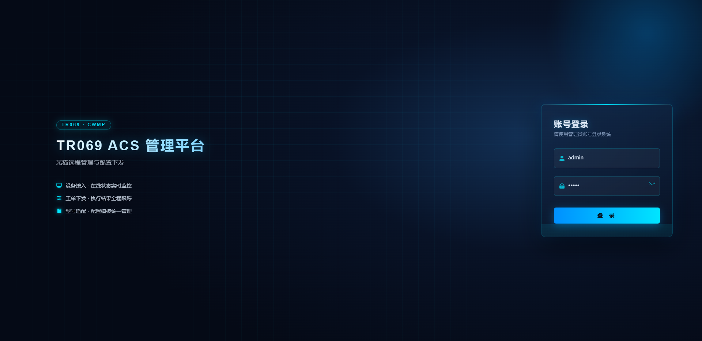

### 首页概览

设备 / 在线 / 离线 / 下发统计、光猫品牌分布、工单与模板统计、快速入口：

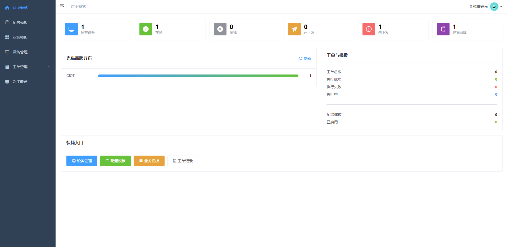

### 设备管理与机型适配

设备列表展示厂商、型号、软硬件版本、PON 数量；业务状态列直读 WAN 连接 / WiFi / SIP；
注册信息含在线状态、探测 IP 与最近上报时间；右下角是批量运维工具条。
未适配的设备会先引导做机型适配：

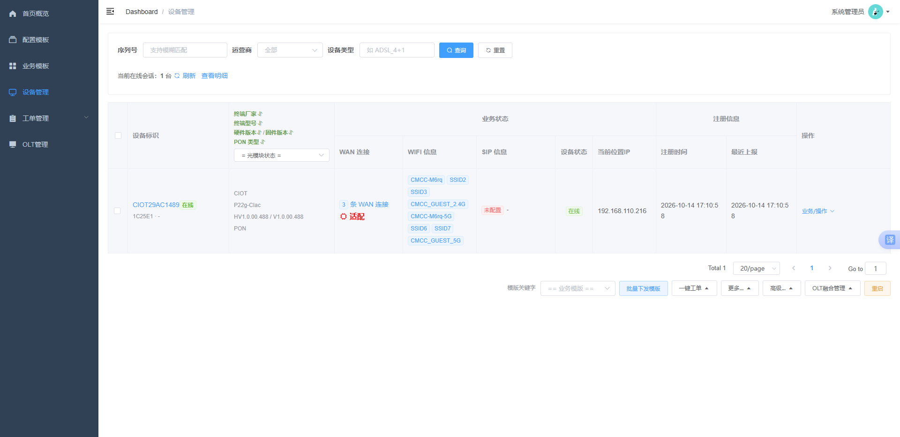

机型适配：人工申报运营商、网口数、网口速率、SIP 数、WiFi 规格：

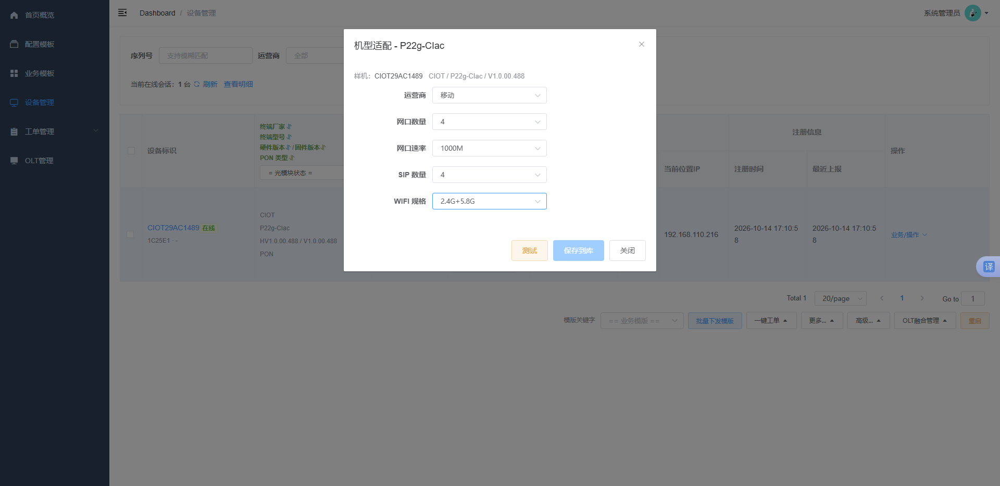

申报后先做试采集，把每个能力项映射到该型号真实的 CWMP 参数路径，结果实时回显：

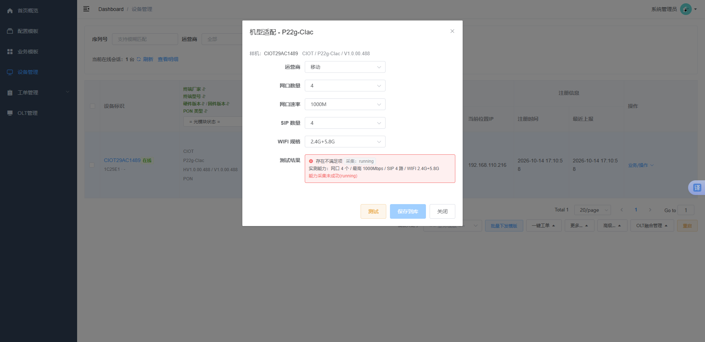

测试通过后逐项给出「能力 ↔ 下发意图数据」对照，一键保存为该型号的适配档案，
申报的运营商会同时登记到设备台账：

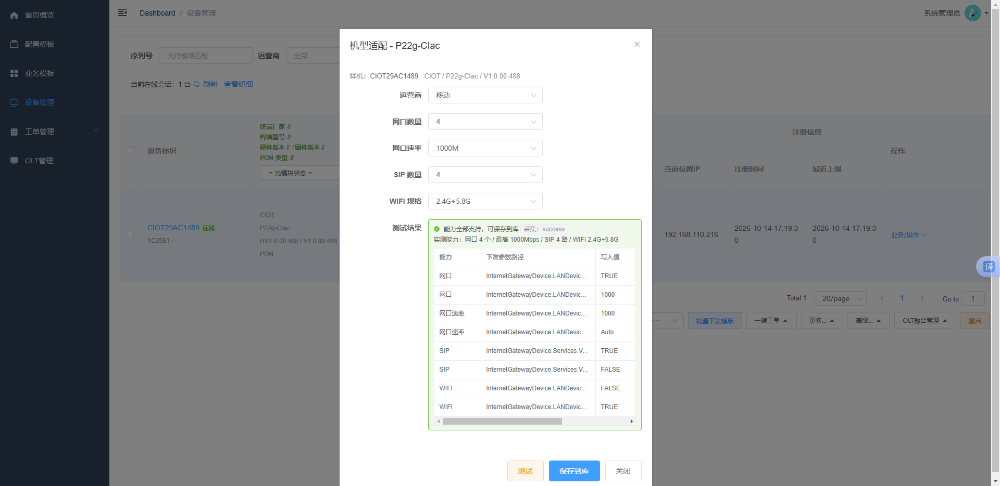

适配完成后，设备转为「已适配」，业务状态按真实数据展示：

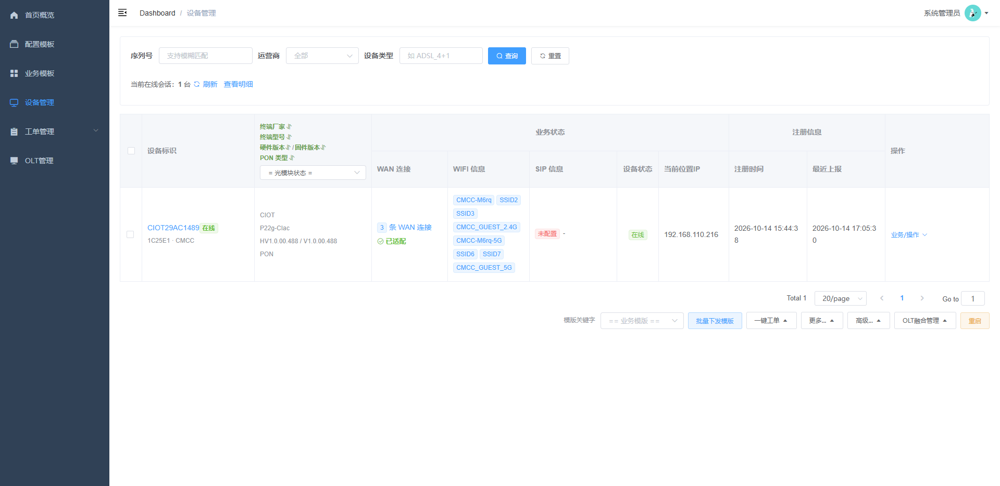

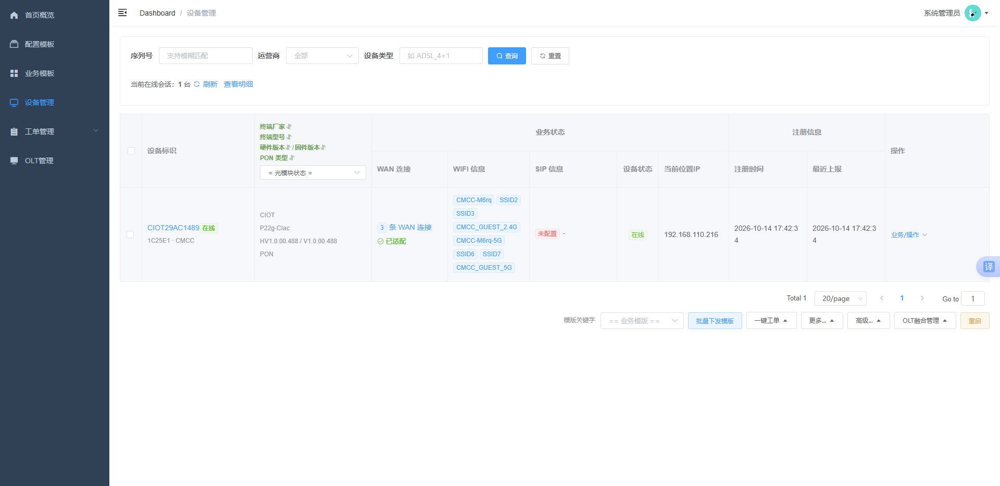

### 设备列表与业务详情（最新）

设备列表（列从左到右）：SN/备注、终端信息（厂家 / 型号 / 硬件固件版本 / PON 类型 + 光功率，表头可排序）、
业务状态（WAN 连接 + **LAN 网口图标**、**WIFI 按 2.4G / 5.8G 上下分行**、SIP 信息、设备状态）、
**运行信息**（运行时长 / 加入时间 / 最后汇报时间 / 汇报 IP，表头可排序）、操作：

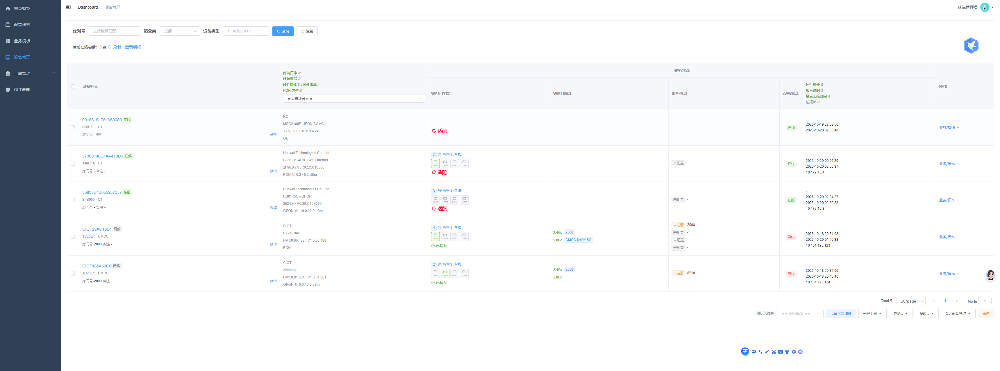

设备详情业务面板：信息卡（运行时长 / 注册时间 / 最近上报 / 上报 IP）、WAN 连接、LAN 网口（插线绿色、
未插灰色，悬停看 MAC）、WLAN 按 2.4G / 5.8G 分行、SIP 语音（只列真实线路实例）：

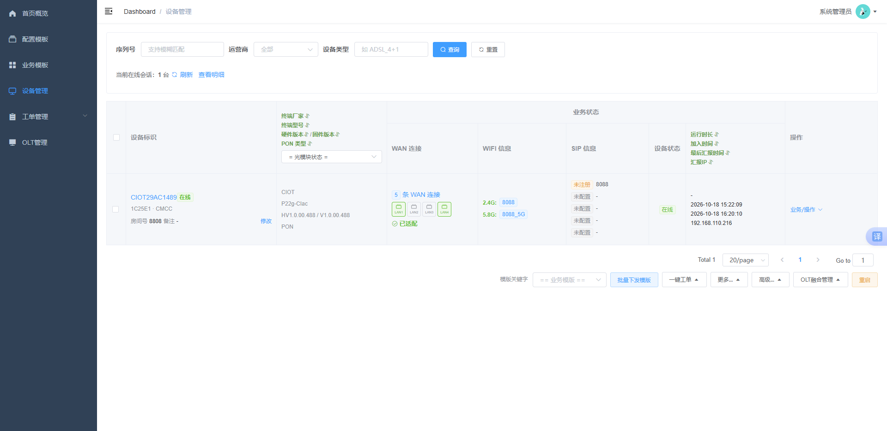

### OLT 管理（演示数据）

OLT 资源、板卡、PON 口与 ONU 在线统计。注意：页面当前数据为前端模拟，
真实采集见「待实现」#6：

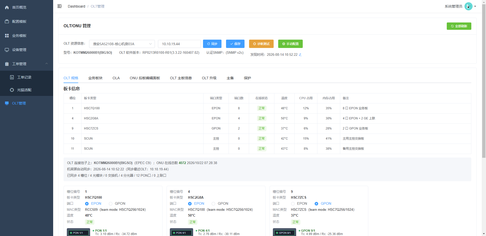

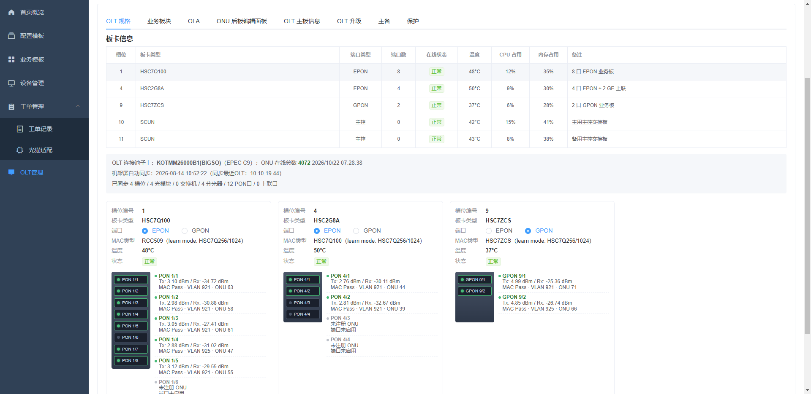

---

## 1. 已实现

### 1.1 后端

| 能力 | 说明 | 主要位置 |
| --- | --- | --- |
| CWMP 接入 | Inform / 空 POST 探活 / RPC 响应三条链路，digest 认证（可 `auto` 免认证），多端口 + 多路径兼容各厂商上报 | `acs/controller/CwmpController`、`acs/auth/CpeAuthenticator`、`common/web/CwmpMultiPortConfig` |
| 协议层 | SOAP 解析/封装、RPC 方法枚举、命名空间 | `cwmp/*` |
| 会话管理 | 会话状态机、待回应 RPC、超时兜底；周期上报视为心跳与会话接管（CPE 换 TCP 连接不重建会话、不打离线、不清待下发队列），离线只按长期无通信判定，疑似双会话仅告警 | `acs/session/*` |
| 设备管理 | 设备自动注册、在线状态、分页详情、在线会话明细 | `acs/service/DeviceRegistryService`、`api/controller/DeviceController` |
| 能力树采集 | 只采集 WAN / WiFi / LAN 网口 / SIP 四类子树：GetParameterNames 拉路径 + GetParameterValues 分批读值，Inform 后自动采集、BOOTSTRAP 强制重采、NextLevel 兜底 | `acs/service/DeviceCapabilityService` |
| **按运营商采集标准** | 移动 / 电信 / 联通 / 广电各一份采集标准（业务子树 + GPN 策略 + 实例探测 + 已知路径探测），**写死在代码** `CapabilityProfiles#builtin`，现场不用维护配置；台账运营商为空时走通用档，采到私有前缀（`X_CMCC_` / `X_CT-COM_` / `X_CU_`）后回写台账供下一轮采集选标准 | `acs/model/Isp`、`acs/config/CapabilityProfiles`、`DeviceCapabilityService` |
| 参数树导出 | 按型号导出能力树到 `configuration/models/`，并可按设备定位模型文件 | `worklist/service/ModelTreeStore` |
| 业务快照 | `device` / `wan` / `wifi` / `lan` / `sip` / `pon` 分区，支持单台与整页批量读；LAN 区补插线状态（`connected`）与 MAC、SIP 区只保留真实线路实例（剔除 `VoiceProfile.{n}.SIP.` 汇总对象）、台账的注册时间与最近上报时间一并返回 | `acs/service/DeviceBusinessService` |
| **LAN 网口状态自动刷新** | 定时（默认 5 分钟）对在线设备重读网口状态叶子（`Enable/Status/X_CT-COM_*LineStatus/MAC/速率`），拔插网线后页面不必手动点「重新采集」；只刷在线设备、只读网口那几个叶子，等回值超时不判失败（指令仍在队列里） | `acs/service/LanStatusRefreshService`、`DeviceBusinessService#lanStatusPaths` |
| **超管账号查询** | `GET /api/device/{sn}/admin-account`：对在线设备实时读 `User.{i}.Username/Password` 并明文返回；离线直接返回 `offline`；能力树没采到时按 TR-098 / TR-181 标准路径兜底；整批被拒时逐条重发，共用 30s 总预算；只认 `.User.{i}.` 下的账号，WAN 拨号账号不会被误收 | `acs/service/DeviceAccountService`、`api/controller/DeviceController` |
| 型号语义映射 | `cpe_model` + `model_param_mapping` / `model_object_mapping`：业务字段 ↔ 型号真实 CWMP 路径，支持按 SN 推荐候选路径 | `worklist/controller/ModelMappingController`、`ModelMappingService` |
| 机型适配 | **先采集后归档**：不管哪家运营商的猫，采完先把能力树 XML 截到 `configuration/models/standard/standard/{型号}.xml` 并入库；人工申报运营商 / 网口数 / 速率 / SIP 数 / WiFi 规格时先试采集逐项验证，通过后按申报运营商另立档案（XML + 适配 yml）；申报运营商同步写回设备台账，列表与详情按台账展示 | `worklist/service/ModelAdaptationService`、`ModelTreeStore` |
| RPC 下发（异步） | 下发返回任务号，按任务号轮询结果；超时统一收尾 | `agent/RpcDispatchService`、`queue/RpcTaskQueue`、`api/controller/RpcTaskController` |
| 队列削峰 | 上报与下发走 Redis 队列，Redis 不可用时降级为进程内处理 | `queue/*` |
| **配置意图模板** | 入库 `config_template`，只描述开通意图（不下发任何数据）：7 类（WAN DHCP / WAN PPPoE / WAN 静态IP / WAN 桥接 / 2.4G WiFi / 5.8G WiFi / SIP），各类自带意图字段；支持 `/meta` 字段定义、列表、详情、保存、删除 | `template/*`（`ConfigTemplateService`、`ConfigTemplateController`） |
| 业务模板 | 多张意图模板编排成一个业务包：列表、详情、保存、删除、下发前自检 `/validate`、下发记录查询 | `biz/*`（`BizTemplateService`、`BizTemplateExecutionService`） |
| **工单下发（管理端）** | `POST /api/worklist/instances` 建单即以 `worklistDesc` 做幂等键，落库后立刻转下发任务（`IntentDeliveryService`，`source=worklist`），任务结束按 `TaskFinishedEvent` 回写终态与失败原因；工单与步骤记录可查 | `worklist/service/WorklistDeliveryService`、`worklist/controller/WorklistExecuteController` |
| 首页概览 | 在线/离线、品牌分布、模板统计（模板数改为统计意图模板） | `api/service/DashboardService` |
| 数据模型适配 | TR-098（`InternetGatewayDevice.`）与 TR-181（`Device.`）双模型：Inform 参数多数判定根节点、业务前缀按双模型展开、型号档案与能力树 XML 记录数据模型并对账 | `acs/model/DataModel`、`InformService`、`DeviceBusinessService` |
| **意图下发执行器** | 意图字段 + 型号语义映射 → CWMP 路径与值 → 按需 `AddObject` 再分批 `SetParameterValues`，全程写进 `device_task`；同 `taskNo` 幂等 | `exec/*`（`IntentDeliveryService`、`IntentPlanRenderer`） |
| **北向接口** | 独立端口 8899 + `/openapi/v1/**：设备台账/在线/能力树/业务快照/工单结果查询、下发受理与结果查询、Webhook 事件推送（上下线、下发结束），复用管理端 JWT 鉴权 | `openapi/*` |
| 管理端鉴权 | JWT 登录、`sys_user` 查库、首次启动写入初始管理员、JWT 拦截器 | `api/controller/AuthController`、`config/AdminAuthInterceptor` |
| 启动自检 | 各业务表补建/初始化、可选只读表存在性校验 | `common/startup/*` |

### 1.2 前端（`web/`）

| 菜单 | 路径 | 状态 |
| --- | --- | --- |
| 首页概览 | `/dashboard` | 已实现 |
| 配置模板 | `/template/list` | 已实现（意图模板，按类型渲染意图字段；**高级模式/文件模板已彻底删除**） |
| 业务模板 | `/biz/list` | 已实现（编排 + 成员视图 + 自检 + 整包串行下发，支持出错继续） |
| 设备管理 | `/device/list` | 已实现（列表/详情/业务信息/WAN 参数弹窗/在线明细 + **右下角批量工具条** + **LAN 网口图标** + **WIFI 按 2.4G/5.8G 上下分行** + **运行信息列**（运行时长/加入时间/最后汇报时间/汇报IP，可排序）+ **查询超管密码弹窗**） |
| 设备详情 | `/device-detail/:sn` | 已实现（能力树、参数树、RPC 调试 + 业务面板：信息卡改为运行时长/注册时间/最近上报/上报IP、LAN 网口区块、WLAN 按频段分行、SIP 只列真实线路） |
| 工单记录 | `/worklist/instances` | 已实现（工单与步骤查询；批量建单入口在设备列表工具条「一键工单 ▲」） |
| OLT 管理 | `/olt/management` | **界面已实现，全量为前端模拟数据** |

设备列表右下角工具条（`web/src/views/device/list.vue`，需先勾选设备）：

| 分组 | 已接通 | 占位（待后端） |
| --- | --- | --- |
| 模版关键字 + 批量下发模版 | 模板下拉已接意图模板与业务模板；按选中模板对勾选设备逐台建单 / 建执行记录 | 整批进度看板、失败一键重试 |
| 一键工单 ▲ | 工单记录跳转 + 批量开通 / 检修工单（逐台建单，每台独立流水号，最后汇总失败清单） | — |
| 更多… ▲ | 恢复出厂 / 深度恢复出厂 / 清零类 → `FactoryReset`；**查询超管密码**（对勾选设备逐台实时读 `User.{i}.Username/Password`，弹窗明文展示，单台超时/离线不影响其它台） | Telnet 开关、WAN 侧访问、一键 WiFi、禁用 SIP、删除 WAN 连接、解除上网限制、删除缓存、标记置换 |
| 高级… ▲ | 导出设备（CSV）、下发自定义 TR069 参数（弹窗 → `SetParameterValues`）、调试指令（弹窗 → 任意 RPC）、刷新状态 | Telnet 命令、去除 SSID 前缀、修复 SIP/桥接、导出/克隆配置文件、强制上报 |
| OLT融合管理 ▲ | OLT/ONU 管理（跳转 OLT 页） | OLT 拓扑 |
| 重启 | 批量 `Reboot`（带二次确认） | — |

### 1.3 光猫型号适配清单

清单单独维护在 **[doc/ADAPTED_MODELS.md](./doc/ADAPTED_MODELS.md)**（只记运营商 + 厂家型号，
适配一台加一行）。适配档案本身在便携化 SQLite 模板库 `configuration/tr069_tpl.pack`
（配置项 `acs.tr069tpl.db-path`），随仓库走，拷到部署机即识别为已适配，不必重新适配。

- **已适配 3 款**：
  - CMCC 移动 `CIOT P22g-CIac`
  - CMCC 移动 `CIOT ZNM802`
  - CT 电信 `B866-S1-4E1P3W1-Ethernet`（XGPON 机型，现场按 Ethernet 上行，见下方备注）
- **适配中 2 款**：
  - CT 电信 `HS8145C5-GPON` —— 能力树已归档（360 对象 / 1947 参数），待申报保存
  - `MSG2100E-UPON-8V-AC` —— GPN 固件不可用（一律 9002），改按已知路径取到 26 对象 / 12 参数，
    待申报保存；运营商待台账确认（Inform 上报了 `X_CT-COM_UserInfo`）

> `B866-S1-4E1P3W1` 硬件是 **XGPON** 上行，这台改成 **Ethernet 上行**后上报的 ProductClass
> 是 `B866-S1-4E1P3W1-Ethernet`，档案也按它归档。若哪天切回 XGPON，ProductClass 会跟着变，
> 需要重新适配一台。

---

## 2. 待实现 / 进行中

| # | 事项 | 当前状态 | 说明 |
| --- | --- | --- | --- |
| 1 | ~~**意图模板下发执行器**（核心）~~ | **已实现** | `exec/IntentDeliveryService`：意图字段 + `model_param_mapping` / `model_object_mapping` → 渲染下发计划（`{i}` 实例号替换、只读与必填校验）→ `AddObject` + 分批 `SetParameterValues`，状态落 `device_task`。下一步是补 WiFi / SIP 之外的更多意图字段（见 #8） |
| 2 | 批量下发模版 | **部分实现** | 业务模板整包批量下发已接通（逐台一条执行记录，汇总成功/失败清单）；配置意图模版批量下发走「批量下发模版」入口建工单。待补：整批进度看板、失败一键重试 |
| 3 | ~~业务模板整包下发~~ | **已实现** | `POST /api/biz-template/execute`：按成员顺序串行执行，执行记录写 `biz_template_execution`；成员失败按模板 `continueOnError` 决定停下还是继续，继续跑完且有失败记 `partial` |
| 4 | ~~一键工单（开通 / 检修）~~ | **已实现** | 设备列表勾选后按台建单，每台一个独立流水号（`worklistDesc` 幂等），单台失败记录但继续其余设备，最后汇总失败清单 |
| 5 | 设备批量运维指令后端 | 部分接通（**超管密码已接通**） | Telnet 开关与命令执行、WAN 侧访问、WiFi 开关、禁用 SIP、删除 WAN 连接、解除上网限制、SSID 前缀清理、配置文件导出/克隆、强制上报等需逐个按厂商/型号补齐参数路径（统一走型号映射，不写死路径）。超管账号查询已可用，但依赖设备在线且该型号把 `User.{i}.Username/Password` 暴露给 TR-069 |
| 6 | OLT 融合管理真实数据 | 模拟数据 | `web/src/views/olt/management.vue` 全为前端 mock；需接 SNMP/Telnet 采集：OLT 资源、板卡、槽位、PON 口（Tx/Rx 光功率、MAC、VLAN、ONU 数），数据替换集中在页面顶部 `resources` / `olt` 两个对象 |
| 7 | 存量数据迁移 | 未开始 | 存量 `biz_template_item.template_key` 仍是旧文件 key，`BizTemplateService.parseId` 会判定为“配置模板不存在”，需迁移脚本改为 `config_template.id` |
| 8 | 意图字段扩展 | 进行中 | 现 WAN 类仅 IP 协议 / VLAN 使用与否 / 是否绑定端口；待补 WAN IP 获取方式、PPPoE 账号、SIP 服务器/账号、WiFi SSID/密码等意图（VLAN ID、具体端口仍不落库，由下发时决定） |
| 9 | 旧机制彻底清理 | 基本完成 | 旧文件模板 / 向导编译 / 旧工单编排引擎已删，工单改走 `IntentDeliveryService`；`worklist` 包中保留档案、型号映射、能力树导出与工单建单/查询，收尾时可再审视命名 |
| 10 | 其它 | 未开始 | 下发操作审计日志细化、权限角色细化、设备告警（光功率劣化、离线批量提醒）、离线判定阈值按设备实际周期上报间隔（`PeriodicInformInterval`）动态计算（当前固定 120 秒，周期不是 60 秒的型号需手调）等 |
| 11 | 界面展示收尾 | 未开始 | ① 设备列表 LAN 网口超过 4 个时的折叠（`+N`）或横向滚动，当前会横向溢出；② 业务**采集**阶段跳过未启用的 SSID（现在只是展示层过滤，采集仍全量读）；③ 详情页未启用 SSID 的视觉区分，当前只靠状态列文案「已禁用」；④ 运行信息列的排序只作用于当前页（后端分页排序暂未打通） |

---

## 3. 技术栈

| 层 | 选型 |
| --- | --- |
| 后端 | Spring Boot 3.2.5、Java 21、MyBatis-Plus 3.5.7、MySQL Connector/J、Spring Data Redis（Lettuce）、JJWT 0.12.6、Lombok、Jackson、SnakeYAML（光猫档案） |
| 前端 | Vue 2.6 + vue-router + Vuex + Element UI 2.13 + axios（vue-admin-template） |
| 存储 | MySQL 8 / MariaDB 10.6+，Redis 6+（可选，关闭则进程内处理） |

## 4. 端口

| 端口 | 用途 | 配置项 |
| --- | --- | --- |
| 8888 | 管理端页面与 `/api` | `server.port` |
| 8899 | **北向接口** `/openapi/v1/**`（上层系统对接），与管理端端口隔离 | `acs.openapi.port` |
| 9090 / 8082 | 光猫上报监听 | `acs.cwmp.listen-ports` |
| 9528 | 前端开发服务器（代理 `/dev-api` → `http://127.0.0.1:8888/api`） | `web/vue.config.js` |

## 5. 目录结构

```
javaacs/
├── README.md                 本文档
├── API.md                    接口文档（管理端 /api 与北向 /openapi/v1）
├── doc/
│   ├── DEPLOYMENT.md         部署文档
│   ├── ADAPTED_MODELS.md     光猫型号适配清单（已适配 / 适配中）
│   ├── DEBUGGING.md          设备能力采集调试记录（踩坑与验证）
│   └── Display/              界面截图（Debug/ 下为采集调试截图）
├── pom.xml                   后端（Maven）
├── sql/schema.sql            全库唯一建表脚本（所有表）
├── deploy/
│   └── config/application.yml.example   外置配置模板
├── src/main/java/com/tr069/acs/         后端源码
├── src/main/resources/
│   └── application.yml                  默认配置
└── web/                      前端工程（构建产物 dist/ 不入库）
```

外部配置目录（默认 `./configuration`；相对路径按 **jar 所在目录**解析，与进程工作目录无关，
见 `acs.worklist.root-path`）：

```
configuration/
└── models/      型号能力树 {isp}/{型号标识}.xml（由能力树导出生成）
                 新猫一律先落 standard/（与移动那台当初一样），按运营商分目录在人工适配申报时
```

> 旧版的 `operators/` 工单模板目录已废弃，模板改为入库；
> 光猫适配档案也迁到了 SQLite 模板库（`acs.tr069tpl.db-path`），不再放 YAML 档案。

## 6. 后端包结构

`com.tr069.acs` 下按职责分包：

| 包 | 职责 |
| --- | --- |
| `acs` | CWMP 接入主体：`controller` 上报入口、`service` 注册/Inform/能力采集/业务快照、`session` 会话与待回应 RPC、`auth` digest 认证 |
| `cwmp` | 协议层：SOAP 解析与封装、RPC 方法枚举、命名空间、结构体模型 |
| `queue` | Redis 队列：上报队列与消费者、RPC 指令队列与任务登记表 |
| `agent` | RPC 下发与结果回填调度（异步任务号） |
| `template` | **配置意图模板**：实体、Mapper、Service、Controller（意图字段定义集中在 `ConfigTemplateService#FIELD_DEFS`） |
| `biz` | 业务模板：编排实体、成员视图、执行记录、下发前自检 |
| `worklist` | 光猫档案（`loader`/`registry`/`model`）、型号语义映射（`ModelMappingService`）、能力树导出（`ModelTreeStore`）、机型适配（`ModelAdaptationService`）、工单建单与查询（`WorklistDeliveryService`、`controller/WorklistExecuteController`） |
| `api` | 管理端接口：设备、能力、业务、RPC 任务、统计、登录及其 Service |
| `exec` | **意图下发执行器**：下发计划渲染（`IntentPlanRenderer`）、执行与任务表（`IntentDeliveryService`、`DeviceTask`）、任务结束事件 |
| `openapi` | **北向接口**：端口与路径隔离（`config`）、查询/下发/事件订阅三个 Controller、Webhook 推送与事件投递、设备上下线侦测（`watch`） |
| `domain` / `mapper` | 主库实体与 Mapper |
| `common` | 统一响应 `Result`、分页、全局异常、启动自检、Web 配置（多端口、路径分发） |
| `config` | JWT 拦截器、跨域、MyBatis-Plus、SPA 路由回退 |

## 7. 前端结构

```
web/src/
├── api/            device / rpc / configTemplate / bizTemplate / dashboard / worklist / user
├── views/
│   ├── dashboard/  首页概览
│   ├── device/     设备列表 list.vue、设备详情 detail.vue
│   ├── worklist/   templates.vue（意图模板）、instances.vue（工单记录）、profiles.vue（光猫适配）
│   ├── biz/        业务模板 template.vue
│   ├── olt/        OLT/ONU 管理 management.vue（模拟数据）
│   └── login/ 404.vue
├── components/     DeviceBusinessPanel（业务面板）、DeviceIdentityCell（终端信息列）、DeviceRuntimeCell（运行信息列）等
└── router/         菜单与路由
```

## 8. 本地开发

```bash
# 1) 建库并建表
mysql -u root -p -e "CREATE DATABASE tr_acs DEFAULT CHARACTER SET utf8mb4;"
mysql -u root -p tr_acs < sql/schema.sql
# 脚本幂等（CREATE TABLE IF NOT EXISTS）；存量库漏表时启动会自动补齐

# 2) 启动后端（8888），按需改 src/main/resources/application.yml
mvn spring-boot:run

# 3) 启动前端（9528，已配置代理转发到 8888 的 /api）
cd web
npm install --legacy-peer-deps
npm run dev
```

浏览器打开 `http://127.0.0.1:9528`，首次启动会创建初始管理员 **admin / admin**（仅当 `sys_user` 为空），登录后请立即改密码。

构建校验：

```bash
mvn -q compile                 # 后端
cd web && npx vue-cli-service lint --no-fix    # 前端 lint
```

光猫接入、打包上线、故障排查见 [doc/DEPLOYMENT.md](./doc/DEPLOYMENT.md)。

## 9. 关键配置速查

| 配置项 | 默认 | 说明 |
| --- | --- | --- |
| `acs.cwmp.listen-ports` | `9090,8082` | 光猫上报端口，逗号分隔 |
| `acs.cwmp.cpe-path` | `/ACS-server/ACS` | 上报主路径 |
| `acs.cwmp.extra-cpe-paths` | `/acs,/cwmp,/tr069,/` 等 | 兼容的上报路径，遇到 405 时在此追加 |
| `acs.auth.cpe-to-acs-username/password` | `auto` | 光猫连 ACS 的账号；`auto`/留空即免认证，上线前改回真实账号 |
| `acs.capability.enabled` / `collect-on-inform` | `true` | 能力树采集总开关与 Inform 后自动采集 |
| `acs.device.capability.auto-detect-isp` | `true`（写死在代码，不落配置） | 按能力树私有前缀（`X_CMCC_` / `X_CT-COM_` / `X_CU_`）识别运营商并回写台账，只补台账上还没有运营商的设备 |
| `acs.device.capability.profiles.<CMCC\|CT\|CU\|CBN\|standard>` | 不配置（用 `CapabilityProfiles#builtin` 写死的那份） | **按运营商采集标准的临时覆盖**：只在排障时写，可覆盖子树清单、`gpn-strategy`（递归优先 / 逐层优先）、`instance-probe` 与 `max-instances`（父对象 GPN 被拒时按 `1..N` 实例号逐个探）、`probe-paths`（GPN 全失败时直接 GPV 的已知路径） |
| `acs.config-template.auto-create-table` | `true` | 启动时补建 `config_template` |
| `acs.worklist.root-path` | `./configuration` | 外部配置根目录（`models/`）；相对路径按 jar 所在目录解析，从任何工作目录启动都指向同一处 |
| `acs.queue.enabled` | `true` | 关掉则退回进程内处理 |
| `acs.device.account.read-timeout-seconds` | `30` | 查询设备本地账号（超管密码）时等设备回值的最长时间（秒） |
| `acs.device.lan.auto-refresh.enabled` | `true` | LAN 网口状态定时自动刷新总开关 |
| `acs.device.lan.auto-refresh.interval-millis` | `300000` | 自动刷新间隔（毫秒），默认 5 分钟 |
| `acs.device.lan.auto-refresh.wait-seconds` | `120` | 单轮等待设备回值的上限（秒），超时不判失败 |
| `acs.device.lan.auto-refresh.max-devices-per-round` | `200` | 单轮最多刷新多少台 |
| `acs.agent.rpc-timeout` | `510` | 单条 RPC 等待设备回应的超时（秒） |
| `acs.exec.request-timeout-seconds` | `90` | 下发等待设备回应的超时（秒） |
| `acs.openapi.port` | `8899` | 北向独立端口，置 0 则挂到管理端口下 |
| `acs.openapi.path-prefix` | `/openapi/v1` | 北向路径前缀，鉴权与端口隔离都按它判定 |
| `acs.openapi.webhook.max-attempts` | `5` | 事件推送最大重试次数 |
| `admin.jwt.expire-hours` | `12` | 管理端 token 有效期（小时） |

> 管理端 JWT 签名密钥不在任何配置文件里：`JwtSecretProvider` 从进程工作目录下的
> `target/secret.xml` 加载，首次启动自动生成；初始管理员账号由 `sql/schema.sql` 建库时写入。

## 10. 北向接口（`/openapi/v1`）

独立端口 **8899**，路径前缀 `/openapi/v1`。鉴权复用管理端 JWT：`POST /api/user/login` 或
`/vue-admin-template/user/login` 拿到 token 后，北向请求带 `X-Token` 或 `Authorization: Bearer`。

**端口隔离**：8899 上只提供 `/openapi/v1/**`，访问其它路径一律 404；反过来管理端口与上报口
也不提供北向路径。CORS 只对管理端路径放开，北向是服务端到服务端调用，不需要跨域。

### 10.1 查询（只读）

| 方法 | 路径 | 说明 |
| --- | --- | --- |
| GET | `/devices` | 设备台账分页：`keyword`、`isp`、`page`、`size` |
| GET | `/devices/{sn}` | 台账 + 能力汇总，返回 `rootNode` 与 `dataModel`（TR-098 / TR-181） |
| GET | `/devices/{sn}/online` | 在线状态、会话状态、最近上报时间 |
| GET | `/devices/{sn}/capability/tree?parent=` | 能力树某一层，不带 `parent` 返回根节点层 |
| GET | `/devices/{sn}/capability/params?prefix=` | 参数值清单，可按路径前缀过滤 |
| GET | `/devices/{sn}/business` | 业务快照：device / wan / wifi / sip / pon 分区，读库不等设备 |
| GET | `/devices/{sn}/deliveries` | 该设备的下发任务历史 |
| GET | `/devices/{sn}/work-orders` | 工单执行结果 |

### 10.2 下发

| 方法 | 路径 | 说明 |
| --- | --- | --- |
| GET | `/deliveries/meta` | 业务类型 ↔ 业务对象对照与意图模板清单 |
| POST | `/deliveries` | 受理一次下发：`{taskNo, sn, category, templateId?, values, createInstance?}` |
| GET | `/deliveries/{id}` | 按内部 id 查结果 |
| GET | `/deliveries?taskNo=` | 按外部单号查结果 |
| GET | `/deliveries` | 任务列表，可按 `sn`、`status` 过滤 |

下发是**异步**的：ACS 只能在设备上报后的那次空 POST 里捎带指令，什么时候发出去取决于设备
心跳周期。返回 `PENDING` / `RUNNING` 都是正常中间态，最终结果轮询上述查询接口或等 Webhook。

任务状态：`PENDING` 受理中 / `RUNNING` 已下发等回应 / `SUCCESS` 设备确认写入 /
`FAILED` 设备故障或超时 / `REJECTED` 未下发（型号未适配、设备离线、缺必填意图字段）。

**幂等**：`source + taskNo` 唯一，重复提交只受理一次，网络重试不会导致重复开通。

### 10.3 事件推送

| 方法 | 路径 | 说明 |
| --- | --- | --- |
| GET | `/events/types` | 支持的事件类型 |
| GET/POST | `/events/subscriptions` | 订阅列表 / 新增或修改订阅（含 `secret`、`eventTypes`） |
| DELETE | `/events/subscriptions/{id}` | 删除订阅 |
| GET | `/events/subscriptions/{id}/deliveries` | 推送记录：`status`、`attempts`、`responseCode` |
| POST | `/events/test` | 发一条测试事件，验证回调与签名 |

事件类型：`device.online`、`device.offline`、`delivery.finished`（成功/失败/拒绝都会推）。

推送请求带三个头：`X-ACS-Event-Id`（接收方据此去重）、`X-ACS-Event-Type`、
`X-ACS-Signature`（`HMAC-SHA256(body, secret)` 的 Base64）。失败按 **30s × 2^n** 退避重试，
默认最多 5 次；投递记录先落库再推，ACS 重启也不会丢。

> 以上只是索引。**完整接口文档（含管理端全部 `/api` 接口、请求/响应示例、错误原因对照表）见
> [`API.md`](API.md)**。
