# javaacs

[English](./README.en.md) | 简体中文

TR069 ACS（Java 版）—— 基于 CWMP/TR069 协议的光猫远程管理平台，Spring Boot 3 + Vue 2 实现。

- **仓库地址：国内 [Gitee](https://gitee.com/kangweft/tr069) ｜ 国外 [GitHub](https://github.com/tangsky001/tr069)**（同源同步，按网络就近访问；截图在国内加载不出来就去 Gitee 看）
- 部署步骤见 **[doc/DEPLOYMENT.md](./doc/DEPLOYMENT.md)**
- 已适配光猫型号见 **[doc/ADAPTED_MODELS.md](./doc/ADAPTED_MODELS.md)**
- 前端工程见 [web/](./web)
- 界面截图见 [doc/Display/](./doc/Display)（见下文「效果展示」）
- 想一起开发？见 **[第 11 节 仓库与共建](#11-仓库与共建)**

> 配置下发链路重构已**基本落地**：模板从「文件 + 步骤编排」改为**入库的意图模板**，
> 下发由「意图 + 型号映射」在运行时生成真实 CWMP 参数（`exec/IntentDeliveryService`），
> 工单与业务模板整包下发都跑在这条链路上。OLT 融合管理已接真实 Telnet 采集（华为 MA5683T 实测），
> 但**只做到「读」**：采集回来展示，**不下发任何写命令**（建 VLAN、增删 ONT、重启板卡都没实现）。
> 模板类标签页（DBA/线路模板、业务/TR069/流量模板）已按真实命令采到设备当前配置，
> 但页面上的「新增 / 删除」按钮仍是占位。
>
> 「ONT 配置/状态」表按现场习惯排好了列：认证码 (SN) → **管理IP** → **MAC** → **业务流**
> → **线路模板** / **业务模板**（两列拆开），行尾是按需查询的图标；
> 表右下角有**重启ONU / 删除注册**两个批量按钮（勾选行后生效，当前只提示未开放）。
>
> **按需查询（点一下才登设备查一次）**：点 SN / 模板列 →
> `display current-configuration ont 0/<槽位>/<端口> <ONT ID>`（授权信息，顺带从
> `display ont info` 取管理 IP）；点 ONT ID → `display ont capability 0/<槽位> <端口> <ONT ID>`
> （硬件能力/状态）；点业务流「查看」 → `display service-port port 0/<槽位>/<端口> ont <ONT ID>`
> （业务流）；行上的图标 → 光信息 / 版本 / 注册历史。
>
> 逐项清单见 **[1.5 OLT 标签页：已实现 / 占位](#15-olt-标签页已实现--占位)**，剩余待办见第 2 节。

---

## 效果展示

全部截图在 [`doc/Display/`](./doc/Display)。

### 登录

左侧品牌区 + 右侧账号卡片，深色科技风：


### 首页概览

设备 / 在线 / 离线 / 下发统计、光猫品牌分布、工单与模板统计、快速入口：


### 设备管理与机型适配

设备列表展示厂商、型号、软硬件版本、PON 数量；业务状态列直读 WAN 连接 / WiFi / SIP；
注册信息含在线状态、探测 IP 与最近上报时间；右下角是批量运维工具条。
未适配的设备会先引导做机型适配：


机型适配：人工申报运营商、网口数、网口速率、SIP 数、WiFi 规格：


申报后先做试采集，把每个能力项映射到该型号真实的 CWMP 参数路径，结果实时回显：


测试通过后逐项给出「能力 ↔ 下发意图数据」对照，一键保存为该型号的适配档案，
申报的运营商会同时登记到设备台账：


适配完成后，设备转为「已适配」，业务状态按真实数据展示：


### 设备列表与业务详情（最新）

设备列表（列从左到右）：SN/备注、终端信息（厂家 / 型号 / 硬件固件版本 / PON 类型 + 光功率，表头可排序）、
业务状态（WAN 连接 + **LAN 网口图标**、**WIFI 按 2.4G / 5.8G 上下分行**、SIP 信息、设备状态）、
**运行信息**（运行时长 / 加入时间 / 最后汇报时间 / 汇报 IP，表头可排序）、操作：

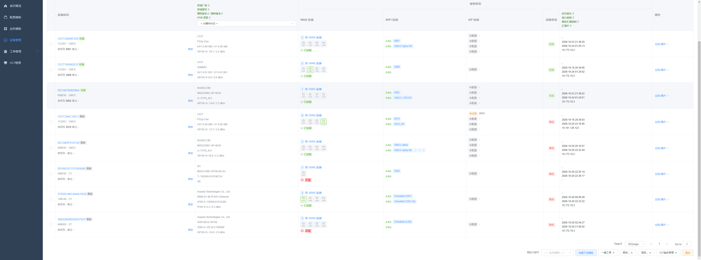

设备详情业务面板：信息卡（运行时长 / 注册时间 / 最近上报 / 上报 IP）、WAN 连接、LAN 网口（插线绿色、
未插灰色，悬停看 MAC）、WLAN 按 2.4G / 5.8G 分行、SIP 语音（只列真实线路实例）：


### OLT 管理（真实设备采集，**只读**）

Telnet 登录 OLT 命令行采集，已经在华为 MA5683T 上实测通过。

页面是**分厂商**的：台账入口按设备厂商把人送到对应的详情页——华为走 `huawei.vue`、
鸿升光走 `hsgq.vue`（整机一体化，没有板卡概念），还没认出来的走 `generic.vue`。
厂商是「测试连接」时用版本回显认出来的，随保存一起落库，添加完就直接进对应的页面。
下面这几张截图都是**华为面板**。

> **只能读，不能写。** 发往设备的命令全是 `display` / `show` 一类（`enable` → `config` 只是进配置视图，
> 温度、ONT、VLAN 这几条命令在该视图下才认，读完立刻 `quit`）。页面上那些标签页展示的都是**设备当前
> 配置的实际读数**，不是 ACS 下发的意图，也不提供任何写入口——改 VLAN、注册/删除 ONT、重启板卡都要
> 到设备命令行自己做。写操作见第 2 节 #15。

- **OLT 状态 / 配置信息**：型号、版本与补丁、背板、主控 MAC、运行时长、同步摘要；板卡卡片列出型号 / 运行状态 / 描述 / 温度 / 端口与 ONT 汇总；
- **机框视图**：按 **`display board 0` 槽位表里的槽位数**画机框（现场 MA5683T 是 0..12 共 13 格，空槽位也算；`device.slotCount`，没采到才按 12 兜底），**槽位 60 宽 / 700 高**、**板卡 55 宽**，上导轨风扇格栅 + 下导轨槽位号，板卡与槽位顶齐不留缝，**板卡整块插进对应槽位**——槽位号就是 SlotID；槽位里只放板卡本体（丝印、螺丝、助拔器、板卡灯、每口光口笼与状态灯），右侧逐口标注列在机框里省掉（60 宽放不下），端口的 RX / ONT / VLAN 用鼠标悬停 tooltip 看，点口展开 ONT 明细；没插板的槽位画成虚线空槽位；整框约 760 宽，一屏放得下 12 个槽位；
- **板卡面板（SVG）**：复刻 MA5683T 机框业务板外观，板卡竖着插在槽位里，**所有板卡统一槽位高度**（按 8 口满口的高度，2/4 口板下面留空白金属面板，和真机框一样齐平）（深灰金属底板、丝印、螺丝、顶部助拔器、RUN/ALM/ACT/ENV 灯），业务区上下两块：上面是 **`PON` 运行灯带**
——8 颗灯**独立渲染、分两列排**（0/2/4/6 左列、1/3/5/7 右列），每颗灯自带灯座 + 灯芯 + 外圈光晕
（绿闪=在线、红常亮=告警、灰=离线）；下面才是**一列竖排**的端口（每行一个 SFP 口笼 / RJ45 电口，
左边印口序号），灯不挂在端口上；**主控板另画管理区**：RESET 复位按钮 + `CON` 控制台口 + `ETH` 管理网口（Link/Act 双色灯嵌在口内）+ `ESC` 扩展口，竖排丝印和真板卡一致；口名、`发光/收光/温度/偏置/电压`、`ONT 在线/总数`、`接口号 0/1/0 · 放通的 VLAN` 放不进 55 宽的板卡，改成鼠标悬停 tooltip，`N ONT 在线` 整板汇总嵌在**板卡底部丝印上方**；点某个口在面板下方展开该口每条 ONT 的 ID / SN / 描述 / 在线-离线；
- **ONT 配置 / 状态**：按板卡分表，端口 × ONT 总数 / 在线 / 离线；每条 ONT 一行，列依次是
  认证码 (SN)、运行标志、**管理IP**、**MAC**、**业务流**、**线路模板**、**业务模板**、ONT 描述、状态、查询图标；
  行可勾选，右下角两个批量按钮：**重启ONU**、**删除注册**（未开放，点击提示）；
- **VLAN**：三层 VLAN 接口（VLAN ID / IP / 掩码）、上行 VLAN 透传（各上行口放通的 VLAN 与 Native VLAN）、VLAN 与二层互通（按类型合并成 `41、45-46`）、静态路由（目的网络 / 下一跳 / 出接口）；
- **采集记录**：每次同步与诊断的连接耗时、摘要、原始回显。

#### ONT 按需查询弹窗（点一次登设备查一次）

**[ONT 配置/业务流]**（点认证码 SN / 线路模板 / 业务模板列）

```
display current-configuration ont 0/<槽位>/<端口> <ONT ID>
display service-port port 0/<槽位>/<端口> ont <ONT ID>
display ont info 0 <槽位> <端口> <ONT ID>
```

弹窗：授权信息（SN / 描述 / 线路模板 / 业务模板）+ 业务流表（业务流ID / OLT网络侧VLAN / VLAN 类型 / GEM Port / 光猫用户侧VLAN / 上下行流量模版 / 编辑 / 选择，底部四个操作按钮均提示未开放）。

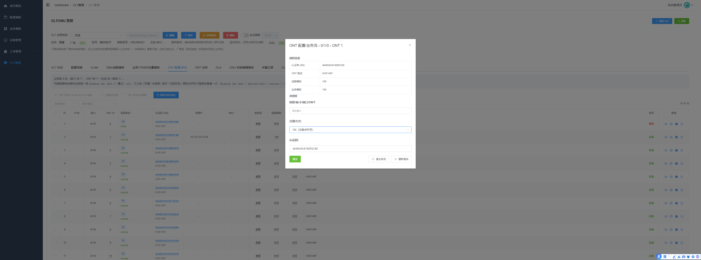

**[ONT 硬件能力/状态]**（点 ONT ID）

```
display ont capability 0/<槽位> <端口> <ONT ID>
```

弹窗：端口数 / T-CONT 数 / GEM port 数 / 流控类型 / ONT 类型 等，标签与值中英文回显都翻成中文。

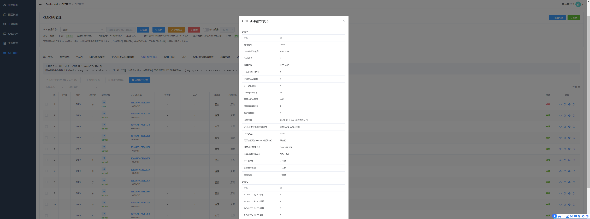

**[ONT 业务流]**（点业务流列「查看」）

```
display service-port port 0/<槽位>/<端口> ont <ONT ID>
```

弹窗：只放业务流表（列同上），不带授权信息。

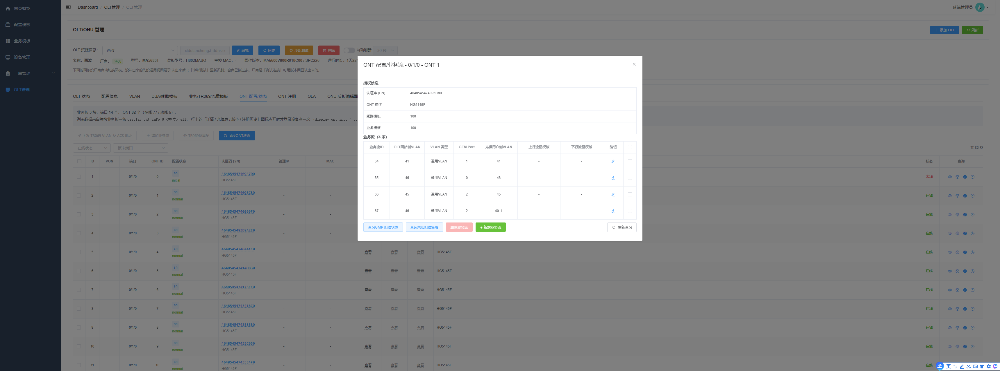

**[详情 / 光信息 / 版本 / 注册历史]**（点行上的眼睛 / 温度计 / info / 时钟图标）

```
display ont info 0 <槽位> <端口> <ONT ID>
display ont optical-info <端口> <ONT ID>
display ont version <端口> <ONT ID>
display ont register-info <端口> <ONT ID>
```

弹窗：详情（IP、掉线原因、在线时长）/ 光信息 / 版本 / 注册历史，块状卡片展示。

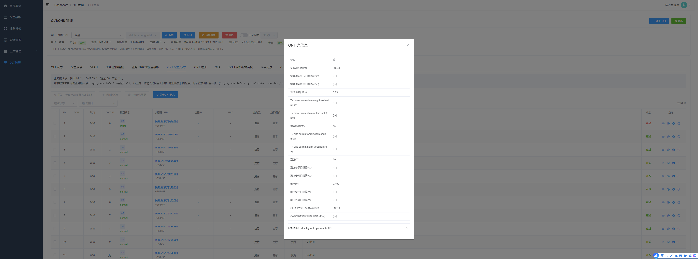

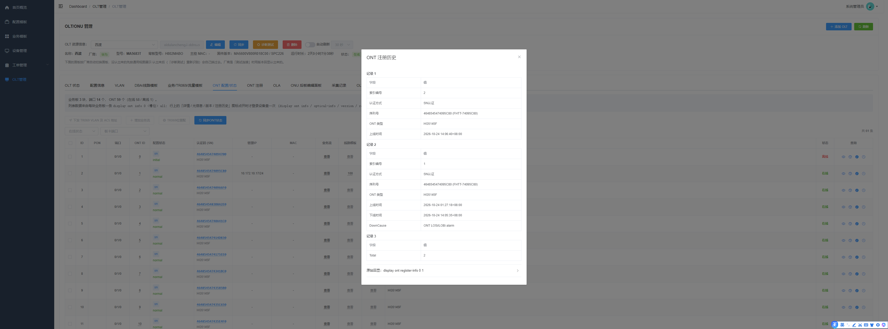

#### DBA / 线路模板（真实采集，只读）

- **DBA 模板**：`display dba-profile all detail` + `display dba-profile all`——模板 ID / 名称 / 类型 / 固定·保证·最大带宽（kbps，原样数字）。总表只给 ID 与 type 数字，名字从详情里按 ID 回补；
- **ONT 线路模板**：`display ont-lineprofile gpon all` 只给概要，逐条 `profile-id` 明细才带 T-CONT（`DBA Profile-ID`）、GEM port 与 GEM 映射（`Mapping VLAN`）。一个 GEM port 挂多条映射时按网管样式逗号合并（映射ID `0,1` / VLAN `45,4011`）；
- 系统内置的 `profile-id 0`（`line-profile_default_0`）不展示。

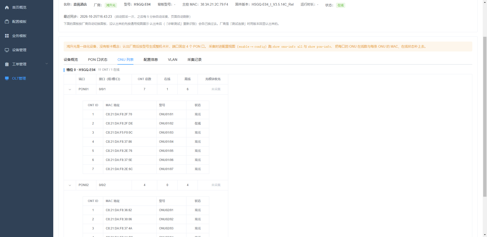

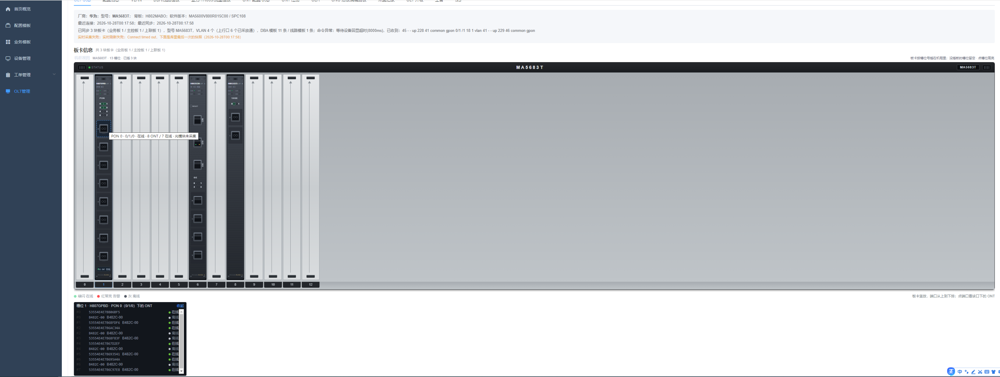

#### 业务 / TR069 / 流量模板（真实采集，只读）

- **ONT 业务模板**：`display ont-srvprofile gpon all` 概要 + 逐条明细，网口 / 电话口数量（`ont-port pots adaptive 32 eth adaptive 8`）；
- **TR069 管理模板**：`display ont tr069-server-profile all`，ACS 地址与登录账号（密码是密文，不采）；
- **流量限速模板**：`display traffic table ip all`，承诺速率（CIR）/ 峰值速率（PIR）；
- **业务流明细**：`display current-configuration section service-port`（字段含义固定，端口 `F/S/P` 不会错位），7 百余条业务流的索引 / ONT ID / 用户侧 VLAN / VLAN 属性 / GEM Port / 端口。

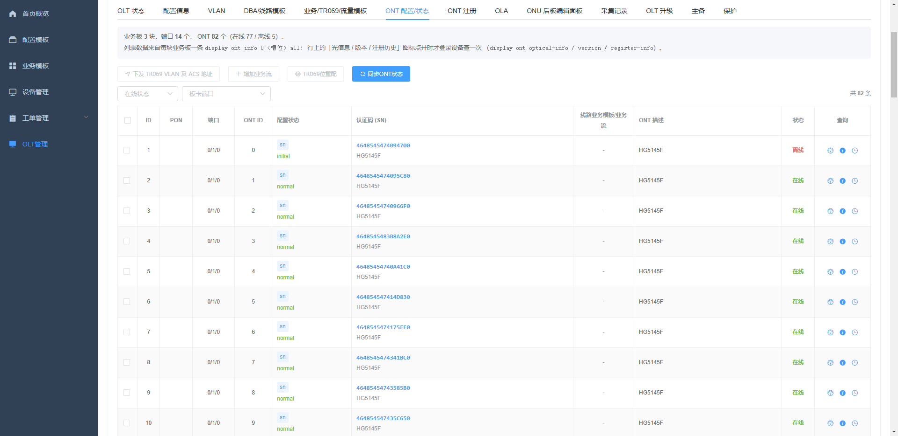

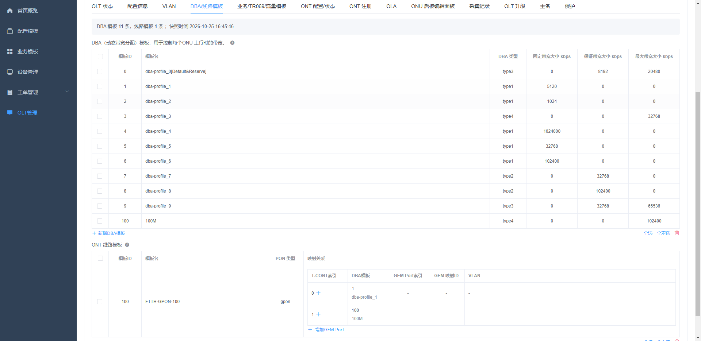

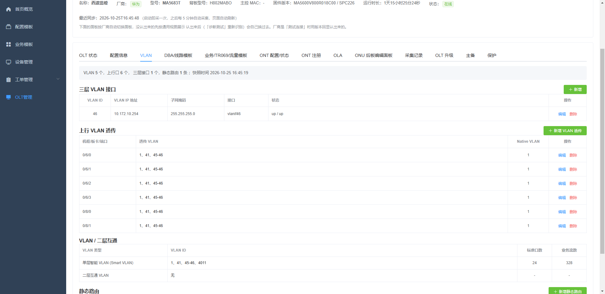

#### OLT 状态与 VLAN（真实采集）

PON 板类型决定命令里的关键字：先按 `gpon` 采，采不到换 `epon`（`display ont-lineprofile epon all`）。
所有模板页的「新增 / 删除」按钮都是**占位**（点击提示下发能力未接入）。

OLT 状态页：3 块板卡（业务板 1 / 主控板 1 / 上联板 1）、背板与版本；每块板一张竖放的 SVG 面板，
业务板上面是 `PON` 灯带（8 颗灯分两列，绿闪=在线），下面端口自上而下一列排开（业务板 `PON 0`-`PON 7`）；
悬停端口能看到该口的 ONU 在线数与光模块数值（发光 / 收光 / 温度 / 偏置电流 / 电压）。

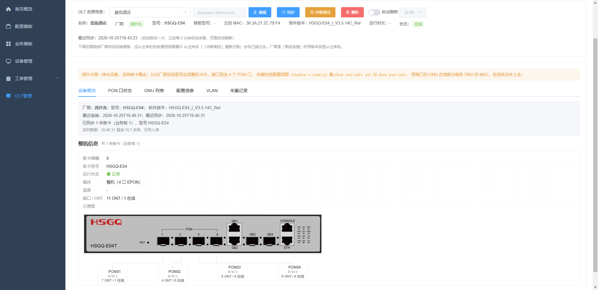

VLAN 页：三层 VLAN 接口（`vlanif46  10.172.10.254/24`）、上行 VLAN 透传（`0/6/0`-`0/8/1` 放通
`1、41、45-46`，Native VLAN 1）、VLAN 与二层互通（单层智能 VLAN）、静态路由（`0.0.0.0/0 → 10.172.10.1`）。

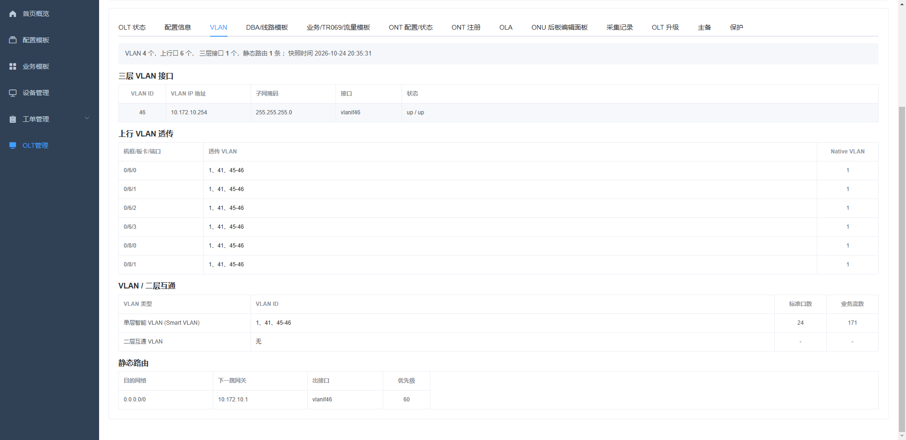

---

## 1. 已实现

### 1.1 后端

| 能力 | 说明 | 主要位置 |
| --- | --- | --- |
| CWMP 接入 | Inform / 空 POST 探活 / RPC 响应三条链路，digest 认证（可 `auto` 免认证），多端口 + 多路径兼容各厂商上报 | `acs/controller/CwmpController`、`acs/auth/CpeAuthenticator`、`common/web/CwmpMultiPortConfig` |
| 协议层 | SOAP 解析/封装、RPC 方法枚举、命名空间 | `cwmp/*` |
| 会话管理 | 会话状态机、待回应 RPC、超时兜底；周期上报视为心跳与会话接管（CPE 换 TCP 连接不重建会话、不打离线、不清待下发队列），离线只按长期无通信判定，疑似双会话仅告警 | `acs/session/*` |
| 设备管理 | 设备自动注册、在线状态、分页详情、在线会话明细 | `acs/service/DeviceRegistryService`、`api/controller/DeviceController` |
| 能力树采集 | 只采集 WAN / WiFi / LAN 网口 / SIP 四类子树（代码内固定）：GetParameterNames 拉路径 + GetParameterValues 分批读值，Inform 后自动采集、BOOTSTRAP 强制重采、NextLevel 兜底 | `acs/service/DeviceCapabilityService` |
| **设备纳管** | Inform 后立刻下发一条 `SetParameterValues`，把 `ManagementServer.URL`（ACS 地址）、`PeriodicInformInterval`（上报间隔）、`ConnectionRequestUsername/Password`（连接请求凭据）写回设备；上报值已一致就跳过、24 小时内不重发、BOOTSTRAP 强制重发；凭据改写成功登记进台账供唤醒使用 | `acs/service/InformProvisionService` |
| **下发前唤醒** | CWMP 是短连接，ACS 不能主动推数据：常规下发排队等设备下一次周期 Inform；人工触发的下发（工单 / 业务模板 / 手动采集）先发连接请求叫设备立刻上报，指令随这一轮带下去，叫不醒则退化成等上报；取凭据的顺序是台账 → 采集参数 → 全局配置 → `itms` 兜底 | `acs/service/DeviceCapabilityService#wakeUp`、`exec/IntentDeliveryService` |
| 参数树导出 | 按型号导出能力树到 `configuration/models/`，并可按设备定位模型文件 | `worklist/service/ModelTreeStore` |
| 业务快照 | `device` / `wan` / `wifi` / `lan` / `sip` / `pon` 分区，支持单台与整页批量读；LAN 区补插线状态（`connected`）与 MAC、SIP 区只保留真实线路实例（剔除 `VoiceProfile.{n}.SIP.` 汇总对象）、台账的注册时间与最近上报时间一并返回 | `acs/service/DeviceBusinessService` |
| **LAN 网口状态自动刷新** | 定时（默认 5 分钟）对在线设备重读网口状态叶子（`Enable/Status/X_CT-COM_*LineStatus/MAC/速率`），拔插网线后页面不必手动点「重新采集」；只刷在线设备、只读网口那几个叶子，等回值超时不判失败（指令仍在队列里） | `acs/service/LanStatusRefreshService`、`DeviceBusinessService#lanStatusPaths` |
| **超管账号查询** | `GET /api/device/{sn}/admin-account`：对在线设备实时读 `User.{i}.Username/Password` 并明文返回；离线直接返回 `offline`；能力树没采到时按 TR-098 / TR-181 标准路径兜底；整批被拒时逐条重发，共用 30s 总预算；只认 `.User.{i}.` 下的账号，WAN 拨号账号不会被误收 | `acs/service/DeviceAccountService`、`api/controller/DeviceController` |
| 型号语义映射 | `cpe_model` + `model_param_mapping` / `model_object_mapping`：业务字段 ↔ 型号真实 CWMP 路径，支持按 SN 推荐候选路径 | `worklist/controller/ModelMappingController`、`ModelMappingService` |
| 机型适配 | 能力采集完成后人工申报运营商 / 网口数 / 速率 / SIP 数 / WiFi 规格，先试采集逐项验证，通过后保存适配档（能力树 XML + 适配 yml）；申报运营商同步写回设备台账，列表与详情按台账展示。**频段识别**按「频段字段 / 信道列表 / 802.11 制式 / SSID 字样」四条判据取并集，只标 5G 不标 2.4G 时按双频认定、一个频段都认不出时按射频数推断（判据清单见 [doc/ADAPTED_MODELS.md](./doc/ADAPTED_MODELS.md)） | `worklist/service/ModelAdaptationService`、`ModelTreeStore` |
| RPC 下发（异步） | 下发返回任务号，按任务号轮询结果；超时统一收尾 | `agent/RpcDispatchService`、`queue/RpcTaskQueue`、`api/controller/RpcTaskController` |
| 队列削峰 | 上报与下发走 Redis 队列，Redis 不可用时降级为进程内处理 | `queue/*` |
| **配置意图模板** | 入库 `config_template`，只描述开通意图（不下发任何数据）：7 类（WAN DHCP / WAN PPPoE / WAN 静态IP / WAN 桥接 / 2.4G WiFi / 5.8G WiFi / SIP），各类自带意图字段；支持 `/meta` 字段定义、列表、详情、保存、删除 | `template/*`（`ConfigTemplateService`、`ConfigTemplateController`） |
| 业务模板 | 多张意图模板编排成一个业务包：列表、详情、保存、删除、下发前自检 `/validate`、下发记录查询 | `biz/*`（`BizTemplateService`、`BizTemplateExecutionService`） |
| **工单下发（管理端）** | `POST /api/worklist/instances` 建单即以 `worklistDesc` 做幂等键，落库后立刻转下发任务（`IntentDeliveryService`，`source=worklist`），任务结束按 `TaskFinishedEvent` 回写终态与失败原因；工单与步骤记录可查 | `worklist/service/WorklistDeliveryService`、`worklist/controller/WorklistExecuteController` |
| 首页概览 | 在线/离线、品牌分布、模板统计（模板数改为统计意图模板） | `api/service/DashboardService` |
| 数据模型适配 | TR-098（`InternetGatewayDevice.`）与 TR-181（`Device.`）双模型：Inform 参数多数判定根节点、业务前缀按双模型展开、型号档案与能力树 XML 记录数据模型并对账 | `acs/model/DataModel`、`InformService`、`DeviceBusinessService` |
| **意图下发执行器** | 意图字段 + 型号语义映射 → CWMP 路径与值 → 按需 `AddObject` 再分批 `SetParameterValues`，全程写进 `device_task`；同 `taskNo` 幂等 | `exec/*`（`IntentDeliveryService`、`IntentPlanRenderer`） |
| **北向接口** | 独立端口 8899 + `/openapi/v1/**：设备台账/在线/能力树/业务快照/工单结果查询、下发受理与结果查询、Webhook 事件推送（上下线、下发结束），复用管理端 JWT 鉴权 | `openapi/*` |
| **OLT 命令行采集** | Telnet 登录 → 关分页 → `display board 0` / `display version` → `enable` → `config`（进视图只为读温度 / ONT / VLAN，不下配置）→ 温度 → 每块业务板一条 `display ont info 0 <槽位> all` → `display vlan all` → 上行/主控口逐个 `display port vlan 0/<槽位>/<端口>` → `display ip interface brief` / `display ip routing-table` → `quit`；板卡、端口 ONT（含每条 ONT 明细）、VLAN、三层接口、静态路由入库（`olt_device.vlan_json`、`olt_board.ports_json`）；启动后自动采一轮、之后每 5 分钟一轮，页面只拉最新数据不碰设备。采集侧全程只有 `display` / `show` / `enable` / `config` / `quit`，写设备的操作走下一行的下发接口（增删 ONT、重启板卡仍未实现）。管理的写操作只是 ACS 自己的 OLT 台账（增删改 + 手工触发同步）。登录后先用版本命令认厂商，结果写回 `olt_device.vendor`，台账据此把设备分给对应的厂商页面（`web/src/views/olt/vendors.js`）。华为 MA5683T 已实测 | `olt/*`（`telnet/OltCliSession`、`telnet/OltInfoParser`、`service/OltService`、`service/OltTelnetService`） |
| **OLT 配置下发** | 一键开局（改端口 VLAN 模式 `access`/`hybrid`/`trunk` + 建业务 VLAN + 建 TR-069 模板）、VLAN 增删、DBA 模板增删、TR-069 模板新增、按命令动作目录执行单条动作。每个能力都是「表单 / 预览 / 下发」三个接口，**预览与下发走同一个命令方法**，页面看到的必然是将要下发的那条序列；取值约束（ID 范围、名称字符集、批量上限、VLAN 表达式写法）由后端一处给出，前端不保存第二份；下发前后都写采集记录。设备知识（整机型号规格、板卡档案、状态翻译、码表阈值）同样由后端下发，前端只负责渲染 | `olt/service/OltService`（`quickSetup` / `vlanCommands` / `dbaProfileCommand`）、`olt/vendor/*`（命令生成与型号规格）、开发约定见 [doc/BACKEND.md](./doc/BACKEND.md) |
| **OLT 模板采集（只读）** | 同一 Telnet 会话里继续采模板：`display dba-profile all detail` + `display dba-profile all`（按 ID 回补模板名，总表只给 ID 与 type 数字）、`display ont-lineprofile <gpon\|epon> all` 概要 + 逐条 `profile-id` 明细（T-CONT 的 `DBA Profile-ID`、`<Gem Index:n>` 与 `Mapping VLAN` 表格）、`display ont-srvprofile <gpon\|epon> all` 概要 + 逐条明细（`ont-port pots/eth adaptive`）、`display ont tr069-server-profile all`（ACS 地址与账号）、`display traffic table ip all`（CIR / PIR）、`display current-configuration section service-port`（业务流，字段含义固定优先于表格回显）。PON 类型先 `gpon` 后 `epon` 探测；内置 `profile-id 0` 不展示；结果按整体覆盖写入 `olt_device.template_json`（采不到保留上次） | `olt/telnet/OltInfoParser`（`parseDbaProfiles` / `parseDbaDetails` / `parseLineProfiles` / `parseSrvProfiles` / `parseTr069Profiles` / `parseTrafficTables` / `parseServicePortsFromConfig`）、`olt/telnet/OltCliSession#collectTemplates` |
| **OLT 单条 ONT 按需查询（只读）** | 点 SN / 模板列 → 一次会话发三条：`display current-configuration ont 0/<槽位>/<端口> <ONT ID>`（授权行：SN / 线路模板 / 业务模板 / 描述）+ `display service-port port 0/<槽位>/<端口> ont <ONT ID>`（业务流表格）+ `display ont info 0 <槽位> <端口> <ONT ID>`（管理 IP）；点 ONT ID → `display ont capability 0/<槽位> <端口> <ONT ID>`（硬件能力/状态）；行图标 → 光信息 / 版本 / 注册历史。老版本不认 `ont` 过滤时退回整口查询按 VPI（ONT ID）筛 | `olt/telnet/OltCliSession`（`queryOntConfigAndServicePorts`、`queryServicePorts`、`queryOntDetail`）、`olt/telnet/OltInfoParser`（`parseOntBindInfo`、`parseServicePorts`、`parseOntKeyValueBlocks`）、`olt/service/OltService#queryOnt` |
| **OLT 命令行健壮性** | ① 华为续页提示 `( Press 'Q' to break ) ----` 纳入分页识别，提示与正文挤同一行时只清提示不送空格，避免误触发翻页卡死；② 关分页按设备来：华为发 `scroll`（`screen-length` 是 VRP 交换机的，OLT 不认），进 config 视图后重发一次；③ 参数补全提示（含无 `<cr>` 的 `{ all<K>\|bound-info<K> }:`）识别后自动补回车取默认/执行，不再干等 8 秒超时 | `olt/telnet/TelnetClient#handlePagination`、`olt/telnet/OltVendor#getPagingCommands`、`olt/telnet/OltCliSession#readToPrompt` |
| **在线接口文档** | springdoc 扫接口 + Knife4j 中文界面：启动后浏览器打开 `http://127.0.0.1:8888/doc.html` 查看全部接口的用途、请求参数与返回结构，可在线调试；`http://127.0.0.1:8888/v3/api-docs` 是 OpenAPI 3.0 JSON，可导入 Apifox / Postman。接口清单从 Controller 签名自动扫出，中文说明集中在 `config/OpenApiDocConfig` 的 `DOC` 表 | `config/OpenApiDocConfig`、`pom.xml`（`springdoc-openapi-starter-webmvc-ui` + `knife4j-openapi3-jakarta-spring-boot-starter`） |
| 管理端鉴权 | JWT 登录、`sys_user` 查库、首次启动写入初始管理员；JWT 拦截器除了验令牌，**还按请求 URL 与方法算出需要的权限点再验权限**（`GET` 要 `xxx:view`，写方法要 `xxx:manage`），够不着返回 403 | `api/controller/AuthController`、`config/AdminAuthInterceptor`、`api/auth/PermissionCodes` |
| **角色权限** | `sys_role` + `sys_role_permission`：20 个权限点（10 个模块 × 读/写）由代码清单给出、**不落库**；角色勾权限，改完**立即生效**（每次请求查库判权限，不缓存在令牌里）；系统管理员在代码里短路放行全部权限，库里没有它的行，也改不了 | `api/auth/PermissionCodes`、`api/service/RoleService`、`api/controller/SystemController` |
| **用户管理** | `/api/system` 九个接口：用户的增删改查、改角色、改口令（**改别人的口令要先验证操作者自己的口令**）、启停；自己删不了自己 | `api/service/UserAdminService` |
| **登录日志** | 每次尝试落到 `sys_login_log`：成败与失败原因、**真实 IP**（取 `X-Forwarded-For` 首段，内网地址不用）、**登录标识**（网页端 / 客户端 / 移动端，按 `X-Client-Type` 或 UA 认）、UA；按用户各留最近 50 条 | `api/service/LoginLogService`、`api/auth/ClientIpResolver`、`api/auth/LoginSourceResolver` |
| 启动自检 | 各业务表补建/初始化、可选只读表存在性校验 | `common/startup/*` |

### 1.2 前端（`web/`）

| 菜单 | 路径 | 状态 |
| --- | --- | --- |
| 首页概览 | `/dashboard` | 已实现 |
| 配置模板 | `/template/list` | 已实现（意图模板，按类型渲染意图字段；**高级模式/文件模板已彻底删除**） |
| 业务模板 | `/biz/list` | 已实现（编排 + 成员视图 + 自检 + 整包串行下发，支持出错继续） |
| 设备管理 | `/device/list` | 已实现（列表/详情/业务信息/WAN 参数弹窗/在线明细 + **右下角批量工具条** + **LAN 网口图标** + **WIFI 按 2.4G/5.8G 上下分行** + **运行信息列**（运行时长/加入时间/最后汇报时间/汇报IP，可排序）+ **查询超管密码弹窗**） |
| 设备详情 | `/device-detail/:sn` | 已实现（能力树、参数树、RPC 调试 + 业务面板：信息卡改为运行时长/注册时间/最近上报/上报IP、LAN 网口区块、WLAN 按频段分行、SIP 只列真实线路） |
| 工单记录 | `/worklist/instances` | 已实现（工单与步骤查询；批量建单入口在设备列表工具条「一键工单 ▲」） |
| OLT 台账 | `/olt/management` | 已实现（**入口页**：台账增删改、诊断连通性、触发同步；**按厂商分发**到下面三个详情页，新加的设备识别出厂商后直接进对应页面） |
| OLT 详情 · 华为 | `/olt/huawei/:id` | 已实现（**真实 Telnet 采集，只读**：OLT 状态（板卡/温度/端口 ONT/SVG 板卡面板）、配置信息、VLAN、**DBA/线路模板**、**业务/TR069/流量模板**、ONT 配置与状态、采集记录；板卡竖放、端口竖排画在面板上（点端口看该口 ONT）；ONT 配置/状态表列含 认证码 / 运行标志 / **管理IP** / **MAC** / **业务流** / **线路模板** / **业务模板**，行可勾选，右下角**重启ONU / 删除注册**按钮；按需查询弹窗：点 SN → 授权信息 + 改授权，点 ONT ID → 硬件能力/状态，点业务流「查看」→ 业务流表；除 VLAN 增删、DBA 模板增删、一键开局外**不能改设备配置**，业务模板页的「新增/删除」、批量运维按钮、业务流四个操作按钮仍为占位；ONT 注册、OLA、ONU 后板编辑面板、OLT 升级、主备、保护仍为占位） |
| OLT 详情 · 鸿升光 | `/olt/hsgq/:id` | 已实现（**整机前面板**：按型号画出 PON 口 + 上联 GE / XGE + NMS / CONSOLE，顶部显示规格 `8 × GPON + 4 × GE + 4 × XGE`；PON 口状态、ONU 列表、配置信息、VLAN（可增删）、一键开局、采集记录） |
| OLT 详情 · 通用 | `/olt/generic/:id` | 已实现（未识别厂商、中兴、烽火走这里：板卡、ONT、VLAN、配置信息、采集记录；**只读**，识别出来后可编辑重测并自动分流到对应厂商页） |
| **用户管理** | `/system/users` | 已实现（增删改用户、改角色即时生效、改密码、启停；列表带**最近登录 / 登录地址 / 登录标识**；初始 `admin` 账号的删除按钮按死） |
| **角色权限** | `/system/roles` | 已实现（按模块勾选「查看 / 管理」；**系统管理员那排是禁用的**；还有人在用的角色删不掉） |
| **登录日志** | `/system/login-logs` | 已实现（成功与失败都记；可按**登录地址 / 登录时间 / 登录标识**筛选） |

设备列表右下角工具条（`web/src/views/device/list.vue`，需先勾选设备）：

| 分组 | 已接通 | 占位（待后端） |
| --- | --- | --- |
| 模版关键字 + 批量下发模版 | 模板下拉已接意图模板与业务模板；按选中模板对勾选设备逐台建单 / 建执行记录 | 整批进度看板、失败一键重试 |
| 一键工单 ▲ | 工单记录跳转 + 批量开通 / 检修工单（逐台建单，每台独立流水号，最后汇总失败清单） | — |
| 更多… ▲ | 恢复出厂 / 深度恢复出厂 / 清零类 → `FactoryReset`；**查询超管密码**（对勾选设备逐台实时读 `User.{i}.Username/Password`，弹窗明文展示，单台超时/离线不影响其它台） | Telnet 开关、WAN 侧访问、一键 WiFi、禁用 SIP、删除 WAN 连接、解除上网限制、删除缓存、标记置换 |
| 高级… ▲ | 导出设备（CSV）、下发自定义 TR069 参数（弹窗 → `SetParameterValues`）、调试指令（弹窗 → 任意 RPC）、刷新状态 | Telnet 命令、去除 SSID 前缀、修复 SIP/桥接、导出/克隆配置文件、强制上报 |
| OLT融合管理 ▲ | OLT/ONU 管理（跳转 OLT 页） | OLT 拓扑 |
| 重启 | 批量 `Reboot`（带二次确认） | — |

### 1.3 已适配光猫型号

清单单独维护在 **[doc/ADAPTED_MODELS.md](./doc/ADAPTED_MODELS.md)**（只记运营商 + 厂家型号，
适配一台加一行）。适配档案本身在便携化 SQLite 模板库 `configuration/tr069_tpl.pack`
（配置项 `acs.tr069tpl.db-path`），随仓库走，拷到部署机即识别为已适配，不必重新适配。

### 1.4 设备纳管与唤醒

出厂的光猫上写着原厂平台的地址，不改的话它下一轮就报到别处去了。设备每次 Inform 上来，
ACS 立刻下发一条 `SetParameterValues` 把它接管过来：

| 下发项 | 值 | 不改的话 |
| --- | --- | --- |
| `ManagementServer.URL` | `acs-url`，留空按 `public-host` + 上报端口 + 上报路径拼 | 设备继续报给原厂平台，ACS 再也见不到它 |
| `ManagementServer.PeriodicInformInterval` | `inform-interval-seconds`，默认 300 | 出厂值常是几十秒，设备一多就是无谓压力；太长则下发要干等 |
| `ManagementServer.ConnectionRequestUsername` | `connection-request-username`，默认 `itms` | 各批次出厂密码不同，ACS 猜不出来就唤不醒设备 |
| `ManagementServer.ConnectionRequestPassword` | `connection-request-password`，默认 `itms` | 同上 |

TR-181 的设备自动换成 `Device.ManagementServer.*` 前缀（按会话的根节点拼）。

写回的四项在设备后台的服务器配置页能直接看到（以 MSG2200C 为例，ACS 地址 / ACS 账号密码 /
连接请求账号密码 / 周期上报时间都在这一页，纳管改的就是其中对应项）：


**为什么连账号密码一起改**：连接请求是 ACS 反向叫醒设备的凭据，写在设备侧。不同批次的光猫
出厂值各不相同，ACS 拿不到正确的那对，唤醒就永远是 401，只能干等它周期上报。纳管时统一
写成 ACS 认得的值，等于把凭据从"猜"变成"已知"。改写成功后会登记进台账，唤醒直接取用——
采集读回来的是改写前的旧值，留着旧值等于拿一把设备已经不认的钥匙。

不会每轮都写，三层判断：Inform 上报的值已经对得上就跳过；24 小时内不重发
（`reprovision-interval-hours`，设 `0` 则每次都发）；**BOOTSTRAP 强制重发**——恢复出厂后
设备里的地址会变回原厂平台，必须重写一遍。

配置：

```yaml
acs:
  auth:
    # ACS 唤醒光猫用的凭据（与 cpe-to-acs-* 方向相反，别配混了）
    acs-to-cpe-username: itms
    acs-to-cpe-password: itms
  public-host: 10.101.125.100        # 上线前必改：拼下发地址用
  device:
    provision:
      enabled: true
      acs-url:                       # 留空按 public-host 拼
      inform-interval-seconds: 300   # 0 表示不改这一项
      connection-request-username: ${acs.auth.acs-to-cpe-username}
      connection-request-password: ${acs.auth.acs-to-cpe-password}
      reprovision-interval-hours: 24
      force-on-bootstrap: true
```

**唤醒（连接请求）**：CWMP 是短连接，ACS 不能主动给设备推数据，只能等它来建会话。所以
常规下发（周期采集、LAN 状态刷新、纳管本身）就排在队列里等下一次周期 Inform，那是成本
最低的路；只有「人点了就要它生效」的操作才反向叫一声——工单下发、业务模板下发、手动采集。
叫不醒就退化成等上报，不影响正确性。取凭据的顺序是：台账 → 采集到的参数 → 全局配置 →
`itms` 兜底。

验证（设备上报一次后看日志）：

```
下发纳管参数: sn=CIOT29ABE539, 参数=...ManagementServer.URL=http://10.101.125.100:9090/ACS-server/ACS,
  ...PeriodicInformInterval=300, ...ConnectionRequestUsername=itms, ...ConnectionRequestPassword=itms
纳管参数下发完成: sn=...
已登记设备连接请求凭据: sn=..., 账号=itms
已发连接请求唤醒设备: sn=..., url=..., 响应码=200
```

设备不接受这几项（部分厂商设为只读）会回 fault，日志打 `纳管参数下发失败: sn=..., err=...`，
此时台账不登记，按周期重试一次就停；要么改设备侧权限，要么把 `enabled` 关掉。

### 1.5 OLT 标签页：已实现 / 占位

华为页（`/olt/huawei/:id`）逐页状态。**已实现 = 真实 Telnet 采到设备当前配置并入库展示；
占位 = 页面只有框架或空态，不碰设备。**

| 标签页 | 状态 | 数据来源 | 说明 |
| --- | --- | --- | --- |
| OLT 状态 | ✅ 已实现 | `display board 0`、`display version`、温度命令、`display port state <口>` | 板卡卡片（型号/状态/温度/端口与 ONT 汇总）、SVG 板卡面板（PON 灯带 + 端口列）、悬停看 ONT 数与光模块数值 |
| 配置信息 | ✅ 已实现 | `display version` 等 | 型号、版本与补丁、背板、主控 MAC、运行时长 |
| VLAN | ✅ 已实现 | `display vlan all`、`display port vlan`、`display ip interface brief`、`display ip routing-table` | 三层接口、上行透传、二层互通、静态路由 |
| **DBA/线路模板** | ✅ 已实现 | `display dba-profile all (detail)`、`display ont-lineprofile … all` + 逐条 `profile-id` 明细 | DBA 带宽档位、T-CONT↔DBA、GEM port↔映射 VLAN；「新增/删除」按钮**占位** |
| **业务/TR069/流量模板** | ✅ 已实现 | `display ont-srvprofile … all` + 明细、`display ont tr069-server-profile all`、`display traffic table ip all`、`display current-configuration section service-port` | 网口/电话口数量、ACS 地址与账号、CIR/PIR、业务流明细；「新增/删除」按钮**占位** |
| ONT 配置/状态 | ✅ 已实现 | `display ont info 0 <槽位> all` | 按板卡分表：端口 × ONT 总数/在线/离线；表格列含 认证码 / 运行标志 / 管理IP / MAC / 业务流 / 线路模板 / 业务模板 / 描述 / 状态 / 查询图标 |
| **点 SN → 授权信息 + 改授权** | ✅ 已实现（只读） | `display current-configuration ont 0/<槽位>/<端口> <ONT ID>`、顺带 `display ont info` 取管理 IP | 授权信息：SN / 描述 / 线路模板 / 业务模板；改授权表单（机框/板卡/端口/ONT、注册方式、认证码）**提交为占位**，只提示读数据 |
| **点 ONT ID → 硬件能力/状态** | ✅ 已实现（只读） | `display ont capability 0/<槽位> <端口> <ONT ID>` | 上行 PON 口数 / POTS / ETH / GEM port 数 / 是否支持 IP 配置 / T-CONT 数 / 流控类型 / ONT 类型 / 各 T-CONT 的 PQ 数，标签与值中文化 |
| **点业务流「查看」 → 业务流表** | ✅ 已实现（只读） | `display service-port port 0/<槽位>/<端口> ont <ONT ID>` | 业务流ID / OLT网络侧VLAN / VLAN 类型 / GEM Port / 光猫用户侧VLAN / 上下行流量模版 / 编辑 / 选择；底部四个操作按钮**均为占位** |
| 采集记录 | ✅ 已实现 | 本地 `olt_sync_record` | 每次同步与诊断的耗时、摘要、原始回显 |
| **重启ONU / 删除注册**（批量按钮） | ⬜ 占位 | — | 按钮已就位并带勾选校验，命令未接，见第 2 节 #15 |
| ONT 注册（autofind） | ⬜ 占位 | `display ont autofind all` | 命令未接 |
| OLA | ⬜ 占位 | — | 未接 |
| ONU 后板编辑面板 | ⬜ 占位 | — | 未接 |
| OLT 升级 | ⬜ 占位 | — | 未接 |
| 主备 | ⬜ 占位 | — | 未接 |
| 保护 | ⬜ 占位 | — | 未接 |
| 光模块数值（Tx 发光 / 收光 / 温度 / 偏置电流 / 电压） | ✅ 已实现 | 接口视图 `interface gpon 0/<槽位>` → `display port state <口>` | 逐口采集，随板卡端口一起入库；面板悬停 tooltip 与 ONT 表「光模块发光 / 收光 / 温度」三列展示。收光仍取 `display board 0/<槽位>` 的 RX 列 |

### 1.6 插图清单

截图**不挪位置、不改文件名**，全在 [`doc/Display/`](./doc/Display) 根目录（排障图在 `Debug/`）。
下面两张表按 **ACS 侧**（ACS 服务 / 光猫设备管理）和 **OLT 侧**（OLT 融合管理）分开列：

#### ACS 侧（ACS 服务 / 光猫设备管理）

| 文件 | 内容 | 引用位置 | 状态 |
| --- | --- | --- | --- |
| `170451_518.png` | 登录页 | 效果展示 · 登录 | 有效 |
| `170528_847.png` | 首页概览 | 效果展示 · 首页概览 | 有效 |
| `171236_574.png` | 设备管理（未适配） | 效果展示 · 设备管理 | 有效 |
| `171244_327.png` | 机型适配 · 申报 | 效果展示 · 机型适配 | 有效 |
| `171437_294.png` | 机型适配 · 试采集 | 效果展示 · 机型适配 | 有效 |
| `172759_926.png` | 机型适配 · 测试通过 | 效果展示 · 机型适配 | 有效 |
| `170658_702.png` | 设备管理（已适配） | 效果展示 · 设备管理 | 有效 |
| `174419_542.png` | 适配完成后列表 | 效果展示 · 设备管理 | 有效 |
| `013530_034.png` | 设备列表（现行版） | 效果展示 · 设备列表 | 有效 |
| `162116_423.png` | 设备详情业务面板 | 效果展示 · 设备详情 | 有效 |
| `013724_056.png` | 光猫后台平台服务器配置 | 1.4 设备纳管 | 有效 |
| `162046_560.png` | 设备列表（**旧版**，`013530_034` 之前用过） | — | 未引用（保留） |
| `025159_916.png` | 设备列表（**旧版**，早期用过） | — | 未引用（保留） |

#### OLT 侧（OLT 融合管理，只读采集）

| 文件 | 内容 | 引用位置 | 状态 |
| --- | --- | --- | --- |
| `164812_931.png` | 华为面板（OLT 状态 / 板卡） | 效果展示 · OLT 管理 | 有效 |
| `164849_972.png`、`164917_540.png` | DBA / 线路模板 | 效果展示 · 模板页 | 有效 |
| `165011_460.png`、`165021_956.png`、`165027_868.png` | 业务 / TR069 / 流量模板 + 业务流明细 | 效果展示 · 模板页 | 有效 |
| `203941_898.png` | VLAN 页 | 效果展示 · VLAN | 有效 |
| `013810_265.png` | ONT 配置/业务流弹窗（点 SN：授权信息 + 业务流表） | ONT 按需查询弹窗 | 有效 |
| `013739_612.png` | ONT 硬件能力/状态弹窗（点 ONT ID） | ONT 按需查询弹窗 | 有效 |
| `004502_731.png` | ONT 业务流弹窗（点业务流列「查看」） | ONT 按需查询弹窗 | 有效 |
| `013803_107.png` | ONT 详情 / 光信息弹窗（点眼睛 / 温度计图标） | ONT 按需查询弹窗 | 有效 |
| `013753_883.png` | ONT 版本 / 注册历史弹窗（点 info / 时钟图标） | ONT 按需查询弹窗 | 有效 |

**OLT 侧待补（新界面还没截图）**：ONT 配置/状态主表（管理IP / MAC / 业务流 / 线路·业务模板列 +
右下角批量按钮）、点 SN 的配置弹窗、点 ONT ID 的硬件能力弹窗、业务流弹窗、光信息/版本/注册历史弹窗——
对应本章以上四段，截完丢进 `doc/Display/` 后按文件名补引用即可。

不再有待确认归属的图；`doc/Display/Debug/` 下的 4 张是排障用截图，不进 README。

鸿升光页（`/olt/hsgq/:id`）：设备概览、PON 口状态、配置信息、VLAN、采集记录已实现；ONU 列表占位。
通用页（`/olt/generic/:id`）：OLT 状态、配置信息、VLAN、ONT 配置与状态、采集记录已实现。

**采集只读，配置可下发**：采集侧发往设备的命令全是 `display` / `show`；写操作已实现建/删 VLAN、
DBA 模板增删、TR-069 模板新增、一键开局（改端口 VLAN 模式 + 建业务 VLAN），增删 ONT、重启板卡、
业务模板增删改仍未实现，见第 2 节 #15。

---

### 1.7 管理端权限体系

**权限点是代码里的功能清单，不落库，也不允许用户增删**：删掉一个权限点、代码还在判它，
那个功能就变成谁也点不动的死按钮。清单由 `GET /api/system/permissions` 给出，页面按它勾选，
勾的结果才落到 `sys_role_permission` 里。

| 模块 | 查看 | 管理 |
| --- | --- | --- |
| dashboard / device / template / biz / model / worklist / olt / file / tag / system | `xxx:view` | `xxx:manage` |

判定按 URL 自动映射，**不给每个接口加注解**：`GET /api/device/**` 要 `device:view`，写方法要
`device:manage`。认不出模块的路径（如 `/api/user/info`）不拦——登进来就能看自己是谁，没必要再配权限。

**两个默认角色**：

| 角色 | 说明 |
| --- | --- |
| `SUPER_ADMIN` 系统管理员 | 内置，**拥有全部权限**，不可删除、权限不可改 |
| `OPS_ADMIN` 运维管理员 | 默认能看全部、能改设备与工单，权限可调整 |

系统管理员的「全权限」在代码里短路，**权限表里没有它的行**——存一份就要操心
「表里那行和代码里那句不一致时谁说了算」。

**初始 `admin` 账号有三道锁**：应用层 `UserAdminService` 拒绝删除（返回「系统用户禁止删除」），
数据库 `BEFORE DELETE` 触发器兜底（手工在 MySQL 里 `delete` 同样删不掉），前端的删除按钮也是按死的。
系统管理员只剩一个时同样删不得、停不得、也降不成别的角色——没人能改权限的系统等于锁死。

改别人的口令要先验证操作者**自己**的口令，这是为了防止会话被借用后批量改口令扩大战果。

> 升级说明：旧版本的 `sys_user.role` 存的是 `admin` / `operator` / `viewer`，
> 首次用到角色时由 `RoleService` 自动迁移（`admin` → `SUPER_ADMIN`，其余 → `OPS_ADMIN`），
> 不用手工跑脚本。接口细节见 [API.md §4.14](./API.md)。

## 2. 待实现 / 进行中

| # | 事项 | 当前状态 | 说明 |
| --- | --- | --- | --- |
| 1 | ~~**意图模板下发执行器**（核心）~~ | **已实现** | `exec/IntentDeliveryService`：意图字段 + `model_param_mapping` / `model_object_mapping` → 渲染下发计划（`{i}` 实例号替换、只读与必填校验）→ `AddObject` + 分批 `SetParameterValues`，状态落 `device_task`。下一步是补 WiFi / SIP 之外的更多意图字段（见 #8） |
| 2 | 批量下发模版 | **部分实现** | 业务模板整包批量下发已接通（逐台一条执行记录，汇总成功/失败清单）；配置意图模版批量下发走「批量下发模版」入口建工单。待补：整批进度看板、失败一键重试 |
| 3 | ~~业务模板整包下发~~ | **已实现** | `POST /api/biz-template/execute`：按成员顺序串行执行，执行记录写 `biz_template_execution`；成员失败按模板 `continueOnError` 决定停下还是继续，继续跑完且有失败记 `partial` |
| 4 | ~~一键工单（开通 / 检修）~~ | **已实现** | 设备列表勾选后按台建单，每台一个独立流水号（`worklistDesc` 幂等），单台失败记录但继续其余设备，最后汇总失败清单 |
| 5 | 设备批量运维指令后端 | 部分接通（**超管密码已接通**） | Telnet 开关与命令执行、WAN 侧访问、WiFi 开关、禁用 SIP、删除 WAN 连接、解除上网限制、SSID 前缀清理、配置文件导出/克隆、强制上报等需逐个按厂商/型号补齐参数路径（统一走型号映射，不写死路径）。超管账号查询已可用，但依赖设备在线且该型号把 `User.{i}.Username/Password` 暴露给 TR-069 |
| 6 | ~~OLT 融合管理真实数据~~ | **已实现（只读）** | Telnet **采集**已接通（华为 MA5683T 实测）：台账、板卡与温度、端口与每条 ONT 明细、VLAN 与三层接口 / 静态路由、**DBA/线路模板**、**业务/TR069/流量模板**（含 TR069 服务器模板与流量限速模板）、业务流明细均真实入库；页面「同步」与后台 5 分钟定时刷新。发往设备的采集命令只有 `display` / `show`；**配置下发已实现**（建/删 VLAN、DBA 模板增删、TR-069 模板新增、一键开局），增删 ONT 与重启板卡仍未实现，见 #15。剩余占位：ONT 注册（`display ont autofind all`）、OLA、ONU 后板编辑面板、OLT 升级、主备、保护，以及各模板页的「新增/删除」按钮。光模块数值（Tx 发光 / 收光 / 温度 / 偏置电流 / 供电电压）另走接口视图：`interface gpon 0/<槽位>` 下的 `display port state <口>`，已逐口采集入库。逐页状态见 [1.5 节](#15-olt-标签页已实现--占位) |
| 7 | 存量数据迁移 | 未开始 | 存量 `biz_template_item.template_key` 仍是旧文件 key，`BizTemplateService.parseId` 会判定为“配置模板不存在”，需迁移脚本改为 `config_template.id` |
| 8 | 意图字段扩展 | 进行中 | **WAN 已接通**：连接模式 / 地址获取方式 / VLAN / NAT / 绑定端口 / 静态地址四项 / PPPoE 账号口令 / **MTU**（TR-098 与 TR-181 同名参数，留空＝不改、填 0 拒发）；**WiFi 已接通** SSID / 密码 / 信道 / 隐藏 / 加密方式；**SIP 已接通** 注册与代理服务器、端口、号码、密码。待补：SIP 出局代理与备用注册服务器、数图规则、WiFi 带宽与功率、设备管理类私有节点（见 #5） |
| 9 | 旧机制彻底清理 | 基本完成 | 旧文件模板 / 向导编译 / 旧工单编排引擎已删，工单改走 `IntentDeliveryService`；`worklist` 包中保留档案、型号映射、能力树导出与工单建单/查询，收尾时可再审视命名。**UDP 连接请求（TR-111 打洞）已删**：内网部署下设备直连可达，用不到穿透，且它「发出即算成功」会顶掉 HTTP 那条，唤醒失败还看不出来 |
| 10 | 其它 | 未开始 | 下发操作审计日志细化、权限角色细化、设备告警（光功率劣化、离线批量提醒）、离线判定阈值按设备实际周期上报间隔（`PeriodicInformInterval`）动态计算（当前固定 120 秒）。纳管已把上报间隔统一下发为 300 秒，这条可以按台账读回的实际间隔算，不必再手调 |
| 11 | 界面展示收尾 | 未开始 | ① 设备列表 LAN 网口超过 4 个时的折叠（`+N`）或横向滚动，当前会横向溢出；② 业务**采集**阶段跳过未启用的 SSID（现在只是展示层过滤，采集仍全量读）；③ 详情页未启用 SSID 的视觉区分，当前只靠状态列文案「已禁用」；④ 运行信息列的排序只作用于当前页（后端分页排序暂未打通） |
| 12 | 唤醒覆盖批量运维 | 未开始 | 纳管、工单、业务模板与手动采集已接入唤醒；批量运维里的重启 / 恢复出厂 / 下发自定义 TR069 参数 / 查询超管密码同为人工操作，目前仍等周期上报（要点了就生效，需在对应入口各加一次 `wakeUp`） |
| 13 | 纳管结果可见性 | 未开始 | 纳管只在日志里体现：下发成功、设备回 fault 的原因、上次纳管时间都在日志里，台账与页面都看不到。设备设为只读而不接受改写时，只能翻日志才发现 |
| 14 | CR 凭据改写的兼容性 | 未开始 | 少数固件把 `ManagementServer.ConnectionRequestUsername/Password` 与设备登录账号共用，纳管改写后 Web 登录密码会跟着变。待按型号加白名单（跳过改写）或改写前先读一次登录账号比对 |
| 15 | OLT 写操作（配置下发） | 未开始 | 当前 Telnet 链路**只能读**（`display` / `show`），页面展示的都是设备现状，改配置必须上设备命令行。待实现写命令：`ont add / delete / reset`、`ont reboot`、`vlan create / port vlan`、`ont autofind confirm`、`service-port` 增删改、`save`（华为写操作要持久化得敲 `save`）。落地前要先补三样：命令白名单与参数校验（只允许拼装安全字符集、禁任意命令注入）、写入前 dry-run 与回显成功判定（现在只判提示符，写失败的设备回 `% ... error` 同样会给提示符）、操作审计（谁在什么时候改了哪台设备的哪条命令，`olt_sync_record` 现只存采集记录） |
| 16 | **ONT 批量操作按钮**（重启ONU / 删除注册） | **占位** | 按钮与勾选校验已就位，点击提示"写操作暂未开放"。需随 #15 的写通道一起接：`ont reboot 0/<槽位>/<端口> <ONT ID>`、`ont delete 0/<槽位>/<端口> <ONT ID>`，并加二次确认与结果回执 |
| 17 | **业务流操作按钮**（查询GMP 组播状态 / 查询未知组播策略 / 删除业务流 / 新增业务流） | **占位** | 业务流弹窗里的四个按钮点击均提示"暂未开放"。前两个是读命令、后两个是写命令，需分别接 #15：写操作先落白名单与审计，读操作可直接补解析 |
| 18 | **MAC 列取值** | 部分 | 只有 MAC 认证（EPON）的认证码本身就是 MAC，能直接格式化成 `aa:bb:cc:dd:ee:ff`；GPON 的 SN 认证在 OLT 侧查不到 MAC，显示 `-`。若要从光猫侧取，得走 TR069 参数映射（见 #5） |
| 19 | 回显文案大小写兜底 | 已处理 | 设备不同版本回显的英文标签大小写不稳定（如 `Traffic Schedulers` / `traffic Schedulers`），翻译表改为先精确匹配、再忽略大小写兜底；标签/值折行也能拼回一条 |

---

## 3. 技术栈

| 层 | 选型 |
| --- | --- |
| 后端 | Spring Boot 3.2.5、Java 21、MyBatis-Plus 3.5.7、MySQL Connector/J、Spring Data Redis（Lettuce）、JJWT 0.12.6、Lombok、Jackson、SnakeYAML（光猫档案） |
| 前端 | Vue 2.6 + vue-router + Vuex + Element UI 2.13 + axios（vue-admin-template） |
| 存储 | MySQL 8 / MariaDB 10.6+，Redis 6+（可选，关闭则进程内处理） |

## 4. 端口

| 端口 | 用途 | 配置项 |
| --- | --- | --- |
| 8888 | 管理端页面与 `/api` | `server.port` |
| 8899 | **北向接口** `/openapi/v1/**`（上层系统对接），与管理端端口隔离 | `acs.openapi.port` |
| 9090 / 8012 / 8080 / 8082 / 8172 / 5481 | 光猫上报监听（华为 / 中兴 / 烽火 / 通用），另有 6060 | `acs.cwmp.listen-ports` |
| 9528 | 前端开发服务器（代理 `/dev-api` → `http://127.0.0.1:8888/api`） | `web/vue.config.js` |

## 5. 目录结构

```
javaacs/
├── README.md                 本文档（简体中文）
├── README.en.md              English version
├── API.md                    接口文档（管理端 /api 与北向 /openapi/v1）
├── doc/
│   ├── BACKEND.md            后端开发文档（OLT 模块：厂商接入、设备知识归属、命令与校验同源）
│   ├── DEPLOYMENT.md         部署文档
│   ├── ADAPTED_MODELS.md     已适配光猫型号清单（运营商 + 厂家型号）
│   ├── ADAPTED_MODELS.en.md  Adapted ONT models (English)
│   └── Display/              界面截图（见「效果展示」）
├── pom.xml                   后端（Maven）
├── sql/schema.sql            全库唯一建表脚本（所有表）
├── deploy/
│   └── config/application.yml.example   外置配置模板
├── src/main/java/com/tr069/acs/         后端源码
├── src/main/resources/
│   └── application.yml                  默认配置
└── web/                      前端工程（构建产物 dist/ 不入库）
```

外部配置目录（默认 `./configuration`；相对路径按 **jar 所在目录**解析，与进程工作目录无关，
见 `acs.worklist.root-path`）：

```
configuration/
└── models/      型号能力树 {isp}/{型号标识}.xml（由能力树导出生成）
```

> 旧版的 `operators/` 工单模板目录已废弃，模板改为入库；
> 光猫适配档案也迁到了 SQLite 模板库（`acs.tr069tpl.db-path`），不再放 YAML 档案。

## 6. 后端包结构

`com.tr069.acs` 下按职责分包：

| 包 | 职责 |
| --- | --- |
| `acs` | CWMP 接入主体：`controller` 上报入口、`service` 注册/Inform/能力采集/业务快照、`session` 会话与待回应 RPC、`auth` digest 认证 |
| `cwmp` | 协议层：SOAP 解析与封装、RPC 方法枚举、命名空间、结构体模型 |
| `queue` | Redis 队列：上报队列与消费者、RPC 指令队列与任务登记表 |
| `agent` | RPC 下发与结果回填调度（异步任务号） |
| `template` | **配置意图模板**：实体、Mapper、Service、Controller（意图字段定义集中在 `ConfigTemplateService#FIELD_DEFS`） |
| `biz` | 业务模板：编排实体、成员视图、执行记录、下发前自检 |
| `worklist` | 光猫档案（`loader`/`registry`/`model`）、型号语义映射（`ModelMappingService`）、能力树导出（`ModelTreeStore`）、机型适配（`ModelAdaptationService`）、工单建单与查询（`WorklistDeliveryService`、`controller/WorklistExecuteController`） |
| `olt` | **OLT 管理（采集 + 下发）**：Telnet 会话与命令编排（`telnet/OltCliSession`，只发 `display` / `show` / `enable` / `config` / `quit`）、回显解析（`telnet/OltInfoParser`，板卡 / VLAN / ONT / DBA / 线路模板 / 业务与 TR069 模板 / 流量模板 / 业务流）、厂商命令差异（`vendor/OltVendorProfile` 及各家实现、命令动作目录 `vendor/Hsgq*ActionCatalog`）、设备知识（`vendor/HsgqModelCatalog` 整机型号规格、`vendor/OltBoardCatalog` 板卡型号档案与状态翻译）、原始连接（`telnet/TelnetClient`，分页提示与续页）、模板与采集数据模型（`model/*`）、台账与同步（`service/OltService`）、定时刷新（`service/OltAutoRefreshService`）、Controller 与模型。开发约定见 [doc/BACKEND.md](doc/BACKEND.md) |
| `api` | 管理端接口：设备、能力、业务、RPC 任务、统计、登录，以及**系统管理**（用户 / 角色权限 / 登录日志）及其 Service；`auth` 子包放权限点清单、登录来源识别、真实 IP 识别 |
| `exec` | **意图下发执行器**：下发计划渲染（`IntentPlanRenderer`）、执行与任务表（`IntentDeliveryService`、`DeviceTask`）、任务结束事件 |
| `openapi` | **北向接口**：端口与路径隔离（`config`）、查询/下发/事件订阅三个 Controller、Webhook 推送与事件投递、设备上下线侦测（`watch`） |
| `domain` / `mapper` | 主库实体与 Mapper |
| `common` | 统一响应 `Result`、分页、全局异常、启动自检、Web 配置（多端口、路径分发） |
| `config` | JWT 拦截器、跨域、MyBatis-Plus、SPA 路由回退 |

## 7. 前端结构

```
web/src/
├── api/            device / rpc / configTemplate / bizTemplate / dashboard / worklist / user / system
├── views/
│   ├── dashboard/  首页概览
│   ├── device/     设备列表 list.vue、设备详情 detail.vue
│   ├── worklist/   templates.vue（意图模板）、instances.vue（工单记录）、profiles.vue（光猫适配）
│   ├── biz/        业务模板 template.vue
│   ├── olt/        OLT/ONU 管理（真实采集 + 配置下发）
│   │   ├── management.vue      台账入口：增删改 / 诊断 / 同步，按厂商分发
│   │   ├── huawei.vue          华为面板（display 命令族）
│   │   ├── hsgq.vue            鸿升光面板（整机一体化，show 命令族）
│   │   ├── generic.vue         通用面板（未识别 / 中兴 / 烽火）
│   │   ├── vendors.js          厂商到视图的映射：vendor → 那个页面
│   │   ├── utils.js            共用小工具（VLAN 区间压缩等）
│   │   ├── mixins/oltDetail.js 详情页公共逻辑：取数、折算、轮询
│   │   ├── components/         OltFormDialog（添加/编辑，含厂商识别）、OltDeviceBar（设备条）、
│   │   │                       OltBoardCards（板卡卡片）、OltBoardPanel（SVG 板卡面板）、
│   │   │                       OltOntBoard（ONT 表）、
│   │   │                       OltDbaPanel（DBA / 线路模板，新增删除按钮为占位）、
│   │   │                       OltServicePanel（业务 / TR069 / 流量模板 + 业务流明细）、
│   │   │                       OltVlanPanel（VLAN）、OltRecords（采集记录）
│   │   └── 板卡型号档案已移到后端 vendor/OltBoardCatalog，随板卡返回，前端不再保存
│   ├── system/      用户管理 users.vue、角色权限 roles.vue、登录日志 login-logs.vue
│   └── login/ 404.vue
├── components/     DeviceBusinessPanel（业务面板）、DeviceIdentityCell（终端信息列）、DeviceRuntimeCell（运行信息列）等
└── router/         菜单与路由
```

## 8. 本地开发

```bash
# 1) 建库并建表
mysql -u root -p -e "CREATE DATABASE tr_acs DEFAULT CHARACTER SET utf8mb4;"
mysql -u root -p tr_acs < sql/schema.sql
# 脚本幂等（CREATE TABLE IF NOT EXISTS）；存量库漏表时启动会自动补齐
# 注意：脚本里有含 DELIMITER 的触发器（禁止删掉初始管理员 / 最后一个系统管理员），
# 请用 mysql 客户端执行整份脚本，别用按分号拆语句的程序喂它

# 2) 启动后端（8888），按需改 src/main/resources/application.yml
mvn spring-boot:run

# 3) 启动前端（9528，已配置代理转发到 8888 的 /api）
cd web
npm install --legacy-peer-deps
npm run dev
```

浏览器打开 `http://127.0.0.1:9528`，首次启动会创建初始管理员 **admin / admin**（仅当 `sys_user` 为空），登录后请立即改密码。

接口文档随服务一起启动，不用另外装东西：

```
http://127.0.0.1:8888/doc.html           Knife4j 文档界面（推荐，可填 token 直接调试）
http://127.0.0.1:8888/doc/index.html     原生 Swagger UI（备用）
http://127.0.0.1:8888/v3/api-docs        OpenAPI 3.0 JSON，导入 Apifox / Postman
```

构建校验：

```bash
mvn -q compile                 # 后端
cd web && npx vue-cli-service lint --no-fix    # 前端 lint
```

光猫接入、打包上线、故障排查见 [doc/DEPLOYMENT.md](./doc/DEPLOYMENT.md)。

## 9. 关键配置速查

| 配置项 | 默认 | 说明 |
| --- | --- | --- |
| `acs.cwmp.listen-ports` | `9090,8082,6060,8012,8080,8172,5481` | 光猫上报端口，逗号分隔。按厂商出厂端口覆盖：9090 华为 / 8012 中兴 / 8080 烽火 / 8082、8172、5481、6060 通用。贝尔常用的 8888 与 `server.port` 撞车，加了也会被自动跳过，要收这类设备先把管理端口挪走 |
| `acs.cwmp.cpe-path` | `/ACS-server/ACS` | 上报主路径 |
| `acs.cwmp.extra-cpe-paths` | `/acs,/cwmp,/tr069,/` 等 | 兼容的上报路径，遇到 405 时在此追加 |
| `acs.auth.cpe-to-acs-username/password` | `auto` | 光猫连 ACS 的账号；`auto`/留空即免认证，上线前改回真实账号 |
| `acs.auth.acs-to-cpe-username/password` | `itms` | **ACS 唤醒光猫**用的连接请求凭据，与上一条方向相反；各批次出厂值不同，纳管时会把设备统一改成这个值 |
| `acs.public-host` | `127.0.0.1` | ACS 对外地址，纳管下发 `ManagementServer.URL` 时按它拼；**上线前必须改成真实地址**，否则设备会往 127.0.0.1 上报 |
| `acs.device.provision.enabled` | `true` | 设备纳管总开关：Inform 后下发 ACS 地址 / 上报间隔 / 连接请求凭据 |
| `acs.device.provision.acs-url` | 留空 | 下发给设备的 ACS 地址；留空按 `http://{public-host}:{上报端口}{cpe-path}` 拼 |
| `acs.device.provision.inform-interval-seconds` | `300` | 下发给设备的周期上报间隔（秒），`0` 表示不改这一项 |
| `acs.device.provision.connection-request-username/password` | `itms` | 纳管时写进设备的连接请求凭据，写成功后登记进台账供唤醒使用 |
| `acs.device.provision.reprovision-interval-hours` | `24` | 距上次纳管超过该小时数才重发，`0` 表示每次上报都发 |
| `acs.device.provision.force-on-bootstrap` | `true` | BOOTSTRAP（恢复出厂）时强制重发纳管参数 |
| `acs.device.capability.wakeup-enabled` | `true` | 唤醒总开关：人工触发的下发前先发连接请求叫设备上报 |
| `acs.capability.enabled` / `collect-on-inform` | `true` | 能力树采集总开关与 Inform 后自动采集 |
| `acs.config-template.auto-create-table` | `true` | 启动时补建 `config_template` |
| `acs.worklist.root-path` | `./configuration` | 外部配置根目录（`models/`）；相对路径按 jar 所在目录解析，从任何工作目录启动都指向同一处 |
| `acs.queue.enabled` | `true` | 关掉则退回进程内处理 |
| `acs.device.account.read-timeout-seconds` | `30` | 查询设备本地账号（超管密码）时等设备回值的最长时间（秒） |
| `acs.device.lan.auto-refresh.enabled` | `true` | LAN 网口状态定时自动刷新总开关 |
| `acs.device.lan.auto-refresh.interval-millis` | `300000` | 自动刷新间隔（毫秒），默认 5 分钟 |
| `acs.device.lan.auto-refresh.wait-seconds` | `120` | 单轮等待设备回值的上限（秒），超时不判失败 |
| `acs.device.lan.auto-refresh.max-devices-per-round` | `200` | 单轮最多刷新多少台 |
| `acs.agent.rpc-timeout` | `510` | 单条 RPC 等待设备回应的超时（秒） |
| `acs.exec.request-timeout-seconds` | `90` | 下发等待设备回应的超时（秒） |
| `acs.olt.auto-create-table` | `true` | 启动时补建 `olt_device` / `olt_board` / `olt_sync_record`，并补齐后加的列（后台板、VLAN 快照等） |
| `acs.olt.connect-timeout-ms` / `login-timeout-ms` | `8000` / `15000` | OLT 建连与登录超时（毫秒） |
| `acs.olt.command-timeout-ms` | `20000` | OLT 单条命令等提示符的超时（毫秒）；老旧设备敲一条 `display board` 要十几秒，给小了会拿到半截回显 |
| `acs.olt.max-raw-output-chars` | `60000` | 单次采集留档回显的字符上限，超出截断 |
| `acs.openapi.port` | `8899` | 北向独立端口，置 0 则挂到管理端口下 |
| `acs.openapi.path-prefix` | `/openapi/v1` | 北向路径前缀，鉴权与端口隔离都按它判定 |
| `acs.openapi.webhook.max-attempts` | `5` | 事件推送最大重试次数 |
| `admin.jwt.expire-hours` | `12` | 管理端 token 有效期（小时） |

> 管理端 JWT 签名密钥不在任何配置文件里：`JwtSecretProvider` 从进程工作目录下的
> `target/secret.xml` 加载，首次启动自动生成；初始管理员账号由 `sql/schema.sql` 建库时写入。

## 10. 北向接口（`/openapi/v1`）

独立端口 **8899**，路径前缀 `/openapi/v1`。鉴权复用管理端 JWT：`POST /api/user/login` 或
`/vue-admin-template/user/login` 拿到 token 后，北向请求带 `X-Token` 或 `Authorization: Bearer`。

**端口隔离**：8899 上只提供 `/openapi/v1/**`，访问其它路径一律 404；反过来管理端口与上报口
也不提供北向路径。CORS 只对管理端路径放开，北向是服务端到服务端调用，不需要跨域。

### 10.1 查询（只读）

| 方法 | 路径 | 说明 |
| --- | --- | --- |
| GET | `/devices` | 设备台账分页：`keyword`、`isp`、`page`、`size` |
| GET | `/devices/{sn}` | 台账 + 能力汇总，返回 `rootNode` 与 `dataModel`（TR-098 / TR-181） |
| GET | `/devices/{sn}/online` | 在线状态、会话状态、最近上报时间 |
| GET | `/devices/{sn}/capability/tree?parent=` | 能力树某一层，不带 `parent` 返回根节点层 |
| GET | `/devices/{sn}/capability/params?prefix=` | 参数值清单，可按路径前缀过滤 |
| GET | `/devices/{sn}/business` | 业务快照：device / wan / wifi / sip / pon 分区，读库不等设备 |
| GET | `/devices/{sn}/deliveries` | 该设备的下发任务历史 |
| GET | `/devices/{sn}/work-orders` | 工单执行结果 |

### 10.2 下发

| 方法 | 路径 | 说明 |
| --- | --- | --- |
| GET | `/deliveries/meta` | 业务类型 ↔ 业务对象对照与意图模板清单 |
| POST | `/deliveries` | 受理一次下发：`{taskNo, sn, category, templateId?, values, createInstance?}` |
| GET | `/deliveries/{id}` | 按内部 id 查结果 |
| GET | `/deliveries?taskNo=` | 按外部单号查结果 |
| GET | `/deliveries` | 任务列表，可按 `sn`、`status` 过滤 |

下发是**异步**的：ACS 只能在设备上报后的那次空 POST 里捎带指令，什么时候发出去取决于设备
心跳周期。返回 `PENDING` / `RUNNING` 都是正常中间态，最终结果轮询上述查询接口或等 Webhook。

任务状态：`PENDING` 受理中 / `RUNNING` 已下发等回应 / `SUCCESS` 设备确认写入 /
`FAILED` 设备故障或超时 / `REJECTED` 未下发（型号未适配、设备离线、缺必填意图字段）。

**幂等**：`source + taskNo` 唯一，重复提交只受理一次，网络重试不会导致重复开通。

### 10.3 事件推送

| 方法 | 路径 | 说明 |
| --- | --- | --- |
| GET | `/events/types` | 支持的事件类型 |
| GET/POST | `/events/subscriptions` | 订阅列表 / 新增或修改订阅（含 `secret`、`eventTypes`） |
| DELETE | `/events/subscriptions/{id}` | 删除订阅 |
| GET | `/events/subscriptions/{id}/deliveries` | 推送记录：`status`、`attempts`、`responseCode` |
| POST | `/events/test` | 发一条测试事件，验证回调与签名 |

事件类型：`device.online`、`device.offline`、`delivery.finished`（成功/失败/拒绝都会推）。

推送请求带三个头：`X-ACS-Event-Id`（接收方据此去重）、`X-ACS-Event-Type`、
`X-ACS-Signature`（`HMAC-SHA256(body, secret)` 的 Base64）。失败按 **30s × 2^n** 退避重试，
默认最多 5 次；投递记录先落库再推，ACS 重启也不会丢。

> 以上只是索引。**完整接口文档（含管理端全部 `/api` 接口、请求/响应示例、错误原因对照表）见
> [`API.md`](API.md)**。

---

## 11. 仓库与共建

两个仓库同源同步，按网络就近访问：

| 访问 | 地址 |
| --- | --- |
| **国内** | https://gitee.com/kangweft/tr069 |
| **国外** | https://github.com/tangsky001/tr069 |

截图都放在 [`doc/Display/`](./doc/Display)，国内加载不出来时直接到 **Gitee** 仓库看（图片与 README 同源，
不用翻墙）。README 里的相对路径在两个平台都能正常渲染。

**欢迎有兴趣的大佬一起来做。** 这个项目是照着真实现网设备（华为 MA5683T、各类光猫）一条命令一条命令啃出来的，
个人精力有限，坑还很多。想上手的话，下面这些方向最缺人（完整清单见第 2 节「待实现 / 进行中」）：

| 方向 | 说明 |
| --- | --- |
| **OLT 写操作**（#15） | 现在只能 `display` / `show`，改成能下发：命令白名单与参数校验、写入前 dry-run、回显成功判定、操作审计 |
| **批量运维指令**（#5） | Telnet 开关、WiFi 开关、禁用 SIP、配置文件导出/克隆等大半还是占位，需要按厂商/型号补齐参数路径（统一走型号映射，不写死路径） |
| **意图字段扩展**（#8） | PPPoE 账号、SIP 服务器与账号、WiFi SSID/密码等意图字段 |
| **机型适配** | 适配一台加一行 [doc/ADAPTED_MODELS.md](./doc/ADAPTED_MODELS.md)；适配档案在便携库 `configuration/tr069_tpl.pack`，欢迎回传，别人就不用重复适配 |
| **回显样本** | 不同厂商/版本的 `display` 回显差异很细（空格、参数提示、续页提示各不一样），**贴原始文本比贴截图有用得多**——解析是按文本匹配的，截图看不出空格 |

怎么参与：两个仓库任一提 issue / PR 都会被看到，PR 建议提到 GitHub（Gitee 侧会同步）。报解析类问题时，
请一并给**原始文本回显** + 设备型号与版本；改了命令或解析行为，请补一条
`src/test/java/com/tr069/acs/olt/telnet/` 下的用例（现有用例就是拿真实回显当样本写的，加一条很快）。

其它待办（#7 存量数据迁移、#10 告警与权限细化、#11 界面收尾、#12 唤醒覆盖批量运维、#13 纳管结果可见性、
#14 CR 凭据改写兼容性、#16 ONT 批量操作按钮、#17 业务流操作按钮、#18 MAC 列取值、#19 回显大小写兜底
）也都欢迎认领，不用客气，开个 issue 说一声即可。

> 本项目仅用于管理**自己有权管理的设备**：接入他人网络或设备前请先取得授权，
> 并遵守当地法律法规与运营商的管理规定。
