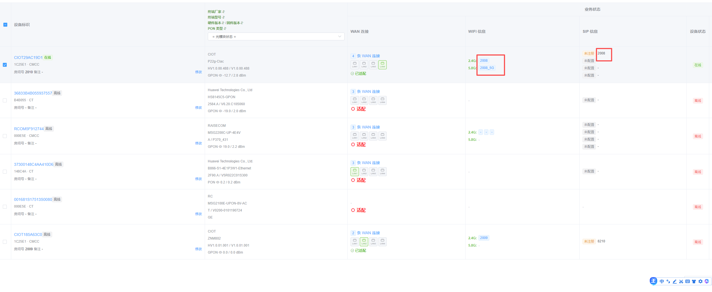
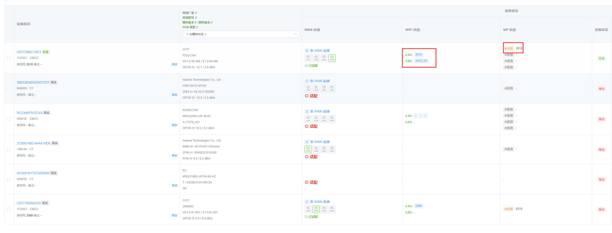
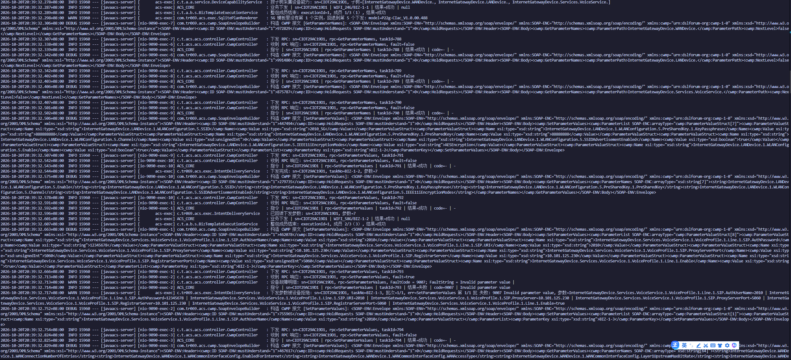

# 设备能力采集 · 调试记录

记录 TR-069 设备能力采集（GPN / GPV 拉参数树）在现场联调中踩过的坑：症状、根因、修法。
截图原件在 [`Display/Debug/`](./Display/Debug)，设备列表见
[`Display/025159_916.png`](./Display/025159_916.png)。

---

## 一、现场设备

| SN | 型号 | 运营商 | 采集结果 |
| --- | --- | --- | --- |
| `36833B4B055937557` | HS8145C5-GPON | CT 电信 | 能力树完整（360 对象 / 1947 参数） |
| `37300148C4AA410D6` | B866-S1-4E1P3W1-Ethernet | CT 电信 | 已适配成功（565 对象 / 3018 参数） |
| `001681S17513S0080` | MSG2100E-UPON-8V-AC | CT 电信（待台账确认） | 只有 5 对象 / 3 参数，卡在参数树扫不动 |
| `9C5C8E7F9101` | MSG2100E-UPON-8V-AC | CMCC 移动 | 待采 |
| `CIOT29AC19D1` | CIOT P22g-CIac | CMCC 移动 | 已适配 |
| `CXOT165B6SCQ` | CIOT ZNM802 | CMCC 移动 | 已适配 |

同样的硬件卖给不同运营商时固件差别很大：华为那两台能吃下 `NextLevel=false` 的递归 GPN，
`MSG2100E` 就不行。采集标准因此按运营商分档，电信档用**自适应**（先试参数树，连续两次
扫不动才降级为只读关键字段）。

---

## 二、踩过的坑

### 1. `cwmp:ID` 没原样回显 → 设备反复 BOOTSTRAP
**症状**：设备每 20 秒重发一次 `0 BOOTSTRAP`，`RetryCount` 一路上涨，从不发空 POST，
ACS 永远没有下发窗口。

**根因**：CWMP 规定响应头里的 `cwmp:ID` 必须与请求一致。华为电信固件（HS8145C5 / B866）
对不上就认为这次会话没被接受，整轮重来。

**修法**：`CwmpController.handleInform` 拿到报文头里的 ID 后原样回显。修完立刻变成
`1 BOOT` + `RetryCount=0` + 正常空 POST。

### 2. 一次会话只下发一条指令
**症状**：第一条 GPN 成功，然后采集卡住；设备回完响应后 2 分 18 秒没有任何动静，直到判离线。

**根因**：处理设备响应时无条件回 `204`。华为这类固件收到 204 就认为会话结束，不再发空 POST，
下一条指令只能等下一个上报周期（这台十几分钟才来一次）。

**修法**：把取指令的逻辑抽成 `deliverNextRpc`，在同一个 HTTP 响应里捎带下一条
（TR-069 §3.4 允许）。队列空了才回 204。

### 3. 队列空 = 会话该结束？不是
**症状**：捎带生效后，指令密集下发几条，又断在半路。

**根因**：采集是一问一答编排的，上一条响应处理完、下一条要拿返回值拼出来，几十毫秒后才入队。
HTTP 线程此刻去队列取不到货就回 204，会话当场结束。

**修法**：回 204 前先等一小会儿（`acs.session.piggyback-wait-ms`，默认 1500ms，每 20ms 查一次队列）。
等到就继续捎带，等不到才收尾。同时把子树采集从串行改成并行提交，让队列里始终压着几条。

### 4. 采集永久挂起 → 这台设备再也采不了
**症状**：手动点采集，日志只有"开始采集"和"下发窗口结束"，既没成功也没失败，界面一直转圈。

**根因**：指令投进队列后等响应，future **没有任何超时**。设备不在下发窗口（下一次上报可能
十几分钟后），future 永远不完成，`inFlight` 也跟着不释放 —— 之后所有采集都被挡住。

**修法**：
- `acs.capability.collect-timeout-ms`（默认 600000）给一轮采集设总时长上限，到点不再等待；
- `start()` 里对"超过时限还在 running"的上一轮强制判失败并清 `inFlight`，下一次点采集能自愈，
  不用重启 ACS。

### 5. 上一轮的残留指令被重复消费
**症状**：同一路径的 GPN 连着发好几遍（`taskId` 还是上一轮的号）。

**根因**：Redis 队列里压着上一轮没发完的任务，新一轮直接接着消费。

**修法**：每轮采集带上批次号，开始时按批次清掉旧指令（`dropStaleRpc`）。

### 6. 首次上报按通用档采
**症状**：`采集启动: isp=null` → 120ms 后 `按 Inform 私有前缀登记: isp=CT`。

**根因**：采集必须抢在回复 InformResponse 之前跑完（要抢空 POST 窗口），而台账入库走队列消费者，
晚 100ms 以上，采集开跑时库里还没有运营商。

**修法**：`rememberInformIsp` 先用 Inform 自带的私有前缀预判运营商，只给这次采集用，不写库
（人工申报过的仍以申报为准）。

### 7. 9002 一次就把设备判死
**症状**：设备偶发 `9002 Internal error`（重启中、CWMP 模块忙），之后永久降级成只读关键字段。

**修法**：改成**连续两次**扫不动才降级，采到树就清零。一次失败只记警告，下一轮继续试。

### 8. 唤醒设备被 401 挡下
**症状**：手动采集前发连接请求，设备回 401；日志 `已认证=false`。

**根因**：Java 自带的 `HttpClient` 只支持 Basic，而连接请求认证普遍是 Digest。

**修法**：自己算 Digest（HA1 / HA2 / response / cnonce），401 后带凭据重发；凭据按
**台账设备级 → 全局配置 → 已采集的参数值** 依次取。同时把
`ManagementServer.ConnectionRequestUsername/Password` 加进关键字段清单，采集时读回来写进
`cpe_device.acs_to_cpe_name/password`，下次唤醒就能认证通过。

### 9. 唤醒误伤不需要唤醒的设备
**症状**：移动的猫本来靠周期上报采得好好的，也被发了连接请求，回 401 刷一屏 WARN。

**修法**：三道闸 ——
- 总开关 `acs.capability.wakeup-enabled`（默认 `true`，不需要就关掉）；
- 设备 60 秒内有通信（还在下发窗口）就不叫它，直接下发；
- 没有凭据又撞 401 的设备，1 小时内不再重试，日志降为 INFO。

---

## 三、关键配置

| 配置项 | 默认 | 作用 |
| --- | --- | --- |
| `acs.session.piggyback-wait-ms` | `1500` | 队列空时再等多久才回 204（毫秒） |
| `acs.session.wait-rpc-response-timeout` | `60` | 单条指令等响应（秒） |
| `acs.session.wait-post-null-timeout` | `60` | 等空 POST 的窗口（秒） |
| `acs.capability.collect-timeout-ms` | `600000` | 一轮采集总时长上限（毫秒） |
| `acs.capability.wakeup-enabled` | `true` | 手动采集前是否发连接请求唤醒设备 |
| `acs.auth.acs-to-cpe-username` / `-password` | `auto` | 连接请求认证凭据（`auto` = 不带凭据） |
| `acs.auth.cpe-to-acs-username` / `-password` | `auto` | 设备上报时的认证（`auto` = 免认证放行） |

---

## 四、正常采集的日志基线

```
新设备注册: sn=..., oui=...
按 Inform 私有前缀预判采集标准: sn=..., isp=CT
开始采集设备能力: sn=..., root=InternetGatewayDevice., trigger=inform, batch=..., 时限=600000ms
本次采集采用的采集标准: sn=..., isp=CT, 标准=中国电信, 策略=自适应（先试参数树，扫不动则只读关键字段）
按子树采集设备能力: sn=..., 子树=[WANDevice., LANDevice., Services.VoiceService., X_CT-COM_UserInfo.]
下发 RPC: sn=..., rpc=GetParameterNames, taskId=...
收到 RPC 响应: sn=..., rpc=GetParameterNames, fault=false
      ...（上面两行应连续出现几十次，间隔几百毫秒）
设备能力采集结束: sn=..., status=success, 路径=565, 读值=3018, 耗时=...ms
```

判读要点：

- `下发 RPC` 与 `收到 RPC 响应` 之后**紧跟着下一条** `下发 RPC` → 捎带生效；
- 两条之间若隔了几分钟 → 会话被掐断，查 `piggyback-wait-ms`；
- `status=partial` + `参数树扫不动` → 设备扫不动树，只读到了关键字段；
- `status=fail` + `采集总时长已到` → 设备一直没进下发窗口，确认在线状态与唤醒是否成功。

---

## 五、调试截图

设备列表（红框为业务数据核对点：WiFi 2.4G 的 SSID / 密码、SIP 号码）：



同一页稍后一次采集（对照业务状态是否刷新）：



采集 VoiceService 子树时的报文流水，可见逐条 GPN 与 `9005 Invalid parameter name`：



逐参数读取 WANPPPConnection 的报文流水：


---

## 六、遗留问题

1. `MSG2100E-UPON-8V-AC` 只归档到 5 对象 / 3 参数，参数树没采下来（判断为降级成只读关键字段）。
   需要它在一次会话里完整采一轮，`status=success` 后再去适配页申报。
2. `MSG2100E` 的运营商待确认：台账标的是电信，但它上报了 `X_CT-COM_UserInfo` 私有节点，
   和移动固件的行为不一致，以现场申报为准。
3. 型号适配进度见 [`ADAPTED_MODELS.md`](./ADAPTED_MODELS.md)。
